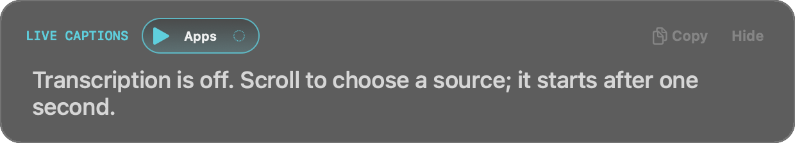
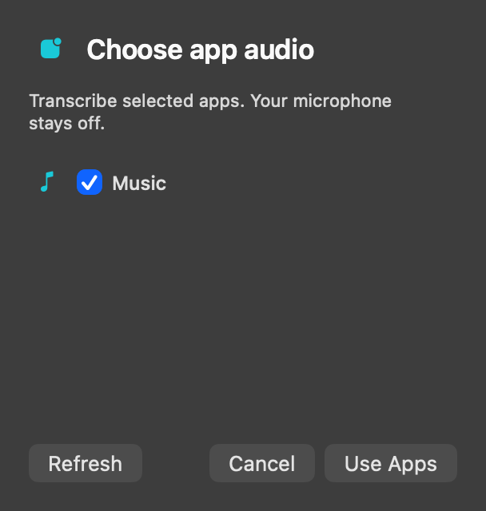

# Floating Speech Controls

Status: implemented and locally verified, 2026-10-13, including the settings
source-selector simplification. Installed in the canonical `.build/Astation Local.app`.

## User Requirements

The floating captions window needs a compact, attractive transcription source
button operated by scrolling and clicking, with no dropdown menu. The latest
interaction applies a scroll selection automatically after a one-second delay.

| Transcription mode | Sources |
| --- | --- |
| Off | No transcription |
| Mic | Microphone |
| System | All system audio, without microphone |
| All | Microphone and all system audio |
| Apps | Selected application audio, without microphone |

System and Apps must not acquire a microphone capture or request microphone
permission for transcription. This needs to apply to capture setup, not only
to the samples delivered to the transcription engine.

Push-to-Talk and Hands-Free are both dictation modes. Dictation has higher
priority than every transcription mode. Starting either dictation mode pauses
the other transcription sources while the microphone is used for dictation.

Dictation supports independently selected outputs:

- Send to the active Atem.
- Insert into the active input text field.
- Save to files.

Any combination is supported, including file-only operation. Transcription also
supports saving to files. These settings are independent between the two modes.

## Interaction

Use a fixed-width rounded pill in the existing floating header, with a source
icon and a short mode label. Preserve its dark translucent appearance and teal
accent; Off is muted. The hit area is 92 points wide and 28 points high.
The idle hint reads "Pick a source; it starts after one second".

The floating button is the transcription source selector. Live Transcription
settings keep engine/model, language, Start/Stop, captions and transcript-saving
options without a duplicate "Listen to" checkbox section. The single
"Floating captions - multiline, last 20 seconds" checkbox sits below the
introduction, before Engine, replacing the settings Show Floating Captions button.
Enabling it reopens the controls, including when transcription is Off, without
starting capture or changing the saved source selection. The Astation menu retains
Show Floating Captions.
Recording sources and microphone-device settings stay in Audio & Recording;
Live Transcription has no Configure Audio Sources shortcut to that page.
App selection uses the floating Apps picker. Recording microphone-only audio
while transcribing microphone and system audio together is supported.
Previously saved source combinations remain intact.

Scrolling the caption text away from the bottom keeps its displayed snapshot and
viewport stable for 15 seconds after the last scroll. Incoming speech, processing
and saved files continue independently. New scrolling restarts the delay; manually
returning to the bottom resumes live following immediately. This includes trackpad,
wheel, scrollbar dragging and keyboard navigation. A common-mode timer returns
active transcription/dictation to the latest text at timeout, even without a new
caption. Preserve text selections for copying. A stopped capture does not cause a
timeout jump; Hide clears the pause. Keep a scrollbar drag paused until release,
then start the full 15-second interval.

Scrolling over the button highlights modes in either direction and applies the
last choice one second after scrolling stops. Clicking can apply immediately or
advance to the next mode. The order is Off, Mic, System, All, Apps, then Off.
A step requires 60 points of trackpad travel or three wheel notches. Direction
changes, new trackpad gestures and input-device changes discard partial travel.
Momentum changes neither the highlight nor the delay. Escape and external mode
changes cancel pending application. A generation guard prevents an older delayed
callback from applying a superseded choice. Highlighting never opens capture or
starts an upload before the delay and any required consent finish.

Apps initially uses the saved application selection from audio settings. Scrolling
to Apps with an empty selection opens an anchored app picker with native app icons,
checkboxes, Refresh, Cancel and Use Apps. Checkbox edits are drafts; Use Apps saves
a separate transcription selection and applies Apps after any required upload
consent. Empty Apps waits for selection instead of applying an empty source or
falling back to system audio. The picker never changes a running recording's
settings or tracks. Existing selections skip the picker; the control displays up
to two selected app icons and lists all names in its tooltip and accessibility
value. Controls remain available until Hide; caption text expires after 20 seconds.
Right-click or Control-click the Apps control reopens the same picker with current
apps checked. Opening or editing the picker cancels pending automatic application
without changing capture. Use Apps commits the replacement; Cancel keeps the
previous selection. Existing recording tracks and settings stay independent.
Microphone captions omit their source prefix in every mode, including retained
captions visible in System, All or Apps. System and app captions retain source
labels when multiple sources are present. Source-title changes reformat visible
captions immediately, even before another segment arrives.
Keyboard arrows highlight one step without the scroll threshold and apply with the
same one-second delay.

Keep dictation activation separate from the transcription source selector. During
Push-to-Talk or Hands-Free dictation, hide the selector and close its app picker.
Replace it with a matching compact microphone icon and "Dictation" status pill;
the indicator has no click or scroll actions.
Show the selector again with its remembered source when dictation releases audio.
The floating Polish switch is visible and enabled only while dictation owns audio
priority, including Push-to-Talk recognition after release. It hides as soon as
transcription resumes, even if dictation output polishing is still finishing.
With no output destination enabled, completion says "Dictation ready." without
assuming that the floating captions window is visible.

## Priority Lifecycle

1. On dictation activation, remember the desired transcription mode and suspend
   its processing and uploads before starting microphone dictation.
2. Keep transcription suspended throughout Hands-Free, including quiet periods.
   Push-to-Talk remains suspended until its recognition work finishes after
   release; output delivery should not needlessly retain audio capture.
3. Resume the desired transcription mode after dictation releases its resources.
   Changing the desired mode while dictating changes the pending selection only.
   Choosing Off prevents resumption.
4. Cancellation and setup failures release the dictation microphone and settle
   the suspended transcription state. Late callbacks cannot reopen capture or
   deliver stale dictation text.

The wait for transcription shutdown captures and retains its task on the main
actor before awaiting completion, so clearing the task during shutdown cannot
race dictation startup.

The approved plan uses automatic resumption and continued independent audio
recording. Pausing transcription must not discard the existing
transcript or interrupt its saved history. Resume must not replay audio collected
during the pause. Cloud consent remains bound to the provider and selected sources;
changing that context requires consent before any newly selected audio is uploaded.

The original active input field and Atem target remain pinned to the dictation
session. Clicking the floating window must not redirect output into another
field or device. Each selected output is attempted independently, so a file
failure does not block another destination and vice versa.

## Implementation

Dictation supports independent Atem, active-field and file outputs. File saving
defaults off and uses private session folders under `~/Documents/Astation/Dictation`,
with TXT, JSONL and metadata marked as dictation. Polishing runs once before fan-out;
on polishing failure, raw text stays in captions and selected local files without
typing or sending. Transcription retains its own TXT/JSONL auto-save and manual export.

Both dictation modes suspend every transcription source. A synchronized per-run
gate rejects late segments before file saving and again before UI delivery. Resumed
ASR uses new utterance identities while retaining the transcript and saver. Capture
is shared when the recording/preview already supplies the requested sources;
otherwise transcription owns a separate capture configured only for its sources.
Recording settings are preserved, and System/Apps never acquire an unneeded mic.

## Validation Plan

- Verify source capture for all five modes, including no microphone request or
  capture for System and Apps, and no capture side effects from scroll previews.
- Verify Push-to-Talk and Hands-Free preempt Mic, System, All and Apps; pending
  mode changes and Off settle correctly when dictation ends.
- Exercise rapid input, delayed setup, release during permission requests,
  cancellation, setup failures, and late callbacks.
- Verify saved transcripts survive pause/resume and disabled outputs are never
  accessed; failures in one output do not prevent other selected outputs.
- Check the control's alignment, hit area, accessibility, selection/copy behavior,
  trackpad momentum, and placement across displays with the existing Local.app
  signing identity preserved.

## Verification Result

- Debug/test build and optimized release build pass.
- Debug bundled model manifest checks, local documentation links and whitespace
  checks pass.
- Full suite through the existing Personal Team signed XCTest host: 729 tests,
  six expected skips, zero failures, including protected Keychain/Secure Enclave
  tests. New tests cover all source/dictation combinations, exact capture sources,
  delayed preparation/release, cancellation, failure recovery, pending selection,
  late callbacks, no paused-audio replay, independent recordings, saved history,
  file-only output, output failure isolation and metadata privacy.
- Follow-up tests reproduce the former three-second Mic-to-All label reset and
  verify the higher scroll thresholds, one-second automatic application, last-input
  debounce, momentum rejection, Escape/external-change cancellation, empty Apps
  picker gating, saved app icons, persistent app selection, recording isolation and
  dictation-only Polish visibility. Cleanup of a stopped dictation manager no longer
  releases a newer session's audio priority.
- App-reselection tests cover right-click and Control-click, current checkmarks,
  draft edits and cancellation, replacement on Use Apps, and cancellation of a
  pending automatic source change. Mic-caption tests verify that existing text
  stays free of microphone prefixes across Off, Mic, System, All, Apps and
  dictation, without another segment; other source and translation labels remain.
- The generated floating/settings snapshots were visually reviewed; controls are
  aligned, the hit area is 28 points high, and the nonactivating panel is preserved.
- Dictation-header follow-up: 31 floating-controls tests and the settings/panel
  rendering test pass. The visible microphone/Dictation indicator aligns with the
  Polish dial, replaces the hidden source button, and restores the source control
  when dictation releases audio. The refreshed snapshot shows the implemented UI.
- All-mode caption follow-up: the full signed suite passes 729 tests, six expected
  skips and zero failures. It covers retained microphone captions across every
  source mode and dictation, system/app and translation labels, and saved source
  metadata. The dictation startup wait runs on the main actor and retains the
  shutdown task; completion text no longer assumes a visible floating window.
- Scroll-review tests exercise real native scrolling with a deterministic clock:
  the 15-second boundary, further-input reset, quiet timeout recovery, selection
  preservation, immediate following at the bottom, stopped capture and Hide.
- Settings source-selector simplification and caption-checkbox placement: 81
  focused transcription/settings/
  floating-controls tests pass. Saved source combinations survive other settings
  edits; enabling the checkbox while Off starts no capture. Hide updates the
  checkbox, and enabling it restores expired captions without interrupting recording.
  Missing and empty sources disable Start, and recording source configuration
  remains independent. Narrow-window snapshots for all three providers fit.
- Installed and restarted the new Debug build at the existing
  `.build/Astation Local.app` path. The signing identity,
  bundle identifier and Keychain entitlements are preserved; strict signature and
  bundled-resource checks pass. Only this Astation instance is running. Startup
  completes, the existing Secure Enclave identity authenticates to the relay, and
  the local WebSocket server starts successfully.
- Latest settings build restarted at 22:27 PDT on 2026-10-11, with the same signing
  and Keychain entitlements. The relay verifies the existing identity; account
  registration still reports missing Agora identity-verification configuration.
- Real trackpad feel, live system/selected-app permissions and audio, Accessibility
  insertion and remote Atem delivery still need manual checks in the installed build.
