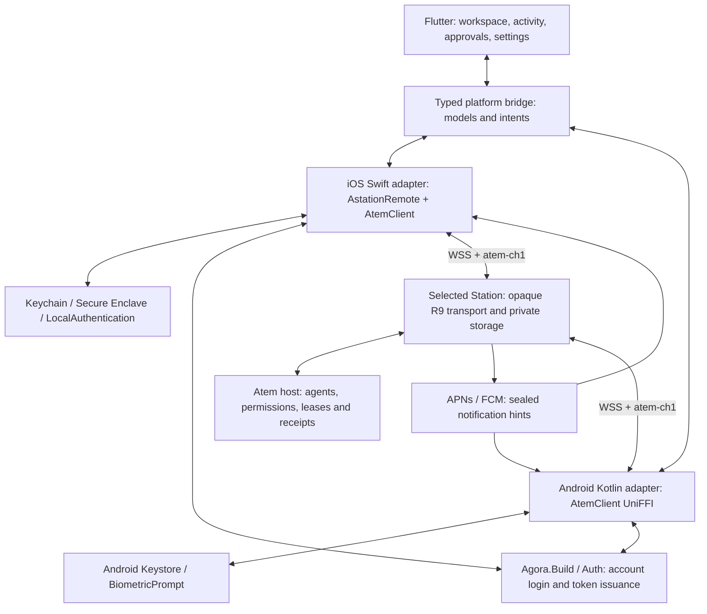

# Astation mobile

Status: the owner approved [the mobile UI](mobile-ui/mobile-ui.md) on 2026-11-03
and authorized implementation. The first Flutter foundation now builds for
Android and the iOS simulator. Native SDK loading, typed presentation models,
Chats / Agents / Account, rich replies, approval/rule UI, profile selection and
adaptive panes are implemented. Real dev account sign-in, rotated refresh and
authenticated Station HTTP admission passed on both platforms on 2026-11-08.
Protected membership enrollment, live host dispatch and offline push are not
complete. Protected Apple/Android identity and exact manager-review primitives
are being built on `feat/mobile-device-enrollment`; see
[the enrollment implementation](protocol/mobile-device-enrollment.md) for its
completed parts and remaining ceremony/channel work. The native entry point uses
the real saved account and displays no
sample connections. Until enrollment is implemented, it advertises no enrollment
capability and opens an explicit setup-status sheet instead of an unfinished
setup action. The separate
preview entry point exercises the interface with clearly labeled sample data.
This is the shared iOS/Android application;
the existing macOS app remains native Swift. Phones, tablets, resizable windows,
foldables and dual-screen devices are in scope on both operating systems.

## Technology decision

Use **Flutter** for the application, with **Swift and Kotlin platform adapters**
around Atem's existing Rust/UniFFI client. Pin the initial toolchain to Flutter
3.47.9, revision `c197ca5199e9ee5661e865596c9c07294dfab51c`. Commit the Dart
dependency lockfile. Consume immutable Atem packages with source and checksum
verification; do not build or modify Atem checkouts from this project.

| Option | Fit for Astation | Decision |
| --- | --- | --- |
| Flutter + native adapters | One adaptive interface, shared rich message rendering, strong layout testing; Swift/Kotlin can consume the existing SDK and native security APIs. | Chosen. |
| Separate SwiftUI and Jetpack Compose apps | Excellent platform integration and direct SDK consumption; duplicates the workspace, activity, approvals and layout implementation. | Good alternative, greater ongoing UI work. |
| Kotlin Multiplatform / Compose Multiplatform | Can share Kotlin logic and UI, but the existing cross-platform protocol core is already Rust; adds another shared runtime without removing native security adapters. | No clear benefit here. |
| React Native | Can share UI, but still needs the same native SDK adapters; no existing React Native client or TypeScript SDK integration to reuse. | No advantage over Flutter for this repository. |
| PWA / browser wrapper | Convenient companion, but does not replace the agreed native device trust and enrollment model. | Not the standalone mobile client. |

Flutter owns navigation, adaptive layout, presentation state and rendering. It
does not implement membership verification, cryptography, lease admission,
request digests or protocol version fallback. Native code owns authentication,
protected persistence, SDK objects and transport effects. Typed platform messages
carry presentation models and intents; private keys and bearer/refresh tokens
never cross into Dart. Agent content necessarily reaches the UI after authorized
decryption; it is not sent to an additional cloud service.

The Mac may be offline. Each enrolled phone/tablet has its own member identity,
device keys, independent Station connection and scoped R9 attachment. Account
login alone does not enroll a controller or authorize agent operations. Use the
existing membership/enrollment contract and authoritative catch-up after push.
The integration/service HTTP APIs are a separate path, not a mobile shortcut
around native membership or a reason to enable the gated host-work HTTP rollout.

## Devices and layout

- Compact windows: a single workspace with bottom navigation and a separate
  activity view after selecting an agent.
- Expanded windows: persistent host/agent list beside the selected agent's
  activity, with navigation that fits the current window.
- Separating vertical hinges: host list on one usable display and activity on
  the other. Controls and text do not cross the reported obstruction.
- Separating horizontal folds: place independent panes above/below the fold
  when both areas can be used. Otherwise keep the active pane in a usable area.
- Adapt to window metrics and OS-reported display features on either platform.
  Never infer a hinge from a device name, assume a future device's physical
  dimensions, or treat every Android device as a foldable. If an OS exposes
  only a resized window, use ordinary responsive layout.
- Preserve selection and draft state on rotation, resizing and fold changes.
  Safe areas, keyboard insets, accessibility text sizes and external input are
  part of layout validation, not separate phone/tablet applications.

No physical iPhone, iPad, Android or folding-hardware acceptance is implied by
synthetic viewport tests. Hinge information depends on what the device OS and
Flutter expose; add a native metrics adapter if hardware testing identifies a gap.

## First useful workflow

1. Sign in through Agora.Build using an external system browser and native PKCE.
   Auth must register the exact mobile client/redirect URIs; never embed an app
   secret or reuse a service integration's key. Native token storage and refresh
   follow the existing issuer/Station audience contract.
2. Enroll this device with a trusted manager, compare the code, and perform the
   required native owner confirmation. Verify and durably pin the membership
   log and account key before connecting to a host.
3. List authorized hosts and sessions directly through the selected Station.
   Open Chats by default, with pending approval cards above conversations ordered
   by latest activity. Agents provides host browsing and approved-profile launch.
   View formatted activity, session rules and request status in each conversation.
4. Send with the existing atomic acquire/takeover contract. Confirm the exact
   current holder before takeover. Approval answers and rule revoke remain
   lease-free. Retain request IDs before effects; uncertain results are queried,
   never silently replayed.
5. Register membership-bound push destinations. Push wakes the app; it does not
   create actionable approvals. Refresh authoritative state before offering
   Allow once / exact Always allow / Deny. On iOS, sealed preview decryption
   belongs in a native notification service extension with an appropriately
   limited shared Keychain group, separate from the Flutter runtime.

The foundation build is explicit about unavailable enrollment and live host
operations. It must not display sample agents as real
connections, claim verification from login or use fixtures as a production backend.

## Reuse existing services and modules

The owner's direction is to reuse Auth, Portal and Station APIs and the released
Atem modules. There is no new mobile backend or parallel permission system.
The Flutter method/event channels are local platform interfaces, not HTTP APIs.

| Responsibility | Existing implementation to consume |
| --- | --- |
| Account creation, GitHub/account sign-in, consent | Agora.Build / Auth in the system browser. Mobile does not reproduce those forms. |
| Native OAuth | Issuer discovery, its advertised authorization/token/JWKS endpoints, authorization code with PKCE S256, `openid profile offline_access astation.remote`, and the exact selected Station as `resource`. Refresh stays native. |
| Apple token validation and refresh | `AstationRemote/AccountOIDC.swift` and `AccountTokenProvider`; the existing desktop loopback rule must remain intact when exact mobile callbacks are added. |
| Account trust and cryptography | Published Atem Rust core through Apple SwiftPM or Android Kotlin/UniFFI. No R9, membership-chain, digest or crypto reimplementation in Dart. |
| Membership log and recovery storage | Station `/api/remote/v1/logs/{genesis}/entries`, `/backups/{version}` and `/probes/{host}` with the existing authorization/verification contract. Login alone supplies no trusted genesis or account key. |
| Independent connection | Station WSS `/api/remote/v1/channels?genesis=...&host=...`; iOS reuses `RemoteRelayClient` / `RemoteAgentChannel`. The Mac can be offline. |
| Agent registry, chat, approvals, profiles and durable receipts | Existing typed R9 SDK operations over the encrypted channel. Do not invent an unimplemented Station REST host-list endpoint or route native membership through integration service keys. |
| Portal integration APIs | Retain the existing third-party/service path. Native Astation uses its own enrolled member identity. |

Both native platforms consume SDK revision
`2b0c384e7213e5d4637cdba1f0a78ccbc53a2083`.
`Config/atem-client-apple.json` pins the iOS device/simulator/macOS XCFramework;
`Config/atem-client-android.json` pins the matching Kotlin source and ARM64,
ARMv7 and x86-64 native libraries. The Android installer verifies source, payload
hashes, architecture and 16 KiB load alignment before installing an immutable
cache. `mobile/ios` links the existing `AstationRemote` Swift package; it is not
a copy of the Mac's protocol implementation. Minimum targets are iOS 17 and
Android API 24. Flutter is the shared presentation layer.

Portal/Auth registration is tracked in
[Portal #30](https://github.com/Agora-Build/Portal/issues/30). The confirmed public
client IDs are `astation-ios` / `astation-android`, with exact redirects
`build.agora.astation.ios:/oauth/callback` /
`build.agora.astation.android:/oauth/callback`. Both are live and verified on
dev; production client registration has not been verified here. No app secret
is embedded.

## Presentation and lifecycle

Preserve Markdown paragraphs, headings, emphasis, lists, links, code and tables.
Do not render executable HTML or automatically fetch remote images. A link tap
shows its destination before explicit navigation; links never trigger agent
commands. Tool and approval parts are typed native-validated models, not markup
that can manufacture approval buttons. Reuse the bounded ordered stream and
history behavior in `designs/protocol/remote-agent-api.md`.

Foreground transport starts with WebSocket, using whole-message updates. A later
Agora Signaling adapter must preserve the same SDK and encrypted channel. Mobile
suspension closes/suspends the channel and releases control; APNs/FCM supplies
offline wake-up. Resume reauthenticates, catches up and queries receipts without
renewing an expired lease or replaying input. Push scheduling remains governed
by the signed shared contract; this app does not invent a new timer.

Production uses `https://agora.build` and built-in `https://station.agora.build`.
Development uses `https://dev.agora.build` and `https://station-dev.agora.build`,
with an explicit environment selector. Portal editing is development-only.
A custom Station remains separate and uses the existing enrollment path.
Endpoints are origins, validated as HTTPS without embedded credentials, query
strings or fragments; changing environment cannot carry an old token, member
attachment, grant or pending operation into a new security context.

## Delivery and remaining owners

| Step | Deliverable | Acceptance |
| --- | --- | --- |
| 1. Foundation | Flutter iOS/Android projects, native bridge, adaptive workspace, safe activity renderer, environment settings. | Static analysis, unit/widget layout tests, Android APK and iOS simulator build. |
| 2. Native identity | Mobile OAuth registration, token refresh, protected keys/checkpoints, manager enrollment and recovery. | Real device biometric/lock/removal tests; independent connection with Mac off. |
| 3. Agent workflow | Registry/activity, send/takeover, approval/rules, receipt recovery and launch profiles. | Actual Atem 0.8.2+ session tests and revocation/reconnect cases. |
| 4. Offline | APNs/FCM registration, sealed previews, tap/catch-up and seen detection. | Actual provider delivery, resolution, expiry, late tap and revoked-device tests. |
| 5. Device polish | Hardware fold transitions, iPad multitasking, keyboard, accessibility and distribution. | Physical platform/device matrix, including foldables on either OS where available. |

Astation owns the mobile apps and platform adapters. Atem owns the host and SDK
and must publish any needed immutable package update rather than asking Astation
to rebuild its checkout. Portal/Auth owns mobile OAuth client registration and
issuer contracts. APNs/FCM provisioning is required for real push, not for the
adaptive UI foundation. No change to the Mac's device identity or running agents
is part of this work.

References inspected for the decision:

- https://docs.flutter.dev/ui/adaptive-responsive
- https://docs.flutter.dev/platform-integration/platform-channels
- https://docs.flutter.dev/release/archive
- Atem `crates/atem-client-ffi/README.md` at the pinned source revision.
- `native-remote/Package.swift` and `designs/protocol/remote-agent-api.md`.
