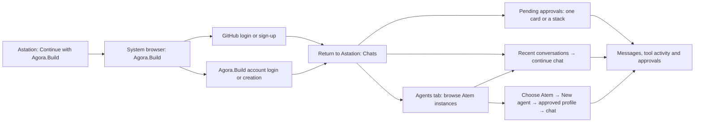

# Astation mobile: UI review 01

Open [the clickable prototype](index.html). It uses local sample data. The
authentication screens are browser-flow illustrations; no credentials are
collected, and no account, enrollment, launch, prompt or approval request is sent.
The default sign-in preview represents a returning, already enrolled device.
Use **New device** to review first-device access confirmation separately.

The owner requested UI review before feature implementation. Flutter project
scaffolding is prepared; live mobile authentication and agent features have not
been implemented or enabled by this design.

## Main flow

### 1. Sign in

- A single native **Continue with Agora.Build** action opens the system browser.
- GitHub and Agora.Build account sign-in/sign-up belong to Agora.Build, using
  the same account creation experience as the Portal. The mobile app does not
  collect a GitHub password or implement a second account database.
- Native PKCE, token storage and refresh are implementation requirements. A
  successful account login identifies the account; it is not device verification.
- After login, open **Chats**, with the account's recent conversations and
  pending requests. **Agents** provides the discoverable Atem instances. For a new native
  device, the first protected operation completes trusted-manager enrollment,
  code comparison and native confirmation. Existing verified devices resume
  without pairing again. Merely listing a host does not grant access to it.
- Empty-account state will offer **Add an Atem** with host setup instructions;
  no automatically fabricated host or agent appears.

#### Welcome feature cards

- The welcome screen offers five cards: **Agent chat**, **Atem**, **Vox Realtime**,
  **Astation Dictation** and **Approvals anywhere**. Swipe, previous/next arrows
  and dots switch cards; keyboard users can use arrows, Home and End.
- Cards change only when the user chooses. They do not rotate automatically,
  move the sign-in action or reset the page's scroll position.
- **Atem** uses the description "A terminal that connects builders, AI agents
  and more." Its terminal example is illustrative; the card opens
  [the Atem repository](https://github.com/Agora-Build/Atem) in the browser.
- **Vox Realtime** opens [vox.agora.build](https://vox.agora.build) in the
  browser, with an explicit external-link action. It highlights voice-agent
  benchmarks: response speed, interruptions and conversation success. The card
  uses Vox's official waveform mark, bundled locally as `assets/vox-mark.png`
  from the Vox repository's `client/public/favicon.png`.
- Other cards are informational feature spotlights. The dictation card describes
  the existing Mac feature; its appearance does not imply mobile dictation is
  implemented. The approval example is illustrative and cannot grant permission.
- On tablets, the headline uses the available text column so **Within reach.**
  stays together. Cards sit beside the sign-in content; on two displays they
  remain on the second pane, clear of the hinge. The Duo welcome logo, headline,
  slogan, sign-in action and footer are centered within the first pane.

### 2. Chats: the default home

- Bottom navigation is **Chats / Agents / Account**, with **Chats** selected
  after sign-in. It replaces the separate Approvals tab.
- If an approval is pending, show its card above the conversation list. Multiple
  requests use a compact stack, with a count, horizontal swipe, previous/next
  controls and **Show all**. The complete pending list opens in a sheet.
- Show the conversation, provider, host name/short ID, summary and exact command.
  **Review request** opens that specific agent's conversation and approval card.
  Each answer applies only to its original request, even across different hosts.
- Resolved, expired or answered-elsewhere requests leave the home stack while
  retaining their closed state in conversation history. With none pending, use
  a compact **No approvals waiting** line so the chat list stays close to the top.
- **Latest chats** lists conversations across agents and hosts, newest first.
  Each row shows title, message preview, provider, host and short ID, activity
  and last-activity time. Use authoritative conversation activity for ordering:
  messages, results and approval events count; opening a chat or receiving a
  connection heartbeat does not. Use a stable identifier to break equal times.
- The prototype uses local timestamps and sample replies only. Sending a preview
  message or answering a sample request updates just that conversation's date.
- Tap a recent conversation to continue it; Back returns to Chats. Preserve each
  draft when opening a different conversation. Creating a new agent also adds it
  to recent chats. An empty account offers **Find an agent** rather than sample
  conversations or fabricated history.
- On tablets and two displays, keep Chats and its approval stack on the first
  pane while the selected conversation opens on the second.

### 3. Agents

- **Agents** groups agents by their Atem instance;
  choose a machine to browse its agents or create one there.
- Each row shows machine name, a distinguishing short Atem ID, online state,
  platform and agent count. The full ID is available in details. Avoid repeating
  a machine name already embedded in the displayed identifier.
- **View agents** shows that instance's agents. **New agent** starts a launch on
  that exact instance. Searching accepts the machine name or its ID.
- Offline hosts stay recognizable with a last-seen label; they cannot accept
  new operations. The real read model must distinguish unreachable, revoked,
  unsupported and genuinely empty states.
- Account and relay configuration do not clutter the primary agent workspace.

### 4. Agent conversation

- Mobile is chat-first. There is no terminal, raw shell command input, terminal
  Take Control toolbar or ANSI screen as the primary interaction.
- The header keeps the agent/provider, Atem name/short ID and agent activity
  visible. Ready is green. Process state, activity and connection freshness
  remain separate values in the real implementation.
- Preserve paragraphs, headings, emphasis, lists, code, copy actions, tables
  and links. Links show their destination before leaving the app. Do not load
  remote images or execute embedded markup automatically.
- Tool activity collapses to a short row and expands to its captured details.
- **Send** uses the agreed atomic acquire-and-submit path when free. If another
  device holds control, show **Take over and send?**, naming the observed holder.
  A stale confirmation must be rejected against the original controller/epoch.
  The user does not manually take control before ordinary chat sends.
- Drafts remain per agent and survive navigation/resizing in the real app.
  Disconnection disables submission; recovery queries the original request ID.
- Touch and hold the conversation card in **Conversation** to open a compact
  conversation switcher. The chat title provides the same shortcut. Tap or
  keyboard activation also opens it for accessibility; right-click works in
  the browser preview.
- The pop-up lists conversations across Atem instances, showing the agent name,
  provider, host name/short ID and activity. Mark the current conversation.
  Select a row to switch directly into that chat while keeping each draft.
  Viewing another chat does not acquire control or submit a message.
- Keep **Show all agents** pinned at the bottom of the pop-up. It closes the
  conversation and opens the **Agents** tab. Dismiss outside or with Escape to
  return to the original view; on two displays, keep the pop-up off the hinge.
- **Conversation → Activity & request status** contains receipt details, with
  meaningful outcomes first. Raw IDs do not occupy the conversation composer.
- Image/audio/PDF attachment actions will appear only after the typed transport,
  host/provider capability and upload flow are ready; this design does not
  promise attachments from text-only APIs.

### 5. Create an agent

- Open a sheet scoped to the selected Atem; keep its name visible.
- Choose a profile already approved on that host. Show the provider and project
  before creating the agent. Do not accept arbitrary shell commands, paths,
  environments or profile definitions from the mobile UI.
- **Create agent** saves one request identity, displays starting/confirmation
  status and opens the matching agent conversation when ready.
- Lost replies show **Checking original launch**. They do not create another
  agent or offer a blind launch retry. Capability/configuration errors need a
  helpful host setup explanation rather than an unexplained disabled control.
- **No profiles** offers host setup guidance. It is distinct from loading,
  disconnected, unsupported-version and permission-refused states.

### 6. Approvals

- Show a typed approval card inside the conversation, and link the approval
  stack in **Chats** to that exact card and agent. There is no separate
  Approvals tab.
- Offer **Allow once / Always allow / Deny** only when authorized and offered
  by the host. Always allow shows the exact rule and its scope before answering;
  the prototype example is Codex's exact command, current session only.
- Deny can include a message. An answer or rule revoke never takes the lease
  away from another controller. Closed/expired/answered cards disable actions.
- Push taps enter this same flow, reconnect and obtain authoritative state.
  A notification is not evidence that an approval is still open.

### 7. Account and device security

- Keep the circular profile avatar in the top-right corner. The account summary
  shows the name and sign-in status without a duplicate avatar.
- **Devices & security** shows the account's trusted Astation devices, their
  permissions and verification state, plus guidance for adding another device.
  Adding or removing members requires native confirmation on a trusted manager.
- **This device** shows only this phone's verification, permissions and local
  device identity. A verified device does not restart enrollment from this row.
  Offer **Set up access** only when the phone still needs approval.
- The prototype's device list and identity are sample data. These review screens
  do not enroll or remove devices, change permissions, or verify real keys.

## Phones, tablets and Duo / folding displays

| Window | Layout |
| --- | --- |
| Phone / narrow split window | Chats home → conversation, or Agents → Atem → agent → conversation, with normal Back navigation. |
| Tablet / expanded window | Persistent Chats or Agents pane plus conversation. New-agent and approval details use a contained sheet. |
| Two usable displays / vertical hinge | Chats or instance/agent list on the first display; conversation on the second. Text, composer and sheets stay clear of the hinge. |
| Horizontal fold / changing posture | Use the currently usable areas, preserving the selected agent and draft; physical metrics must come from the OS. |

These rules apply on both iOS and Android. The Duo preview illustrates a vertical
hinge, not any particular product's dimensions or claimed hardware support.
Actual window and display-feature handling, horizontal folds, rotation,
keyboard, font scaling and accessibility require Flutter and physical-device
validation after UI review.

## Visual direction

Use Astation's existing warm paper, sage/olive accents and quiet tool cards,
with Agora.Build's IBM Plex typography for continuity with account screens.
Expressive serif headings are limited to the welcome and workspace entry
points; chat stays compact and readable. Color communicates activity and
approval state, with accompanying labels. Platform-native browser, biometric,
permission and share surfaces retain their normal OS appearance.

The owner approved this prototype on 2026-11-03. It remains a UI review artifact;
the Flutter foundation with Swift/Kotlin adapters is now implemented in `mobile/`, described in
`designs/mobile-app.md`. The existing macOS app and live agents are unaffected.
