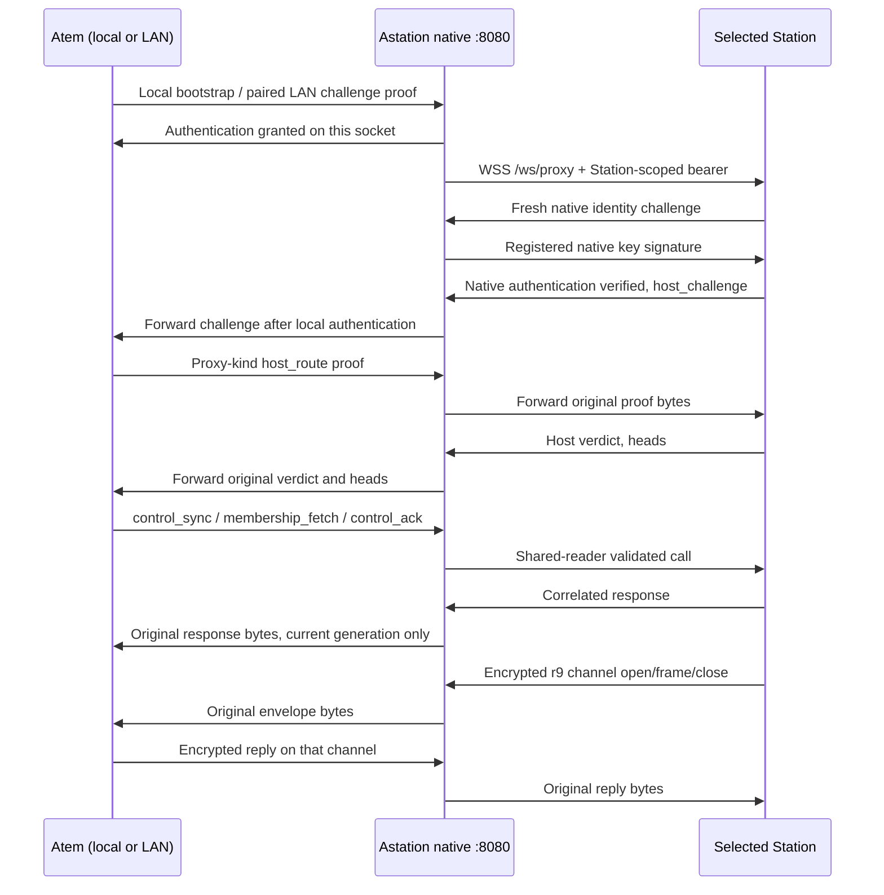

# Delegated Station implementation (#79)

This is implementation status against the agreed Atem Step 4 contract, pinned
to `de7ec29882f23508a430436cba34f73f88c15ed1` (published SDK
`atem-client-sdk-de7ec29882f2`, including #190-#199).
The feature is **not ready for activation**. This change does not enable
delegated execution or new native membership/control signing.

## Implemented

- Apple, Android and relay shared-core pins; published artifact hashes checked.
- One durable own feed per Station/account/genesis, including an empty feed.
  Membership, record append, signing high-water and shared ACK ledger use the
  same recovery-root transaction and lock. Failed commits expose no record or
  ACK evidence; a reused record ID with a different body is refused.
- Strict `heads`, correlated `control_sync`, `membership_fetch`, and whole-ACK
  validation on current proved host associations. Periodic heads every 30 s,
  durable-change wakeups and replica nudges re-read authority from storage.
  Bounded responses use the shared builders, 64-item/262144-byte limits and
  30-second handler deadlines.
- Queued control responses carry their original host association, checked
  again under the membership lock at the socket write. Trust generation is
  captured at admission, including when a generation changes without a key
  change. Old stored routes without a generation require a fresh proof.
  Obsolete control frames are discarded during close flushing too; they cannot
  prevent an independently authorized #80 verification completion from flushing.
- Durable shared-ledger report outbox with stable IDs/bodies, per-host effect
  evidence, retry pacing, explicit refusal and report-client stop/resume.
  Committed reporting may settle during a membership freeze; new authority and
  host ACKs stay blocked.
- Protected service-key reconciliation from authenticated Portal state:
  cover, hold, release, revoke and a later explicit interrupt. Expiry emits
  nothing. Covered hosts come from verified grant history, so narrowing a scope
  cannot remove a previously covered host from revocation accounting. A native
  revoke cannot be undone by a later active Portal snapshot. A separate own-key
  revoke is still issued for Portal reporting. Keys remain until signed R9
  membership removal, rather than being deleted on Portal revocation alone.
- Durable deployment-generation recovery fence, initial-history check and
  operator status/fence commands. A restore's externally increased generation
  blocks stale replicas, feed/ACK operations, signing and queued socket frames.
  Reporting holds the fence through actual HTTP delivery and commits ledger
  settlement together with its global delivery marker. This implements fencing,
  not complete snapshot reconstruction or reopening after a restore.

## Native Portal Station discovery

The shared native transport implements the directory agreed in
[Portal #40](https://github.com/Agora-Build/Portal/issues/40#issuecomment-7082465418),
against merged Portal #42 (`d81bda5`). It uses a Portal-audience native bearer
with `integrations:read` at `GET /api/v1/stations`, without a browser cookie or
an unversioned fallback. Read-only credentials can list Stations; consent and
revoke writes still require `integrations:approve` before token acquisition.

The strict page reader retains built-in, owned, shared, removed and ended
entries. It rejects ambiguous JSON, unknown fields, inconsistent access/state
fields, invalid origins and oversized pages. Traversal follows opaque cursors,
up to 100 rows per page, 41 pages and 4,096 rows locally. A failed page, repeated
identity, cursor cycle or exceeded bound yields no successful prefix. A stale
or explicitly incomplete response remains incomplete. Cancellation retires a
pending traversal rather than publishing its partial result.

This directory is discovery metadata. Its mutable keyset traversal is not an
atomic security inventory, an R9 grant or proof that every verifier is present.
Neither a lost-access row nor an omission removes a previously reviewed route
or verifier obligation. It does not authorize a new control destination.
Production directory retention, explicit route review and participant lifecycle
wiring remain required; the additional-route provider remains unset.

## November 22 shared-contract responses

- [Astation #101](https://github.com/Agora-Build/Astation/issues/101#issuecomment-7082464613):
  typed loaded-core verifier reports agreed for implementation. The consuming
  signing gate requires the exact current head, expected signer/slot and a
  continuously measured lease that includes token/challenge delays and sleep.
  Report carriage and production adoption are not implemented by discovery.
- [Astation #114](https://github.com/Agora-Build/Astation/issues/114#issuecomment-7082464868):
  service signing ceilings and native-stop retention readings agreed; complete
  author-journal collection through publication still needs a durable exact-plan
  barrier or reconciled continuation. Hashing the received imports alone cannot
  prove that a later signed stop has arrived. Recovery remains fenced.
- [Atem #120](https://github.com/Agora-Build/Atem/issues/120#issuecomment-7082465179):
  result/status signing while sender-revoked, immutable first-resolved task IDs
  and typed `required_version` shape confirmed. Requested a new immutable SDK
  covering #190 and #191-#195, plus owner `reply_query` for selector tasks as a
  separate follow-up. No SDK pin is changed by this increment.
- [Portal #41](https://github.com/Agora-Build/Portal/issues/41#issuecomment-7082465658):
  binding grammar confirmed. A changes cursor alone does not version binding
  rows, which can change without a feed event. Exact binding content/versions
  must join locked recovery evidence; D27 release/invalidation is still pending.

## November 23 SDK adoption and review resolutions

Atem's responses crossed the November 22 status update. Its immutable
`de7ec29882f2` SDK is now the Apple, Android and Station source pin. The release's
combined manifest was verified before selecting the individual asset hashes;
the consumers download published release assets, validate every consumed hash
and source record, and retain an offline bundle option with the same checks.
They no longer depend on expiring Actions artifacts. Native/Android test
fixtures remain byte-bound to the published vectors; the supplemental signed
membership fixture is pinned to the same source commit.

The native gate now invokes the shared `membershipRequiredVersion`, removing
the provisional local action/scope classifier. Its `nil` result waives only
this upgrade check, never another authorization or signing boundary. The
production participant provider remains absent and new signing remains off.

The review answers are posted on
[#101](https://github.com/Agora-Build/Astation/issues/101#issuecomment-7089434853),
[#114](https://github.com/Agora-Build/Astation/issues/114#issuecomment-7089435073)
and [Atem #120](https://github.com/Agora-Build/Atem/issues/120#issuecomment-7089435308):

- The verifier challenge has a 4,096-byte bound; a mismatched configured origin
  is `origin_mismatch`; the client's log has frozen, not host-held, state.
  No extra reporter-wall-clock future-`issued_at` bound is requested. Native
  authorization requires its own exact single-use challenge and ContinuousClock
  deadline, captured before token work, with sleep/delay consuming at most 30 s.
- The exact-plan durable author barrier and typed signer report are agreed
  for implementation. The journal/locking/publication adapter remains
  Astation-owned and unimplemented; the signer-report helper is a newly
  approved Atem build, not part of this SDK.
- Valid retained Station-own stops may be carried unchanged, as may a current
  manager's. Covers/holds/releases are new signatures. The shared snapshot
  checker reports consistency only, never complete history or clocks.
- Routine key rotation uses the separate `host_enc_key_new` op, one persistent
  pending key, refusal rather than re-sealing on immediate retirement, and an
  advisory with explicit confirmation before shortening a previous window.
  Crash replay cannot extend the previous key's 24-hour lifetime. Rotation's
  host/shared implementation and native UI remain separate work.

All previously requested Atem inputs are supplied and these review questions
are answered. They must not be reported as unanswered external blockers.
Package adoption does not implement Station report carriage, complete process
enumeration, author barriers, production recovery publication or VII.A.
Shared-host WAIT, #176 hold and disabled delegated activation remain.

## Exact Portal recovery source

The Station has an explicit report-credential consumer for
`GET /api/v1/stations/changes?checkpoint=1`. It requires the checkpoint key,
an empty changes list and one bounded, duplicate-free response. A legacy
cursor-zero reply, partial/page-shaped snapshot or invalid response is refused.
The configured report binding travels with the stored source. Built-in
`station.agora.build` and `station-dev.agora.build` snapshots require account
completeness and bindings; custom snapshots must contain neither, even as null.
An incomplete account view never means an absent account is enabled. A legacy
null revocation time stays unknown.

The collector retains this exact source with the policy's existing durable
compare-and-swap revision. Equal feed cursors do not suppress binding changes:
the binding content/version and a fresh local revision are retained together.
Lower/conflicting binding versions and disappearing known bindings/integrations
are refused, retaining the prior source for recovery. A later ordinary feed
response or denial invalidates the source's current-revision marker without
erasing its retained evidence. Delayed replica writes cannot overwrite either.

This read-only collection entry point is not wired into the background worker
or production recovery provider yet. Binding-to-room ownership enforcement,
account lifecycle closures, history/clock completeness and locked plan-source
comparison remain required. No provider, signing, publication or reopening is
enabled by a successful collection. D27 pending releases/admin actions are not
inferred. The normal hosted policy polling path remains in use.

## Native client HTTP carriage

All endpoints are under `/api/remote/v1/logs/{genesis}/control`, require the
existing account access token, return `Cache-Control: no-store`, and check the
account's ownership of the root. Login permits storage access, never signing
or host authority. All are unavailable while the delegated runtime gate is off.

| Method/path | Request | Response |
| --- | --- | --- |
| GET base | none | Shared `heads` envelope for this Station |
| POST `/sync` | Exact shared `control_sync` envelope | Correlated shared result or metadata-free refusal |
| POST `/reservations` | `{principal, manager, expected:{seq,hash}}` | `{issued_at}`; monotonically reserved before signing |
| POST `/records` | `{record:<signed object>, expected:{seq,hash}}` | `{record_id, appended}` after durable publication |

Requests are strict JSON: duplicate/unknown fields are refused. Reservations
check the exact current head, known principal and active manager. Publication
also requires the shared verifier to accept a current native manager's
signature; only `revoke` and `interrupt_running` are allowed. Covered hosts are
derived inside the transaction. These endpoints accept no host ACKs. After a
membership change a caller must refresh and revalidate; it cannot replay an old
confirmation under a new head. An unchanged retry at the same head is idempotent.

`RemoteRecoveryHTTP` consumes these endpoints using its existing account-token,
HTTPS, redirect refusal and bounded-response path. Shared readers validate own
heads and exact sync correlation, and an anchored local log verifies a manager
record before publication. The adapter accepts only a matching record ID and a
Boolean receipt. It does not sign a record or treat a receipt as host application.

## Native stop delivery

The Mac integration screen now has gated Revoke and later Interrupt workflows.
Revoke's interruption checkbox starts off. A review shows the integration,
principal, Station, action, interruption choice and exact record ID before a
separate fresh owner authentication. The ordinary membership key provider still
refuses control signatures; the authorized stop path uses the same protected
identity with a one-use `RemoteConfirmedSigner` for the SDK's exact request.
Managers cannot use this path to sign service cover, hold or release.

`RemoteControlPublication` stores the draft before confirmation and the exact
signature before either delivery leg. Its protected checkpoint is bound to the
account, genesis and Station and retains the Portal issuer/owner and explicit
interruption choice. A changed membership head invalidates an unsigned review.
A retry revalidates a signed record against the current independently anchored
membership; a removed manager needs a new review/signature. Its already confirmed
Portal revoke intent remains available. Checkpoints also verify retained
signatures with the public key pinned at preparation.

Station storage and Portal mirroring settle independently. A failed or lost
reply, app restart, or write that committed before throwing never creates a new
record or signature. An uncertain protected write stops the instance until a
reload. The account coordinator schedules retries at startup/resumption and
every 30 seconds, independent of the Settings window; account, Station and
coordinator generation changes retire its work. It uses the same cached native
integration authorization as the approval screen, without opening a sign-in
prompt in the background. These receipts never imply host application.

The production constructor supplies no delegated signing authorization, so
these controls and retries remain off. This is not the separate all-verifier
gate for the five new membership actions; that gate also stays off, and
host-sender Readmit is not implemented by the service-stop UI.

## Native host-sender reviews and verifier authorization

The Security page now opens a separate Host Sending Access window. Its rows come
from the locally anchored shared device list, including the sending state and
projects of removed hosts. Removing or replacing a host's key does not readmit it.
Revoke reviews the exact host and interruption choice (off by default); Readmit
explains that only newly sent work is accepted and cancelled tasks do not return.
The view distinguishes a committed device-list entry from receiving-host
application. Host senders have no Pause/Resume controls.

`RemoteHostSenderReview` uses the shared action builders, publisher and signing
purposes, without adding a wire format. The account's existing serialized writer
durably saves the exact review before confirmation and the signature before
append. Pending reviews exclude other membership writers. Signing checks current
manager authority and the exact head before and after fresh owner confirmation,
then checks verifier authorization again at the actual protected-key boundary.
Neither the ordinary key provider nor a direct identity call can sign the five
new actions without the additional authorization callback.

A restart or lost append reply resumes the saved publication, reconciling its
exact entry against the verified chain before sending anything. A signed retry
reuses its signature. A write that might have committed fences the account writer
until protected reload. A losing compare-and-swap is archived rather than
automatically re-signed at another head. Another manager's noninterrupting revoke
cannot satisfy an interrupting intent; that case requires a fresh review.
The archive is bounded to 16 losing publications; exhausting it requires review,
never silent evidence deletion. Complete retention tooling remains open.

`RemoteVerifierSigningGate` is an authorization adapter for an independently
enumerated account, genesis and exact device-list head. The roster must include
all active signed-list members and current hosts, at least one Station replica,
and the caller's complete replica/other-SDK inventory. It cannot establish that
external inventory's completeness or authenticity itself. Omitting/removing an
obsolete verifier is not automatic discovery and requires an explicit manager
decision. The production application does not yet supply this authority.

The shared `required_version` helper is published and adopted through
`membershipRequiredVersion`; native code no longer duplicates its action/scope
classification. The actual loaded production core is pinned with that helper.
Complete roster discovery, authenticated non-host report carriage and lifecycle
invalidation remain Astation work before a production authorizer can be supplied.

The native service-approval path also keeps new launch/message/notify signatures
closed while that all-verifier authorizer is absent. Existing host feature
checks remain necessary but do not establish complete account compatibility.
For these operations the exact enrollment request is checked before owner
confirmation, after refreshing membership following confirmation, and again in
the protected key provider. The provider applies a supplied authorizer to an
enrollment request as well as the five new membership actions. This reuses the
existing product consent review; it does not adopt a second production minimum-
version classifier. Saved signatures still resume delivery without a new
signature or owner prompt, and existing view/prompt grants remain unchanged.

The next increment adds explicit durable Station-replica rosters, finite
process reports, fenced account-private HTTP and a native reader/evidence
adapter: [Station verifier inventory](station-verifier-inventory.md).
The production participant provider remains unset. This does not establish
authenticated reports for other native/SDK members or authorize signing.

Each consumer starts unconfirmed. Reports are scoped to fresh connection tokens;
reconnect, missing inventory, offline status, malformed inventory, lower versions
and narrower action sets invalidate confirmation. Delayed reports/disconnects
from retired connections cannot restore or invalidate a newer one. Host reports
must be taken from the shared-core-authenticated welcome, matching account, head
and host trust generation. The channel owner must retire that evidence on closure,
authorization expiry or identity change. Non-host reports require their own
authenticated source. Nothing is confirmed from presence, release version, cached
inventories or a host feature flag, and no confirmation survives a process restart.

The gate also checks each host welcome's monotonic authorization deadline at the
signing boundary, independently of timers or channel-close callbacks. A deferred
welcome must carry its original receipt time; a future time, an expired welcome
or deadline overflow cannot confirm the host. Reobserving that connection's
welcome cannot extend its first deadline, even after a missing report. A new
authenticated connection needs fresh evidence. This does not discover the roster
or replace the channel owner's invalidation duties.

The first finite deadline is also retained when the initial welcome arrives too
late to be accepted. Same-connection replay cannot revive that authorization.
The default evidence clock is `ContinuousClock`, so system sleep consumes the
authorization lifetime. Deferred callbacks must capture their receipt timestamp
with the gate's clock rather than mixing clock origins. These expiry protections
are merged in #91, main `fbd9c90`, after all six required checks passed.

The native r9 connection and shared channel/router now accept an optional gate
from the authoritative roster owner. Opening a channel retires the previous
connection's report before the handshake. Only the shared core's verified welcome
can supply new host evidence, synchronously before the ready callback. Closure,
link loss, handshake/read/write failure, authorization expiry and disposal retire
it. A fence or changed host membership head invalidates evidence before observers
receive the event; an unchanged head leaves it usable. Late callbacks or closure
from a retired channel cannot alter its replacement's evidence. A missing or
unsupported inventory keeps signing off while the ordinary channel remains usable.

This lifecycle plumbing does not enumerate the account, authenticate a Station
replica/non-host report or supply the production gate. The normal native factory
still passes no gate. Its roster provider and the remaining account-wide source
invalidations are required before new-action signing can be enabled. Tests drive
the adapter with controlled channel events and a real shared-verifier membership
log. The native adapter regression uses the actual shared-core init and a refused
accept to verify gate forwarding and failure cleanup. All 298 shared Swift tests
(one optional skip) and 11 native-channel tests pass, without failures. These tests
do not constitute a real host handshake or joint-check pass.

All five actions require version 2 and the requested action in every live report.
The adapter also implements the proposed version-1 rule for service scopes with
launch/message/notify, including the prospective service's verifier on add. This
does not change the existing hosted integration enrollment path: migrating it to
the all-consumer gate still requires actual non-host inventory carriage and joint
verification. A version number does not substitute for the reported actions.

### Later host interruption

The native connection also carries retained, already-signed host interrupts over
its authenticated r9 channel. The coordinator supplies only durable signatures
that still verify against that connection's exact account/genesis/head; unsigned
reviews, service records, uncertain storage and superseded-manager signatures
cannot enter this path. The ordinary application supplies this journal source,
but it returns no records while delegated controls are disabled.

`RemoteControlCarriage` sends missing membership first through the shared SDK's
typed `sendMembership` method, in pages bounded to 64 entries and 256 KiB. It waits
for the authenticated head before sending host records. Its `control_records`
message preserves the saved signed objects and goes through the shared
`sendJson` reader, feature checks and request/result correlation. Each message is
bounded to 64 records and 256 KiB, with at most one outstanding call and 256
retained records. A missing answer closes the channel after 30 seconds.

A pending result or request error retains the exact signature for a later call
under a new request ID. Applied/duplicate/refused results settle only this
connection's delivery attempt; reconnect starts again from the durable journal.
No channel result creates a Station receipt, ACK-ledger evidence or Portal
report. Even a record already stored at every Station is still eligible for the
native channel. The coordinator notifies live connections only after its durable
account operation releases its lock; new records do not wait for another window
or reconnect. Account/Station changes and retired channels retain the existing
connection fences. Actual native/Atem carriage remains part of VII.A.

Host Sending Access also provides a separate Interrupt review after a sender has
been revoked. It selects the latest historical `host_sender_revoke` from the
anchored device list, including after Readmit or removal of the host key. The
shared record binds `host:<host_id>` and that exact `revoke_seq`; it has no
service key, feed, origin or integration fields. The receiving host applies it
only to tasks admitted before that revoke. New work accepted after Readmit is
unaffected.

The selected Station reserves the timestamp. The existing protected control
journal saves the exact unsigned review before confirmation, then the signature
before delivery. Closing the window or restarting restores the review. A changed
head, manager demotion, changed account/Station or denied owner authentication
cannot sign it. A lost receipt or uncertain signature write resumes the exact
record and signature after protected reload, without reusing an owner approval
to sign again. Signed pending deliveries use the account's existing background
retry path, without a Portal revocation request. An unsigned review may be
cancelled; a signed intent remains retained.

The protected journal and coordinator can deliver a host interrupt to the selected
Station and up to 63 additional authenticated account Stations. The caller must
provide an independently established account roster and a separate transport with
an access token scoped to each exact origin. This adapter does not authenticate or
establish the completeness of that roster. The normal application supplies no
roster yet; authoritative discovery and production wiring remain unfinished.

The exact sorted destination set is retained before confirmation and displayed
with the revoke sequence and record ID. A changed review cannot redirect or narrow
it. One signature is stored before delivery and the exact bytes are sent through
the existing publication API, without a new wire format. Each Station has an
independent durable receipt. A missing destination or failed request remains
pending; a newly configured origin cannot receive an earlier saved review. A lost
reply retries only the pending destinations with the same signature. An unavailable
primary does not prevent delivery through another Station: each attempt refreshes
and verifies membership from that destination against the independently anchored
chain. Current manager authority and the current roster are rechecked before
publication. Uncertain receipt writes fence the account writer until reload.

The UI distinguishes every reviewed Station's storage receipt from host application.
Removed-manager records use the fresh re-sign workflow below; their copies retain
the original destination set but never inherit its receipts. Ordinary service
records remain bound to their one Station and cannot use this fanout. This is not
an account-wide delivery claim: authoritative Station discovery, adding new routes
to retained intents, native-channel carriage and the real joint checks remain.

The normal app constructor supplies neither new-action inventory authorization
nor delegated-control authorization. The view is read-only and the new signing
paths remain OFF. This increment does not implement authoritative non-host roster
discovery or authoritative Station roster carriage, project/host-key
signing UI, account-wide re-sign/application alerts or VII.A.

### Control activity and signer alerts

Settings -> Security -> Review Control Activity lists this Mac's retained
service and host stops for the selected Station, including unsigned reviews and
already-stored records. Each row identifies its exact record ID, principal and
signer. The protected journal survives restart; a storage receipt never removes
the record from this view. The shared verifier identifies a signed stop whose
manager lost authority and displays a fresh-manager-review warning. No report,
retry or alert signs a replacement or reuses an owner confirmation.

The account-authenticated `POST /api/remote/v1/logs/:genesis/control/status`
accepts exactly `record_ids` and `expected` (the independently verified device
list head). IDs are 1-64 distinct canonical UUID v4 strings. A mismatched head is
refused, cross-account access returns no record information, and both delegated
gates and the recovery-generation fence apply. The response contains exactly
`head` and the ordered `records` array of `{record_id, state}`. Native rejects
missing, extra, reordered, duplicated or unknown fields/IDs/states, changed
heads and responses over 256 KiB.

`unknown` means no matching native revoke/interruption is stored in that feed.
`awaiting_application` comes from the shared ledger's outstanding-record set;
`effects_reported` means it reports no outstanding effect for that stored native
stop on its covered hosts. A cursor, refused or pending effect never substitutes
for application evidence. An original or re-signed copy counts according to the
shared ledger. This is the selected Station's report, not independent evidence
that a process stopped or that another Station received the stop. It grants no
authority. Portal mirroring remains independent.

Native queries signed local records in batches of 64, using the same anchored
head for every batch, and rechecks the head and account/Station generation after
the last response. Responses are not cached across window refreshes or restart;
errors retain local records without displaying old application claims. Closing
the window or changing account/Station retires the read and clears the view.
Normal constructors keep server polling gated off. Account-wide discovery across
Stations and multi-Station aggregation remain open.

The native coordinator can run this discovery without an
Activity window. An authenticated account starts one bounded page
and status refresh, then the existing account lifecycle timer retries every
30 seconds. The same account writer serializes imports with foreground changes;
busy or uncertain storage postpones the scan. The cursor advances only after a
successful correlated page and current status refresh. Completed scans restart
at zero so later manager removals are detected. A source error retains the
cursor and journal; it never emits an empty/resolved alert set. Account, Station,
sleep, generation, membership and manager checks retire stale
replies. The background path never signs, confirms, or requests login.

Verified retained stops can trigger an in-app reminder for a fresh manager
review, and another reminder after a day while unresolved. The protected reminder
book is scoped to account/genesis/device and separately keyed by Station. It
commits only record IDs and notification times before presentation, with no task,
principal, tool, signer or response content. A failed or uncertain write produces
no notification until protected reload. Disabling in-app notifications does not
consume a reminder. A signed valid replacement suppresses the original's request
for another signature; an unsigned or removed-manager replacement does not.
Selected-Station application evidence cannot suppress another destination's
review obligation. The banner opens Control Activity for a new verified review;
it carries no approval or signing action. Context changes clear the banner.

This is bounded discovery and local notification for the selected Station, not
complete multi-Station/account-wide discovery or a new APNs payload. Its
production activation remains tied to the delegated gate and VII.A.

### Retrying retained stops

The account lifecycle retry also visits protected control journals belonging to
previously selected Stations. Each tick selects one pending journal in rotating
origin order and retries at most eight signed records, rotating past the previous
batch even when its records remain unavailable. An offline journal cannot
prevent another journal's next turn. Unsigned reviews remain saved for explicit
owner confirmation and never enter this delivery path.

Delivery uses the original bytes and only the destinations retained by the
confirmed review. Changing selection cannot redirect a service stop to another
Station or add a new host-interrupt destination. An exact-origin transport uses
the existing silent account authorization; its origin must match before reading
membership or sending a record. Each destination refreshes the independently
anchored membership and verifies the retained signature against current manager
authority. A removed manager leaves a review obligation, never permission to
sign again in the background. Missing credentials, a failed request, a retired
account context or uncertain protected storage cannot settle a delivery.

The Portal mirror remains an independent leg, including while the original
Station is unavailable. Saved final Portal refusals and individual Station
receipts remain durable across retries. A receipt is storage evidence only;
host application remains separately reported. Integration windows accept a
delivery update only for their own integration and Station origin.

### Monitoring retained Stations

Background monitoring also rotates through the authenticated additional Station
roster and origins already retained in the account's protected control journals
or accepted server-list reviews. Only reviews for the current genesis count.
This discovers no new URL from presence, a notification, or a server's claim.
The union is bounded to 64 origins; exhausting the bound requires review and
never silently discards a retained destination. Complete discovery of unseen
owned/shared/built-in Stations still requires the native Portal directory
contract requested in Portal #40.

One origin gets one bounded feed page and status refresh per lifecycle tick.
Each origin keeps its own cursor and protected journal. Even identical feed IDs
on two origins cannot share a cursor. An unavailable primary does not prevent
the next origin's turn. Completed scans restart from zero, while failed scans
retain their prior cursor and journal and produce no empty/resolved notice.
Missing directory entries or unavailable credentials cannot erase saved stops.

Each source refreshes the independently anchored log through its own transport,
checks current manager authority and rechecks that the destination remains
authorized after awaits and before importing records or displaying status.
Per-origin existing login sessions refresh silently, with one in-process refresh
owner for each origin. Portal/another Station's token is never substituted.
The selected Station's WebSocket or registration need not be live to read a
retained Station over its separately authorized HTTP transport.
Background monitoring opens no browser, signs nothing and asks for no owner
confirmation. Sign-out clears the cached Station authorizations too.

A reminder identifies its source Station. Clicking it opens that origin's
Activity instead of the currently selected origin's journal. A zero-count scan
for another origin cannot dismiss the current banner. Reviewing a secondary
Station is read-only until the owner selects that Station; monitoring never
changes the selected relay or routes a signature through another origin.

The existing delegated authorization gate remains required. This adds retained-
origin monitoring and production token carriage, not a complete account
directory, signing activation, new APNs payload, or VII.A evidence.

### Fresh manager review of retained stops

Control Activity can discover other managers' removed-signer stops in the selected
Station's own feed. Each Refresh reads one page through the existing shared
`control_sync` builder, reader and correlation check: at most 64 records, within
the transport's 256 KiB response bound. The independently verified membership
head must match the Station's heads response and remain unchanged after the page.
Continuation requires the same feed and membership head; otherwise discovery
restarts at zero. A refresh after a completed scan also starts at zero, so a later
manager demotion is checked against older records. This is bounded discovery for
one selected Station, not a global notification service.

Only native stops which the shared verifier identifies as `removed_manager` are
eligible. The original signature is independently checked against the historical
member key before retaining the evidence in the protected journal. A forged or
unsupported record is skipped without hiding a later valid stop. An ID/body
conflict, capacity limit or persistence failure stops the page. Importing a stop
neither signs it nor creates Portal revocation authority. No host ACK reason can
request a signature or substitute for this evidence.

The owner selects a stop and reviews a saved copy naming the original and new
record IDs, current manager, selected Station and exact interruption choice.
The draft is durable before confirmation. Its fresh UUID v4 and reserved Station
timestamp preserve the original principal, key, action, reason, integration and
historical host `revoke_seq`; a host stop still has no service fields. The shared
verifier checks current authority and the exact membership head before and after
fresh owner authentication. Denial, a retired account/Station context or a changed
head produces no signature. An unsigned copy can be cancelled without removing
the original stop.

The original signature and its independently approved Portal mirror remain
retained. The fresh copy has no Portal mirror. Once the replacement is signed,
the original's futile Station retry is suppressed without fabricating a storage
receipt or settling its Portal leg. Restart and lost-reply recovery reuse the
exact saved draft or signature. Retrying an already signed copy never requests
another approval or key signature. The selected Station's shared ledger accounts
for the original and replacement effects; storing the copy still does not prove
host application or delivery to other Stations. Normal constructors leave this
signing and discovery flow gated off pending the real joint checks.

Portal [#38](https://github.com/Agora-Build/Portal/issues/38) is resolved by
[#39](https://github.com/Agora-Build/Portal/pull/39), `893bf30`, deployed to dev.
A later interrupting native mirror raises an earlier noninterrupting revoke
monotonically. The native transport still refuses a successful receipt that
does not match its exact Station, integration, owner role or interruption choice.

For an interrupting mirror only, authenticated `409 too_late` and
`409 station_removed` are final settlements. The native transport requires the
bounded, strict Portal error object from the same owner/issuer-bound revoke
request. Other status codes, malformed errors and unknown conflicts remain
pending. The protected journal retains the final reason separately from a
confirmed mirror, including across restart and uncertain checkpoint writes.
Neither final reason changes the signed native stop, confirms Station storage
or proves host application. An unfinished Station leg still retries the exact
record/signature; a settled Portal leg never retries. The UI displays the final
reason without claiming the interruption reached the hosts. Real joint
convergence/24-hour-boundary checks remain required before activation.

## Unknown Outcomes

Connections now exposes a host-wide Outcomes window; the Activity sheet also
lists the host's unresolved tasks. This remains available when the original
agent session has ended. An authenticated native control member lists alerts
through the same shared SDK channel used by the receipt adapter. A scan uses
at most 64 rows per page and 256 rows total, ordered by the host's sequence.
Only a complete scan replaces the prior list. A missing cursor, interrupted
page or timeout preserves the prior cards and requires a new scan/reconnect.

Explicit review offers Mark failed with a reason or Mark done with an existing
published memory/vault result snapshot. The SDK validates the entire request,
digest and correlated response. The review is tied to its connection and
authority generation. A refused resolution needs another scan and review; a
lost response is recovered by queries, never an automatic resolution replay.
Only the host's receipt settles the card. A late reply may instead move the task
to awaiting_result, which is not success. Unknown task/message receipts continue
polling so such a change is visible. Resolution remains disabled by default;
production does not supply the opt-in used by isolated tests.

Hosts advertising host.alerts are polled while the native channel is ready,
independent of the Outcomes window. New outcomes and daily reminders use the
existing in-app notification preference. The reminder checkpoint is protected
by the Data Protection Keychain, scoped to account/genesis/device and host trust
generation, and committed before presentation. It retains identifiers and
notification timing, without task text, sender, reason or result contents.
Uncertain storage suppresses notifications until reload without disabling
authenticated review. An incomplete scan cannot generate a reminder.

Signed, sealed outcome_unknown push hints are verified by the shared reader
against current membership and recipient keys, then routed to authenticated
host catch-up and the Outcomes window. They do not enter the approval inbox or
create an actionable card from push content. Delivery dedup and a tap's fresh
verification stay separate. Actual OS push delivery, protected reminder storage,
and owner resolution on a real delegated host still need VII.A evidence; unit
tests and notification wiring do not establish that joint result.

## Reporting recovery

Before any HTTP delivery, Station durably commits an in-flight marker for the
report-client binding shared by all accounts and replicas. It then locks that
marker through the request and settlement. A 403 persists a Station-wide stop.
If the stop commit fails or the process dies during delivery, the earlier
marker remains and **all further reports stay blocked**, including after restart.
An uncertain response might have been a 403, so an elapsed timeout alone never
authorizes a resend.

After investigating/fixing the report-client configuration, an operator may
resume with both `STATION_DELEGATED_REPORT_RESUME_CLIENT` equal to the configured
client and a fresh UUID `STATION_DELEGATED_REPORT_RESUME_ID`. Each resume ID is
consumed durably once across replicas; leaving it configured or replaying it
after another 403 cannot resume again. Remove it after use. A same-client resume
retains pending report IDs/bodies; a replacement client uses the shared ledger's
explicit drop policy. This is operator recovery, not a native owner action.

The ordinary retry path persists its backoff and clears the marker only after
settlement commits. No redirect is followed. Refused report IDs are retained
for operator diagnostics rather than retried under a new ID.

## Local/LAN Station Proxy

The local `:8080` and paired LAN connections remain owner-present transports.
`StationLocalProxy` adds a separate forwarding socket to the **currently selected
Station**, without joining the native relay room as another host or replacing
the host's independent relay socket. Both carriers use the same control feed,
membership readers and acknowledgment ledger; the proxy creates no second feed.

The endpoint requires the delegated build/runtime gate. Its query names `room`,
`atem_id`, the paired `session_id`, and the local authentication `generation`
(UUID). The account token is sent **only in the Authorization header**, never in
a URL or persisted route. This token alone grants no host authority. Station
requires the registered P-256 native key proof, the current verified native room
owner, the same account, and the live session-to-native binding before issuing a
host challenge. Proxy admission is scoped to that account's anchored root and
uses the shared `RouteKind::Proxy` verifier. The normal relay verifier accepts
only `RouteKind::Relay`.

Proxy bindings have their own durable slot, independent of the host's relay
binding. Their native parent connection, paired session, local generation, host
trust generation and proof are captured together. Replacing or retiring a proxy
cannot remove or publish over the host's real relay route. The independent r9
API prefers a live proved relay route and otherwise can use the current proxy;
a stale stored carrier must not hide a live one. No route moves to a different
Station implicitly. A failed directory read returns unavailable rather than
selecting a saved carrier whose current presence could not be checked.

Station rechecks native ownership, key, pairing and account authorization when
admitting traffic and again at the actual proxy writer boundary. Membership and
binding checks retain the existing transaction fence. A removed pairing cannot
release ciphertext or control responses already queued. The native bridge uses
the shared control readers and `relayControlSyncAnswers`; it permits one live
read call, at most 30 seconds, and forwards only results for that generation's
call and announced feed. Native-owned r9 channels never enter the proxy.
Retiring the account or Station still closes the tracked proxy channels through
the captured authenticated local socket. That close-only path grants no further
forwarding, and the local server refuses it once the socket generation changes.

Each direction has a bounded queue (128 frames / 8 MiB). Encrypted envelopes
retain their original bytes and existing 2 MiB bound, including the underlying
WebSocket receive and fragment-aggregation limits; control messages retain
the shared 256 KiB / 64-record limits. A transport failure closes the proxy's
virtual channels and retries with backoff. A closing channel remains tracked
until the local write succeeds, so queue rejection still retires it. The local
socket tracks at most 128 native and proxy channel handles together. Atem signs
one challenge per local authentication generation: a subsequent Station challenge causes fresh local
authentication on the same TCP socket, with old channels closed **before** the
new authentication request and a new client generation. Both loopback and LAN
reuse their existing authentication credentials; this requires no new pairing
ceremony. An explicit host-proof refusal stops that proxy attempt and leaves
ordinary local/LAN traffic usable. Early challenges are dropped, never buffered.

Native forwarding additionally requires exact
`ASTATION_LOCAL_STATION_PROXY=true`, a verified host advertising `host.delegated`,
and completed account/Station registration. This is an opt-in joint-test path;
deployment configuration does not enable it or delegated execution.
For a prepared dev Station and hook-enabled host, launch with
`ASTATION_LOCAL_STATION_PROXY=true bash scripts/run-dev.sh`; the launcher passes
the opt-in flag through LaunchServices. For an already provisioned bundle, use
`open --env ASTATION_LOCAL_STATION_PROXY=true "/path/to/Astation Local.app"`
after quitting that app. The Station still needs its separate build/runtime
gates and healthy recovery generation; this native flag changes none of them.
Station and Apple consume the reviewed shared core at
`de7ec29882f23508a430436cba34f73f88c15ed1`; native forwards the proof opaquely
and uses the shared control readers/correlation helper. This
does not satisfy the separate all-verifier signing compatibility gate.

Coverage includes real loopback/LAN authentication and reauthentication, native
proof ordering, unchanged ciphertext, read correlation, refusal and bounded
queues; real Station WSS native/key/session/account admission, proof-kind
refusal, concurrent relay/proxy routing, queued-write fencing and stale parent
retirement; and Postgres replica reload/replacement/revocation of both bindings.
The production socket factory receives a greater-than-1-MiB frame from a real
WebSocket in tests. Regressions also cover a close against a full local queue,
channel-capacity release, the reauthentication timeout and directory failures.
These are isolated tests, not a claim of a completed real native/Atem joint run.

## Gates and remaining work

The `delegated-host-work` Cargo feature and exact
`STATION_DELEGATED_HOST_WORK=true` runtime setting are both required, with a
normalized `PUBLIC_BASE_URL` and externally maintained
`STATION_DELEGATED_RECOVERY_GENERATION`. Deployment configuration enables neither
the build feature nor runtime gate.
New native signing/device-list compatibility gates remain off.

Still required before activation:

- Real native/Atem `:8080` joint verification of the implemented proxy described
  above. Astation agreed the domain-separated proxy contract in
  [Atem #174](https://github.com/Agora-Build/Atem/pull/174#issuecomment-6919776085)
  at `fb81d081f5a1695a1ddc71ac9b846780543ae018`. This supersedes forwarding a
  relay-kind proof over the local link: Atem does not authenticate its local
  peer, which must never obtain a proof usable to claim a relay route.
  Local links sign `atem-host-route-proxy` with label
  `atem-host-route-proxy-v1`; relay and proxy verifiers reject each other's kind,
  including a relabelled signature. Accept proxy proofs only on a forwarding
  connection independently bound to the selected Station, paired native session
  and local socket/authentication generation. No relay-kind fallback is allowed.
  Forward a challenge only after the host's same-socket authentication reply;
  an early challenge is dropped and requires a new challenge after authentication.
  One proof is allowed per authenticated generation. Disconnect, reauthentication,
  native session/Station changes and identity changes retire the old authority
  and in-flight calls. A refused verdict keeps the owner-present local link
  usable but authorizes no Station calls. The host's verdict is informational.
  The proof's `room` is the paired Astation's relay room, not the host's own ID;
  `atem_id` remains the host's ID. Encrypted local channel forwarding already
  exists on the host and must be preserved by the native proxy.
  A native login token cannot replace the proof. A proxy must not take over a
  normal host route without supporting its encrypted channel routing too.
  The release-test correction at `d59f98f` resolves the debug-only dump dependency;
  the trust-generation-only change during host reauthentication is corrected in
  Atem #175 at `d7a066e8505822db86dbb6e713b34cd164beedc7`, source-reviewed with
  no blocking finding in [Atem #120](https://github.com/Agora-Build/Atem/issues/120#issuecomment-6925943051).
  The final source sign-off extends to #175 head `7664045`, now merged; the
  explicit item-15 agreement includes same-socket reauthentication,
  trust-generation-only changes and host-channel-key changes on both carriers.
  See [the latest agreement](https://github.com/Agora-Build/Atem/issues/120#issuecomment-6938206284).
  Astation approved building a separate hook-enabled test artifact, preserving
  the running shared runtime, agents, pairing and credential agent. The exact
  artifact/hash, isolated configuration and coordinated joint slot are still
  required. Source tests are not real joint-test evidence.
- Authoritative replica/non-host verifier inventory carriage, wiring all live
  inventory invalidations, and complete multi-Station Interrupt routing. The
  protected per-Station fanout/retry adapter is implemented, but production roster
  discovery and adding newly discovered routes remain. Native-channel carriage
  from the durable signed journal is implemented with separate channel-only
  results; its real-host checks remain part of VII.A.
  Native host-sender
  Revoke/Readmit reviews, their UI and the inventory authorization adapter are
  implemented but remain gated, as are the selected-Station host Interrupt flow
  and the service Revoke/Interrupt journal.
  Selected-Station activity, bounded discovery of other managers' removed-signer
  stops and fresh protected re-sign reviews are implemented and gated off.
  Background discovery and protected in-app reminders now cover the selected
  Station. Complete account-wide alert discovery remains required.
  Unknown-outcome listing, resolution review, protected reminder
  policy and push routing are implemented; their real joint checks remain open.
- Complete restore/reset tooling: a restored database must never reuse a
  `feed_id`. A reset must reissue a complete latest-state snapshot, including
  native records needing a manager. The present storage UUID is restart-stable;
  it is not a completed database-restore procedure. The deployment-generation
  fence and operator status/fence commands now keep uncertain history closed;
  snapshot reconstruction, recovery-wide manager re-sign orchestration and
  reopening remain unfinished.
  Retention/compaction must
  preserve required stops, high-water and at least 30 days of records. The
  implementation requirements and recovery sequence are recorded in
  [delegated-station-restore.md](delegated-station-restore.md).
- Account ownership/mailbox integration and all real Station/native/Atem/Portal joint checks listed
  in #79. Passing fake-host/isolated tests is not activation evidence.

### Android delegated conformance

The Android instrumentation job now exercises the pinned JNI SDK's Station
readers/builders and ACK ledger. It runs the published 27 call goldens,
124 invalid calls, both complete-message boundary cases and 12 correlation
groups, plus all six ACK scenarios covering deadlines, crash/restart, replica
serialization, per-effect accounting, Portal refusals, informational reasons
and manager re-signing. The SDK installer compares the packaged vector bytes
against Station's committed copies and installs an immutable test-assets cache;
those assets are not included in the app's production APK.

The runner rejects unknown fixture steps, preserves raw malformed wire strings
and checks exact refusal codes and byte goldens. It reloads only committed ACK
state, checks transition immutability and compares competing replica transitions
before adopting one. Portal-side database assertions remain external; this
runner does not model or claim their success. Full membership-action,
host-envelope and push verification, complete inventory and the real joint
checks remain separate requirements before a signing gate may open.

Local Android 16 arm64 emulator validation: all 22 connected tests (including
the nine delegated tests) and eight JVM unit tests pass without skips; Android
lint passes. Eight SDK-integrity/tooling tests pass. APK inspection confirms
all 11 verified delegated fixture files are in the instrumentation APK and none
are in the application APK. All six required checks passed at `f199a18`; #90 is
squash-merged as `ccef00f` with an identical tree. These tests do not establish
real joint behavior or Portal database effects.

## Host Mail Follow-up

Part I (#79) stays first. The owner confirmed that Atem-to-Atem messages will
use host senders with sealed, signed mail, skipping the Station-integration
stage for Atem hosts. Astation reviewed and agreed to the H-0 contract at
Atem PR #168 `527a7c89e647bdaecc16bde5b2ac9f02578108d6`, with no Critical or
High contract finding. The agreement covers mailbox put/stored/sync/done and
heads, status forms, result_id, select only in host envelopes, D3's host
encryption-key signature in the normal verification ceremony under the same
owner authentication, and D4's first version without a vault directory.
The exact review is in
[the H-0 review](../reviews/2026-11-15-host-mail-h0.md) and
[Atem #120 comment 6903887341](https://github.com/Agora-Build/Atem/issues/120#issuecomment-6903887341).

The shared mailbox wire in [Atem #173](https://github.com/Agora-Build/Atem/pull/173#issuecomment-6919736991)
is signed off at `ec7ca2a6dd7e960fcf9601c043314131e84883c4` (496 independent
checker cases pass and applicable exact-head CI is green). H-4/H-5 can proceed.
It subsequently merged as `7a7cbb81b1c86189b6e00f57f90bce9d6523fad0`, with the
three agreed readings recorded in documentation at head `6511067`.
Agreed readings: malformed sealed shape is dropped unanswered; invalid put
lifetimes get `expired`; deterministic result ID validation follows strict
plaintext parsing and precedes outbox correlation regardless of sender standing.
This is source/contract sign-off without SDK adoption. The reference mailbox,
mailbox-call vectors, Station storage and real VII.B remain follow-ups.

The reference model in [Atem #178](https://github.com/Agora-Build/Atem/pull/178)
is source-signed-off at `5f7c951`; all eight readings are agreed, as recorded in
[the original reply](https://github.com/Agora-Build/Atem/issues/120#issuecomment-6930157163).
The later [#177/#179 receiving-client readings and item-15 extension](https://github.com/Agora-Build/Atem/issues/120#issuecomment-6938206284)
are also agreed. Reset cursor/dones/pending-position changes commit before
fetch. Deferred admission or result storage never causes a premature done;
rewind is permitted, furthest-read state is retained, and deferred results do
not hold the admission gate. Retained results use their exact fetched bytes and
the sender's own result reader. Bounded storage follows the documented clock
and expiry qualifications.

Station's mailbox implementation must serialize pages and heads delivered to
each verified host association across replicas: within one mailbox history, an
older queued head cannot follow a newer answered page. Replica notifications
only trigger a fresh authoritative store read, and history/association must be
checked at the write boundary. A genuine reset fences obsolete jobs and links;
it must not be concealed with a maximum of old and new heads. Delayed heads,
replica switching and reset races require real storage/socket tests. This is an
agreed implementation obligation, not deployed mailbox evidence.

The required D3 ceremony wire change in Atem #176 remains held until the matching
native implementation and partial-commit joint tests are ready. It is a separate
coordinated change, with no compatibility fallback and no signing activation.

### Remaining November 19 readings

[Astation's latest contract response](https://github.com/Agora-Build/Atem/issues/120#issuecomment-7028723996)
reviews Atem main `e8551409ad2072120ab4218f60dfc58ae5082bcc` (#189). The
independent shared-vector checker passes 669 cases. The admission, result,
completion and launch readings are agreed subject to the explicit durable
staging, authorization, no-disclosure and dispatch fences in that response.
This is contract review, without adopting that SDK or claiming VII.B.

Two follow-ups remain explicit. Owner-channel query, resolution and interruption
must support host-selector UUIDv5 tasks with recorded host-sender provenance;
CLI-only resolution does not meet the mobile requirement. The proposed
final-head-only project narrowing is not agreed: removing/narrowing permission
and restoring it before catch-up currently lets old queued work survive, unlike
the prior per-entry rule. Keep the prior requirement until the owner decides.
Routine host encryption-key rotation also needs a separate reviewed operation;
get is not rotation, and unsupported in-place re-verification is not a substitute.

The isolated VII.A artifact is already built: `bin/atem.3cc0cc9`, SHA-256
`47002a5871d9378e67df2254412042b5361d357fe4c009212e8e0c58b2db1c47`.
The owner's decision to wait before switching the shared host still applies.
The response specifies disposable service-principal cases, native-manager cases,
scripted-profile coverage and the separate real Codex and local/LAN checks.
Astation must publish exact readiness/builds and a run sheet before requesting
that joint slot. No runtime, pairing or credential-agent change is authorized
by these agreements.

Next, build the Station host-mail mailbox (reuse enrollment mailbox
storage only where the authority/retention semantics actually fit), native
project/host-key signing and host-sender Revoke/Readmit, and the complete verifier
inventory check before new signed actions. VII.B follows VII.A. None of this
authorizes new signing or displaces the remaining Part I implementation.

## Pairing Test Scope

The owner and Atem confirmed that the product has no in-place re-verification
of an already verified, route-proved host. `atem pair verify` returns
`Already verified`; replacing the key uses `atem unpair`, then `atem pair`,
which removes the old pin/link before the owner-present unproved ceremony.
The clarification is recorded in
[Atem #120](https://github.com/Agora-Build/Atem/issues/120#issuecomment-6899199958).

Astation #80 is resolved as unreachable through the supported product flow.
The defensive relay fix (#81) and host fix (Atem #167) remain, with regression
coverage. No live re-verification was run or is required for Part I's joint
checks. This removes only that unsupported scenario from #79's earlier test
list; the other real joint checks and activation gates still apply. A future
lighter host-key rotation path must be reviewed and tested separately.

## Validation

Tests exercise strict shared fixtures through actual Rust and Swift bindings,
real sockets without a Mac, isolated Postgres and Redis, two replicas/restart,
generation changes behind a queued response, ACK commit failure, service-key
binding, lifecycle concurrency and expiry, historical coverage, HTTP retries,
failed stop/marker commits and explicit one-shot resumption. Outcome tests cover
all four pages, failure/timeout recovery, stale confirmation and late scan/query
races, explicit receipt confirmation, daily reminder reload and uncertain writes,
and actual shared verification of signed alert targets and tampering.

Recovery-fence validation: default relay 604 passed/145 ignored; combined
`host-work-api,delegated-host-work` 611 passed/166 ignored; all isolated Postgres
tests in that combined build 97 passed, including all 19 delegated Postgres
tests. The default Postgres build passes 76 tests. The existing background-poll
test now asserts its readiness reason for both hosted build-gate states.
The actual operator binary passes isolated status/fence, generation increase,
stale-generation refusal and invalid-configuration checks without creating a
feed. These results do not establish complete snapshot recovery or VII.A.

The working branch's exact commands/results are recorded in its PR. Real
protected owner ceremonies and native local transport remain joint checks.

The native fanout adapter passes the full shared Swift suite (287 executed,
one optional skip, zero failures) and all 102 recovery-coordinator tests. Added
cases exercise two real HTTP transports with separate origin credentials and a
wrong-record receipt, independent receipts, exact lost-reply/restart retry,
primary outage, an absent or changed roster, a mislabeled transport, manager
demotion at a destination, uncertain receipt writes and re-sign destination
preservation. A selected-Station application report cannot hide a removed-manager
warning while another destination's host application is unconfirmed, even when
that Station stored the record. These are isolated adapter tests, not VII.A/VII.B evidence or
authoritative Station-inventory coverage.
