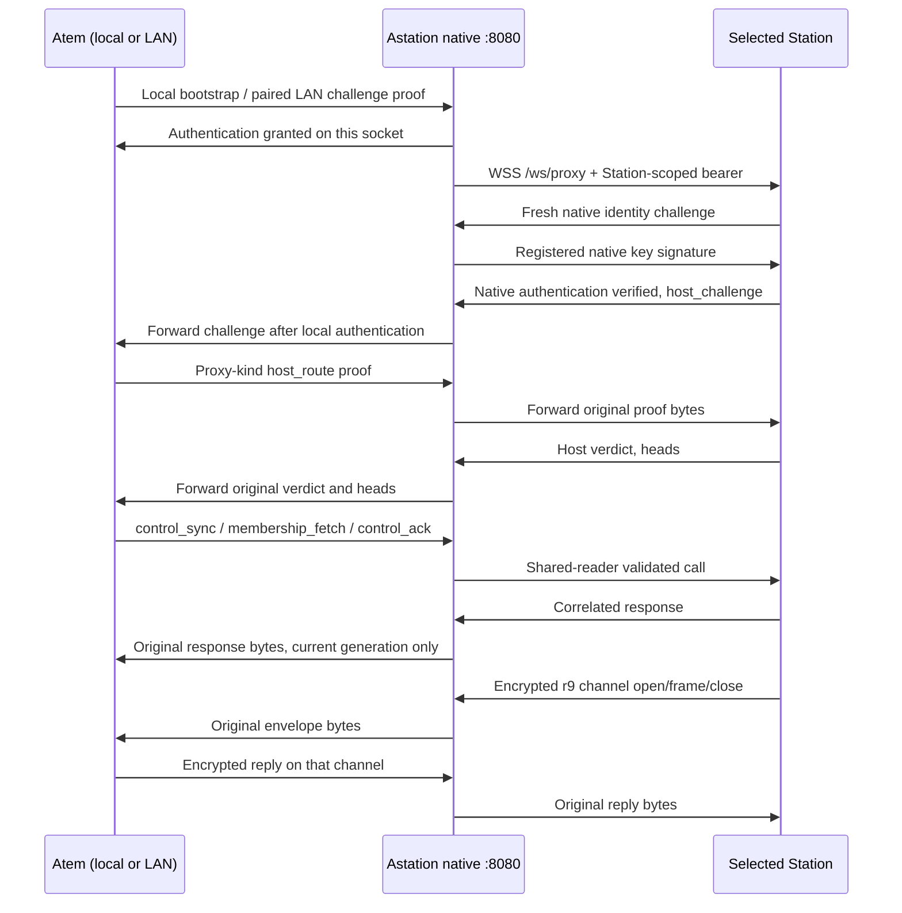

# Delegated Station implementation (#79)

This is implementation status against the agreed Atem Step 4 contract, pinned
to `c7b0054fe1208cad1bac98162d9d3ea99b5307cc` (#166's merged tree).
The feature is **not ready for activation**. This change does not enable
delegated execution or new native membership/control signing.

## Implemented

- Apple, Android and relay shared-core pins; published artifact hashes checked.
- One durable own feed per Station/account/genesis, including an empty feed.
  Membership, record append, signing high-water and shared ACK ledger use the
  same recovery-root transaction and lock. Failed commits expose no record or
  ACK evidence; a reused record ID with a different body is refused.
- Strict `heads`, correlated `control_sync`, `membership_fetch`, and whole-ACK
  validation on current proved host associations. Periodic heads every 30 s,
  durable-change wakeups and replica nudges re-read authority from storage.
  Bounded responses use the shared builders, 64-item/262144-byte limits and
  30-second handler deadlines.
- Queued control responses carry their original host association, checked
  again under the membership lock at the socket write. Trust generation is
  captured at admission, including when a generation changes without a key
  change. Old stored routes without a generation require a fresh proof.
  Obsolete control frames are discarded during close flushing too; they cannot
  prevent an independently authorized #80 verification completion from flushing.
- Durable shared-ledger report outbox with stable IDs/bodies, per-host effect
  evidence, retry pacing, explicit refusal and report-client stop/resume.
  Committed reporting may settle during a membership freeze; new authority and
  host ACKs stay blocked.
- Protected service-key reconciliation from authenticated Portal state:
  cover, hold, release, revoke and a later explicit interrupt. Expiry emits
  nothing. Covered hosts come from verified grant history, so narrowing a scope
  cannot remove a previously covered host from revocation accounting. A native
  revoke cannot be undone by a later active Portal snapshot. A separate own-key
  revoke is still issued for Portal reporting. Keys remain until signed R9
  membership removal, rather than being deleted on Portal revocation alone.
- Durable deployment-generation recovery fence, initial-history check and
  operator status/fence commands. A restore's externally increased generation
  blocks stale replicas, feed/ACK operations, signing and queued socket frames.
  Reporting holds the fence through actual HTTP delivery and commits ledger
  settlement together with its global delivery marker. This implements fencing,
  not complete snapshot reconstruction or reopening after a restore.

## Native client HTTP carriage

All endpoints are under `/api/remote/v1/logs/{genesis}/control`, require the
existing account access token, return `Cache-Control: no-store`, and check the
account's ownership of the root. Login permits storage access, never signing
or host authority. All are unavailable while the delegated runtime gate is off.

| Method/path | Request | Response |
| --- | --- | --- |
| GET base | none | Shared `heads` envelope for this Station |
| POST `/sync` | Exact shared `control_sync` envelope | Correlated shared result or metadata-free refusal |
| POST `/reservations` | `{principal, manager, expected:{seq,hash}}` | `{issued_at}`; monotonically reserved before signing |
| POST `/records` | `{record:<signed object>, expected:{seq,hash}}` | `{record_id, appended}` after durable publication |

Requests are strict JSON: duplicate/unknown fields are refused. Reservations
check the exact current head, known principal and active manager. Publication
also requires the shared verifier to accept a current native manager's
signature; only `revoke` and `interrupt_running` are allowed. Covered hosts are
derived inside the transaction. These endpoints accept no host ACKs. After a
membership change a caller must refresh and revalidate; it cannot replay an old
confirmation under a new head. An unchanged retry at the same head is idempotent.

`RemoteRecoveryHTTP` consumes these endpoints using its existing account-token,
HTTPS, redirect refusal and bounded-response path. Shared readers validate own
heads and exact sync correlation, and an anchored local log verifies a manager
record before publication. The adapter accepts only a matching record ID and a
Boolean receipt. It does not sign a record or treat a receipt as host application.

## Native stop delivery

The Mac integration screen now has gated Revoke and later Interrupt workflows.
Revoke's interruption checkbox starts off. A review shows the integration,
principal, Station, action, interruption choice and exact record ID before a
separate fresh owner authentication. The ordinary membership key provider still
refuses control signatures; the authorized stop path uses the same protected
identity with a one-use `RemoteConfirmedSigner` for the SDK's exact request.
Managers cannot use this path to sign service cover, hold or release.

`RemoteControlPublication` stores the draft before confirmation and the exact
signature before either delivery leg. Its protected checkpoint is bound to the
account, genesis and Station and retains the Portal issuer/owner and explicit
interruption choice. A changed membership head invalidates an unsigned review.
A retry revalidates a signed record against the current independently anchored
membership; a removed manager needs a new review/signature. Its already confirmed
Portal revoke intent remains available. Checkpoints also verify retained
signatures with the public key pinned at preparation.

Station storage and Portal mirroring settle independently. A failed or lost
reply, app restart, or write that committed before throwing never creates a new
record or signature. An uncertain protected write stops the instance until a
reload. The account coordinator schedules retries at startup/resumption and
every 30 seconds, independent of the Settings window; account, Station and
coordinator generation changes retire its work. It uses the same cached native
integration authorization as the approval screen, without opening a sign-in
prompt in the background. These receipts never imply host application.

The production constructor supplies no delegated signing authorization, so
these controls and retries remain off. This is not the separate all-verifier
gate for the five new membership actions; that gate also stays off, and
host-sender Readmit is not implemented by the service-stop UI.

## Native host-sender reviews and verifier authorization

The Security page now opens a separate Host Sending Access window. Its rows come
from the locally anchored shared device list, including the sending state and
projects of removed hosts. Removing or replacing a host's key does not readmit it.
Revoke reviews the exact host and interruption choice (off by default); Readmit
explains that only newly sent work is accepted and cancelled tasks do not return.
The view distinguishes a committed device-list entry from receiving-host
application. Host senders have no Pause/Resume controls.

`RemoteHostSenderReview` uses the shared action builders, publisher and signing
purposes, without adding a wire format. The account's existing serialized writer
durably saves the exact review before confirmation and the signature before
append. Pending reviews exclude other membership writers. Signing checks current
manager authority and the exact head before and after fresh owner confirmation,
then checks verifier authorization again at the actual protected-key boundary.
Neither the ordinary key provider nor a direct identity call can sign the five
new actions without the additional authorization callback.

A restart or lost append reply resumes the saved publication, reconciling its
exact entry against the verified chain before sending anything. A signed retry
reuses its signature. A write that might have committed fences the account writer
until protected reload. A losing compare-and-swap is archived rather than
automatically re-signed at another head. Another manager's noninterrupting revoke
cannot satisfy an interrupting intent; that case requires a fresh review, including
the later standalone Interrupt workflow that remains to be implemented for hosts.
The archive is bounded to 16 losing publications; exhausting it requires review,
never silent evidence deletion. Complete retention tooling remains open.

`RemoteVerifierSigningGate` is an authorization adapter for an independently
enumerated account, genesis and exact device-list head. The roster must include
all active signed-list members and current hosts, at least one Station replica,
and the caller's complete replica/other-SDK inventory. It cannot establish that
external inventory's completeness or authenticity itself. Omitting/removing an
obsolete verifier is not automatic discovery and requires an explicit manager
decision. The production application does not yet supply this authority.

Each consumer starts unconfirmed. Reports are scoped to fresh connection tokens;
reconnect, missing inventory, offline status, malformed inventory, lower versions
and narrower action sets invalidate confirmation. Delayed reports/disconnects
from retired connections cannot restore or invalidate a newer one. Host reports
must be taken from the shared-core-authenticated welcome, matching account, head
and host trust generation. The channel owner must retire that evidence on closure,
authorization expiry or identity change. Non-host reports require their own
authenticated source. Nothing is confirmed from presence, release version, cached
inventories or a host feature flag, and no confirmation survives a process restart.

All five actions require version 2 and the requested action in every live report.
The adapter also implements the proposed version-1 rule for service scopes with
launch/message/notify, including the prospective service's verifier on add. This
does not change the existing hosted integration enrollment path: migrating it to
the all-consumer gate still requires actual non-host inventory carriage and joint
verification. A version number does not substitute for the reported actions.

The normal app constructor supplies neither new-action inventory authorization
nor delegated-control authorization. The view is read-only and the new signing
paths remain OFF. This increment does not implement authoritative non-host roster
discovery, standalone host interruption/multi-Station fanout, project/host-key
signing UI, record-specific re-sign/application alerts or VII.A.

Portal [#38](https://github.com/Agora-Build/Portal/issues/38) is resolved by
[#39](https://github.com/Agora-Build/Portal/pull/39), `893bf30`, deployed to dev.
A later interrupting native mirror raises an earlier noninterrupting revoke
monotonically. The native transport still refuses a successful receipt that
does not match its exact Station, integration, owner role or interruption choice.

For an interrupting mirror only, authenticated `409 too_late` and
`409 station_removed` are final settlements. The native transport requires the
bounded, strict Portal error object from the same owner/issuer-bound revoke
request. Other status codes, malformed errors and unknown conflicts remain
pending. The protected journal retains the final reason separately from a
confirmed mirror, including across restart and uncertain checkpoint writes.
Neither final reason changes the signed native stop, confirms Station storage
or proves host application. An unfinished Station leg still retries the exact
record/signature; a settled Portal leg never retries. The UI displays the final
reason without claiming the interruption reached the hosts. Real joint
convergence/24-hour-boundary checks remain required before activation.

## Unknown Outcomes

Connections now exposes a host-wide Outcomes window; the Activity sheet also
lists the host's unresolved tasks. This remains available when the original
agent session has ended. An authenticated native control member lists alerts
through the same shared SDK channel used by the receipt adapter. A scan uses
at most 64 rows per page and 256 rows total, ordered by the host's sequence.
Only a complete scan replaces the prior list. A missing cursor, interrupted
page or timeout preserves the prior cards and requires a new scan/reconnect.

Explicit review offers Mark failed with a reason or Mark done with an existing
published memory/vault result snapshot. The SDK validates the entire request,
digest and correlated response. The review is tied to its connection and
authority generation. A refused resolution needs another scan and review; a
lost response is recovered by queries, never an automatic resolution replay.
Only the host's receipt settles the card. A late reply may instead move the task
to awaiting_result, which is not success. Unknown task/message receipts continue
polling so such a change is visible. Resolution remains disabled by default;
production does not supply the opt-in used by isolated tests.

Hosts advertising host.alerts are polled while the native channel is ready,
independent of the Outcomes window. New outcomes and daily reminders use the
existing in-app notification preference. The reminder checkpoint is protected
by the Data Protection Keychain, scoped to account/genesis/device and host trust
generation, and committed before presentation. It retains identifiers and
notification timing, without task text, sender, reason or result contents.
Uncertain storage suppresses notifications until reload without disabling
authenticated review. An incomplete scan cannot generate a reminder.

Signed, sealed outcome_unknown push hints are verified by the shared reader
against current membership and recipient keys, then routed to authenticated
host catch-up and the Outcomes window. They do not enter the approval inbox or
create an actionable card from push content. Delivery dedup and a tap's fresh
verification stay separate. Actual OS push delivery, protected reminder storage,
and owner resolution on a real delegated host still need VII.A evidence; unit
tests and notification wiring do not establish that joint result.

## Reporting recovery

Before any HTTP delivery, Station durably commits an in-flight marker for the
report-client binding shared by all accounts and replicas. It then locks that
marker through the request and settlement. A 403 persists a Station-wide stop.
If the stop commit fails or the process dies during delivery, the earlier
marker remains and **all further reports stay blocked**, including after restart.
An uncertain response might have been a 403, so an elapsed timeout alone never
authorizes a resend.

After investigating/fixing the report-client configuration, an operator may
resume with both `STATION_DELEGATED_REPORT_RESUME_CLIENT` equal to the configured
client and a fresh UUID `STATION_DELEGATED_REPORT_RESUME_ID`. Each resume ID is
consumed durably once across replicas; leaving it configured or replaying it
after another 403 cannot resume again. Remove it after use. A same-client resume
retains pending report IDs/bodies; a replacement client uses the shared ledger's
explicit drop policy. This is operator recovery, not a native owner action.

The ordinary retry path persists its backoff and clears the marker only after
settlement commits. No redirect is followed. Refused report IDs are retained
for operator diagnostics rather than retried under a new ID.

## Local/LAN Station Proxy

The local `:8080` and paired LAN connections remain owner-present transports.
`StationLocalProxy` adds a separate forwarding socket to the **currently selected
Station**, without joining the native relay room as another host or replacing
the host's independent relay socket. Both carriers use the same control feed,
membership readers and acknowledgment ledger; the proxy creates no second feed.

The endpoint requires the delegated build/runtime gate. Its query names `room`,
`atem_id`, the paired `session_id`, and the local authentication `generation`
(UUID). The account token is sent **only in the Authorization header**, never in
a URL or persisted route. This token alone grants no host authority. Station
requires the registered P-256 native key proof, the current verified native room
owner, the same account, and the live session-to-native binding before issuing a
host challenge. Proxy admission is scoped to that account's anchored root and
uses the shared `RouteKind::Proxy` verifier. The normal relay verifier accepts
only `RouteKind::Relay`.

Proxy bindings have their own durable slot, independent of the host's relay
binding. Their native parent connection, paired session, local generation, host
trust generation and proof are captured together. Replacing or retiring a proxy
cannot remove or publish over the host's real relay route. The independent r9
API prefers a live proved relay route and otherwise can use the current proxy;
a stale stored carrier must not hide a live one. No route moves to a different
Station implicitly.

Station rechecks native ownership, key, pairing and account authorization when
admitting traffic and again at the actual proxy writer boundary. Membership and
binding checks retain the existing transaction fence. A removed pairing cannot
release ciphertext or control responses already queued. The native bridge uses
the shared control readers and `relayControlSyncAnswers`; it permits one live
read call, at most 30 seconds, and forwards only results for that generation's
call and announced feed. Native-owned r9 channels never enter the proxy.

Each direction has a bounded queue (128 frames / 8 MiB). Encrypted envelopes
retain their original bytes and existing 2 MiB bound; control messages retain
the shared 256 KiB / 64-record limits. A transport failure closes the proxy's
virtual channels and retries with backoff. Atem signs one challenge per local
authentication generation: a subsequent Station challenge causes fresh local
authentication on the same TCP socket, with old channels closed **before** the
new authentication request and a new client generation. Both loopback and LAN
reuse their existing authentication credentials; this requires no new pairing
ceremony. An explicit host-proof refusal stops that proxy attempt and leaves
ordinary local/LAN traffic usable. Early challenges are dropped, never buffered.

Native forwarding additionally requires exact
`ASTATION_LOCAL_STATION_PROXY=true`, a verified host advertising `host.delegated`,
and completed account/Station registration. This is an opt-in joint-test path;
deployment configuration does not enable it or delegated execution.
Station consumes shared proof verification at Atem `d59f98f46816d16bbbf06d39f783fafe2602966d`.
The Apple SDK remains at its existing reviewed pin: native forwards the proof
opaquely and already has the shared control readers/correlation helper. This
does not satisfy the separate all-verifier signing compatibility gate.

Coverage includes real loopback/LAN authentication and reauthentication, native
proof ordering, unchanged ciphertext, read correlation, refusal and bounded
queues; real Station WSS native/key/session/account admission, proof-kind
refusal, concurrent relay/proxy routing, queued-write fencing and stale parent
retirement; and Postgres replica reload/replacement/revocation of both bindings.
These are isolated tests, not a claim of a completed real native/Atem joint run.

## Gates and remaining work

The `delegated-host-work` Cargo feature and exact
`STATION_DELEGATED_HOST_WORK=true` runtime setting are both required, with a
normalized `PUBLIC_BASE_URL` and externally maintained
`STATION_DELEGATED_RECOVERY_GENERATION`. Deployment configuration enables neither
the build feature nor runtime gate.
New native signing/device-list compatibility gates remain off.

Still required before activation:

- Real native/Atem `:8080` joint verification of the implemented proxy described
  above. Astation agreed the domain-separated proxy contract in
  [Atem #174](https://github.com/Agora-Build/Atem/pull/174#issuecomment-6919776085)
  at `fb81d081f5a1695a1ddc71ac9b846780543ae018`. This supersedes forwarding a
  relay-kind proof over the local link: Atem does not authenticate its local
  peer, which must never obtain a proof usable to claim a relay route.
  Local links sign `atem-host-route-proxy` with label
  `atem-host-route-proxy-v1`; relay and proxy verifiers reject each other's kind,
  including a relabelled signature. Accept proxy proofs only on a forwarding
  connection independently bound to the selected Station, paired native session
  and local socket/authentication generation. No relay-kind fallback is allowed.
  Forward a challenge only after the host's same-socket authentication reply;
  an early challenge is dropped and requires a new challenge after authentication.
  One proof is allowed per authenticated generation. Disconnect, reauthentication,
  native session/Station changes and identity changes retire the old authority
  and in-flight calls. A refused verdict keeps the owner-present local link
  usable but authorizes no Station calls. The host's verdict is informational.
  The proof's `room` is the paired Astation's relay room, not the host's own ID;
  `atem_id` remains the host's ID. Encrypted local channel forwarding already
  exists on the host and must be preserved by the native proxy.
  A native login token cannot replace the proof. A proxy must not take over a
  normal host route without supporting its encrypted channel routing too.
  The release-test correction at `d59f98f` resolves the debug-only dump dependency;
  a trust-generation-only change during host reauthentication remains a separate
  Atem before-activation fix. Source tests are not real joint-test evidence.
- Authoritative replica/non-host verifier inventory carriage, wiring all live
  inventory invalidations, and standalone host Interrupt/fanout. Native host-sender
  Revoke/Readmit reviews, their UI and the inventory authorization adapter are
  implemented but remain gated, as are the service Revoke/Interrupt journal.
  Record-specific re-sign/application alerts
  remain required. Unknown-outcome listing, resolution review, protected reminder
  policy and push routing are implemented; their real joint checks remain open.
- Complete restore/reset tooling: a restored database must never reuse a
  `feed_id`. A reset must reissue a complete latest-state snapshot, including
  native records needing a manager. The present storage UUID is restart-stable;
  it is not a completed database-restore procedure. The deployment-generation
  fence and operator status/fence commands now keep uncertain history closed;
  snapshot reconstruction, manager re-signs and reopening remain unfinished.
  Retention/compaction must
  preserve required stops, high-water and at least 30 days of records. The
  implementation requirements and recovery sequence are recorded in
  [delegated-station-restore.md](delegated-station-restore.md).
- Account ownership/mailbox integration, the remaining Kotlin delegated
  fixture runner, and all real Station/native/Atem/Portal joint checks listed
  in #79. Passing fake-host/isolated tests is not activation evidence.

## Host Mail Follow-up

Part I (#79) stays first. The owner confirmed that Atem-to-Atem messages will
use host senders with sealed, signed mail, skipping the Station-integration
stage for Atem hosts. Astation reviewed and agreed to the H-0 contract at
Atem PR #168 `527a7c89e647bdaecc16bde5b2ac9f02578108d6`, with no Critical or
High contract finding. The agreement covers mailbox put/stored/sync/done and
heads, status forms, result_id, select only in host envelopes, D3's host
encryption-key signature in the normal verification ceremony under the same
owner authentication, and D4's first version without a vault directory.
The exact review is in
[the H-0 review](../reviews/2026-11-15-host-mail-h0.md) and
[Atem #120 comment 6903887341](https://github.com/Agora-Build/Atem/issues/120#issuecomment-6903887341).

The shared mailbox wire in [Atem #173](https://github.com/Agora-Build/Atem/pull/173#issuecomment-6919736991)
is signed off at `ec7ca2a6dd7e960fcf9601c043314131e84883c4` (496 independent
checker cases pass and applicable exact-head CI is green). H-4/H-5 can proceed.
It subsequently merged as `7a7cbb81b1c86189b6e00f57f90bce9d6523fad0`, with the
three agreed readings recorded in documentation at head `6511067`.
Agreed readings: malformed sealed shape is dropped unanswered; invalid put
lifetimes get `expired`; deterministic result ID validation follows strict
plaintext parsing and precedes outbox correlation regardless of sender standing.
This is source/contract sign-off without SDK adoption. The reference mailbox,
mailbox-call vectors, Station storage and real VII.B remain follow-ups.

Next, build the Station host-mail mailbox (reuse enrollment mailbox
storage only where the authority/retention semantics actually fit), native
project/host-key signing and host-sender Revoke/Readmit, and the complete verifier
inventory check before new signed actions. VII.B follows VII.A. None of this
authorizes new signing or displaces the remaining Part I implementation.

## Pairing Test Scope

The owner and Atem confirmed that the product has no in-place re-verification
of an already verified, route-proved host. `atem pair verify` returns
`Already verified`; replacing the key uses `atem unpair`, then `atem pair`,
which removes the old pin/link before the owner-present unproved ceremony.
The clarification is recorded in
[Atem #120](https://github.com/Agora-Build/Atem/issues/120#issuecomment-6899199958).

Astation #80 is resolved as unreachable through the supported product flow.
The defensive relay fix (#81) and host fix (Atem #167) remain, with regression
coverage. No live re-verification was run or is required for Part I's joint
checks. This removes only that unsupported scenario from #79's earlier test
list; the other real joint checks and activation gates still apply. A future
lighter host-key rotation path must be reviewed and tested separately.

## Validation

Tests exercise strict shared fixtures through actual Rust and Swift bindings,
real sockets without a Mac, isolated Postgres and Redis, two replicas/restart,
generation changes behind a queued response, ACK commit failure, service-key
binding, lifecycle concurrency and expiry, historical coverage, HTTP retries,
failed stop/marker commits and explicit one-shot resumption. Outcome tests cover
all four pages, failure/timeout recovery, stale confirmation and late scan/query
races, explicit receipt confirmation, daily reminder reload and uncertain writes,
and actual shared verification of signed alert targets and tampering.

Recovery-fence validation: default relay 604 passed/145 ignored; combined
`host-work-api,delegated-host-work` 611 passed/166 ignored; all isolated Postgres
tests in that combined build 97 passed, including all 19 delegated Postgres
tests. The default Postgres build passes 76 tests. The existing background-poll
test now asserts its readiness reason for both hosted build-gate states.
The actual operator binary passes isolated status/fence, generation increase,
stale-generation refusal and invalid-configuration checks without creating a
feed. These results do not establish complete snapshot recovery or VII.A.

The working branch's exact commands/results are recorded in its PR. Real
protected owner ceremonies and native local transport remain joint checks.
