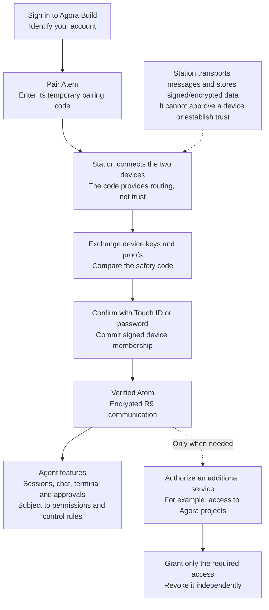

# Pairing and service authorization

Status: **draft for owner review**, 2026-10-28. This records the proposed
product flow and security boundaries. It does not approve a new wire format,
authorize implementation or enable hosted execution. Atem owns its protocol
and host implementation; Astation owns native UX and integration.

## Recommendation

Pairing establishes device trust. Service authorization grants access to an
additional service. Make them independent internally and present one guided
**Pair Atem** experience to the user.

A user signed in to Agora.Build must be able to pair and verify Atem without
an Agora.io service session. The native app must not send its Agora.Build
Portal or Station access/refresh tokens to Atem as a replacement for old
Agora credentials.

The separation does not add another pairing command or require users to
verify again whenever they use an agent. Existing verified membership remains
the basis for access, subject to permissions, revocation and the R9 freshness
rules. Each process/session is not a new device.

## Proposed flow

Mermaid diagram source

The diagram shows the intended user experience, not an already implemented
protocol. Device messages travel through the selected Station; the native
device and Atem verify the cryptographic evidence themselves.

| Step | Establishes | Does not establish |
| --- | --- | --- |
| Agora.Build login | The authenticated account for account APIs | Device membership, host trust or permission to operate an agent |
| Temporary pairing code | A bounded rendezvous between the two devices | Trusted device/account identity or a decryption key |
| Safety-code verification and signed enrollment | Device trust under the existing account trust anchor | Authorization to every service or automatic vault unlock |
| Service authorization | Explicit permissions for a service or integration | New device trust or permission beyond the grant |
| Take Control | Which controller may operate a session under the R9 rules | A login, enrollment or credential grant |

## Native experience

1. The user signs in to Agora.Build and selects a Station.
2. Atem starts pairing and displays a temporary code and expiry. The native
   **Pair Remote Atem** action accepts that code and displays the selected
   Station, so the destination is visible.
3. The dialog shows progress: connecting, waiting for Atem, checking device
   identity, and waiting for the user's safety-code confirmation. A failed or
   expired attempt shows a useful error instead of silently closing.
4. The user compares the codes on the two endpoints and confirms on the
   native device with Touch ID or the supported owner-password path. Account
   login and possession of the pairing code cannot replace this confirmation.
5. The endpoints durably save the verified state before presenting the host
   as verified. An interrupted enrollment remains pending until the existing
   R9 recovery/reconciliation rules establish its actual state.
6. Agent features become available according to membership and feature
   permissions. Remote terminal control retains its explicit control lease;
   chat and approvals follow their own current R9 operation rules.

Optional service access is a separate action when needed. For example, a user
can authorize Agora project tools after pairing, and revoke that access later
while retaining the verified host. Pairing solely for agent operations must
work without connecting an Agora.io account.

The integration approval screen is a later stage: load requests, select a
verified host, review the requested permissions, then authenticate the owner
to approve the service identity. It must explain the verified-host
prerequisite when no host is available. This proposal does not bypass the
joint verification gate for hosted execution.

## Pairing introduction without service tokens

Replace the pairing path's dependency on `credentialSync` with an explicit,
versioned introduction that supplies only the information necessary to find
the native identity connection. The exact message name and field encoding
remain subject to joint review on Atem #81.

The contract must specify:

- Protocol version and bounded validation rules; unsupported peers produce a
  clear upgrade error rather than falling back to legacy credential sync.
- Correlation with the current pending pairing attempt and its lifetime;
  delayed messages from an old attempt cannot change the active attempt.
- The native routing identity needed to open the existing authenticated
  identity connection. A relay-forwarded identity is an untrusted hint.
- Account, selected-Station and connection context captured before
  asynchronous work, with checks before applying or sending its result.

There are no service access tokens, refresh tokens, project certificates,
passwords, recovery secrets or account data keys in the introduction. It
does not select a different Station or silently change an existing account
trust anchor. Non-secret routing metadata still receives normal redaction
and retention treatment.

The existing device-key proofs, fresh challenges, safety-code comparison,
owner confirmation and signed membership checks establish authority after
the introduction. Reuse the signed R9 primitives and reviewed membership
lifecycle; do not invent a second trust protocol for this transport change.

## Trust and lifecycle invariants

- Agora.Build/Auth verifies account access. The native device and Atem
  establish device trust against their independently retained account
  anchors. The Station validates API admission and transports evidence; it
  cannot authorize enrollment or replace a signed membership decision.
- Neither a pairing code nor a forwarded account/device identifier is proof
  of identity. A compromised relay must not be able to turn its own routing
  metadata into a verified device, service identity or encryption state.
- Successful pairing requires durable verified state. Duplicate delivery
  must not create duplicate enrollment or rotate keys implicitly. After a
  disconnect, pending work is reconciled before reporting success.
- An already paired host retains the existing no-op behavior for `atem pair`;
  pending verification uses the explicit verification flow. Revocation and
  explicit unpair remain authoritative. This change does not reset keys,
  revive revoked membership or merge accounts by name/email.
- Several Atem processes may reuse one enrolled host identity. Multiple
  native controllers require their own valid account membership and
  permissions; sharing an Agora.Build login alone does not make them trusted.
- Service grants have their own scope, expiry and revocation. Revoking a
  service grant does not unpair the host; revoking device control still
  fences operations according to R9. Pairing does not acquire a lease or
  automatically unlock the memory/vault/credential store.
- Account API tokens retain their registered audiences. Native Portal and
  Station refresh credentials remain native secrets. Any future host/API
  grant must be independently specified with the appropriate resource and
  scope; pairing does not implicitly provide one.

## Ownership and delivery

| Component | Work |
| --- | --- |
| Astation | Native sender, account/context checks, progress and errors, owner confirmation, signed enrollment persistence, integration prerequisite guidance |
| Atem | Receiver and CLI state machine independent of SSO credential sync, authenticated connection transition, durable pairing and retry behavior |
| Station | Preserve bounded pairing-room transport; keep routing and API admission distinct from device trust |
| Agora.Build/Auth | Retain existing account/API grants; review a separate host/service grant only if a feature actually needs it |

First agree the token-free introduction, capability/version handling and
durable transition with Atem. Then implement and test the native and host
sides separately, pin the new joint builds, and run the real native ceremony.
No production merge/deploy or live enrollment is authorized by this draft.

Minimum joint tests:

1. Agora.Build-only login with an empty legacy Agora session store: pair,
   verify and open an authorized R9 agent connection.
2. Missing required native account state: actionable refusal, no false
   success and no credential fallback.
3. Expired/unknown code, absent peer, disconnect and explicit cancellation:
   bounded progress and retry without stale success.
4. Account change, Station change, duplicate introductions and late replies:
   fence the old attempt and preserve existing enrollment.
5. Spoofed routing identity, mismatched safety code, owner cancellation and
   revoked membership: no trusted enrollment or key release.
6. Crash before/after durable enrollment: reconcile the same operation;
   never report verified solely from a relay response.
7. Inspect pairing traffic for absence of Portal/Station access or refresh
   tokens and other service credentials.
8. Revoke optional service access while keeping the host paired; confirm
   only that service's access is removed.

## Why this is needed now

On 2026-10-28 both native Astation and the test host reached the correct dev
Station pairing room. The native app then skipped `credentialSync` because it
had no legacy Agora session. Atem joint source `e7dff6d` waits for that message
before learning the native routing identity, so pairing timed out despite
successful Agora.Build login and a working relay connection.

The [account integration diagnosis](account-identity-integration.md#live-pairing-bootstrap-gap-2026-10-28)
and [Atem #81 evidence](https://github.com/Agora-Build/Atem/issues/81#issuecomment-6477265981)
record the observed failure. The relay's earlier ten-second ownerless-pairing
bug is fixed separately; that transport fix does not remove this native/host
dependency.

## Review before implementation

The owner is reviewing the separation and user experience. The proposed
flow keeps one guided pairing action; optional service access remains
independent. Atem and Astation must jointly confirm the wire shape, version
negotiation, retry/persistence semantics and the host build pin before coding
this change. This document is the review draft, not that confirmation.
