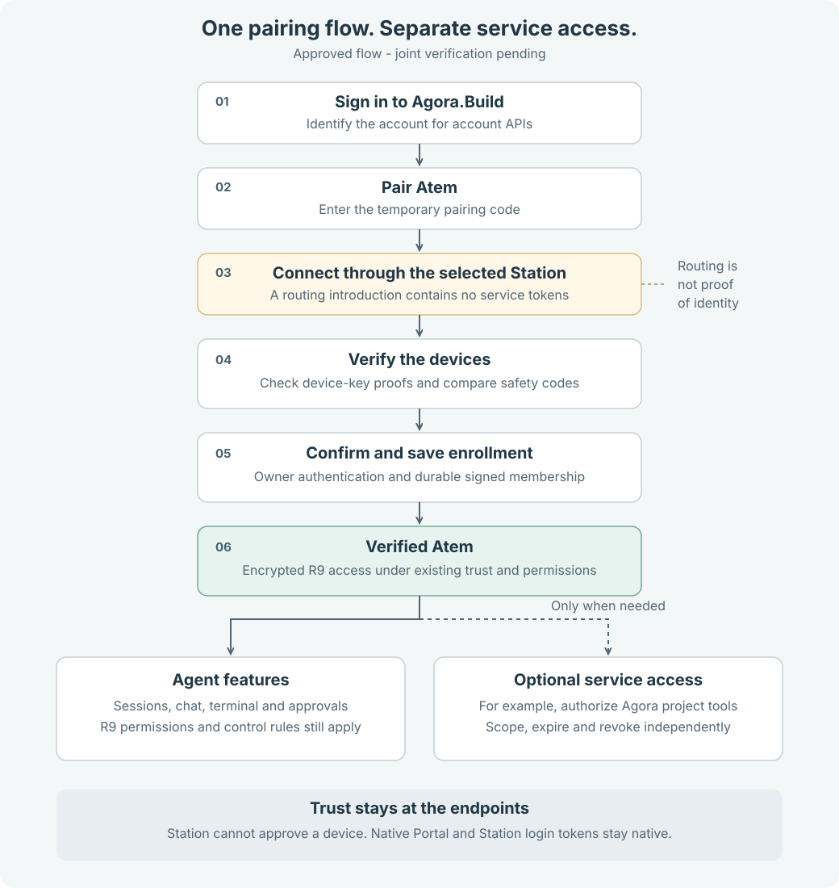
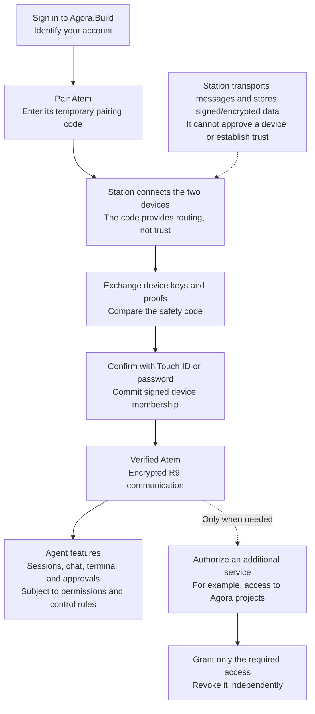

# Pairing and service authorization

Status: **joint device verification and native service approval completed**,
2026-10-28. The owner approved the separation and requested implementation.
The isolated host on Atem `03ca230` completed both halves of verification at
trust generation 2, after the earlier fresh-key retry problem described below.
The Mac subsequently approved the protected service member. Source review and
actual R9 session/execution release checks remain open.
Atem owns its protocol and host
implementation; Astation owns native UX and integration. Hosted execution
remains disabled pending the real joint end-to-end gates.

## Recommendation

Pairing establishes device trust. Service authorization grants access to an
additional service. Make them independent internally and present one guided
**Pair Atem** experience to the user.

A user signed in to Agora.Build must be able to pair and verify Atem without
an Agora.io service session. The native app must not send its Agora.Build
Portal or Station access/refresh tokens to Atem as a replacement for old
Agora credentials.

The separation does not add another pairing command or require users to
verify again whenever they use an agent. Existing verified membership remains
the basis for access, subject to permissions, revocation and the R9 freshness
rules. Each process/session is not a new device.

## Guided flow



<details>
<summary>Mermaid diagram source</summary>



</details>

The diagram shows the approved user experience. Native and host delivery
still require joint validation. Device messages travel through the selected Station; the native
device and Atem verify the cryptographic evidence themselves.

| Step | Establishes | Does not establish |
| --- | --- | --- |
| Agora.Build login | The authenticated account for account APIs | Device membership, host trust or permission to operate an agent |
| Temporary pairing code | A bounded rendezvous between the two devices | Trusted device/account identity or a decryption key |
| Safety-code verification and signed enrollment | Device trust under the existing account trust anchor | Authorization to every service or automatic vault unlock |
| Service authorization | Explicit permissions for a service or integration | New device trust or permission beyond the grant |
| Take Control | Which controller may operate a session under the R9 rules | A login, enrollment or credential grant |

## Native experience

1. The user signs in to Agora.Build and selects a Station.
2. Atem starts pairing and displays a temporary code and expiry. The native
   **Pair Remote Atem** action accepts that code and displays the selected
   Station, so the destination is visible.
3. The dialog shows progress: connecting, waiting for Atem, checking device
   identity, and waiting for the user's safety-code confirmation. A failed or
   expired attempt shows a useful error instead of silently closing.
4. The user compares the codes on the two endpoints and confirms on the
   native device with Touch ID or the supported owner-password path. Account
   login and possession of the pairing code cannot replace this confirmation.
5. The endpoints durably save the verified state before presenting the host
   as verified. An interrupted enrollment remains pending until the existing
   R9 recovery/reconciliation rules establish its actual state.
6. Agent features become available according to membership and feature
   permissions. Remote terminal control retains its explicit control lease;
   chat and approvals follow their own current R9 operation rules.

Optional service access is a separate action when needed. For example, a user
can authorize Agora project tools after pairing, and revoke that access later
while retaining the verified host. Pairing solely for agent operations must
work without connecting an Agora.io account.

The integration approval screen is a later stage: load requests, select a
verified host, review the requested permissions, then authenticate the owner
to approve the service identity. It must explain the verified-host
prerequisite when no host is available. This flow does not bypass the
joint verification gate for hosted execution.

## Pairing introduction without service tokens

Replace the pairing path's dependency on `credentialSync` with an explicit,
versioned introduction that supplies only the information necessary to find
the native identity connection. The candidate below is posted for joint
confirmation on [Atem #81](https://github.com/Agora-Build/Atem/issues/81#issuecomment-6477978879),
with the relay wrapper and authentication correlation in the
[implementation follow-up](https://github.com/Agora-Build/Atem/issues/81#issuecomment-6478324332).

The contract must specify:

- Protocol version and bounded validation rules; unsupported peers produce a
  clear upgrade error rather than falling back to legacy credential sync.
- Correlation with the current pending pairing attempt and its lifetime;
  delayed messages from an old attempt cannot change the active attempt.
- The native routing identity needed to open the existing authenticated
  identity connection. A relay-forwarded identity is an untrusted hint.
- Account, selected-Station and connection context captured before
  asynchronous work, with checks before applying or sending its result.

There are no service access tokens, refresh tokens, project certificates,
passwords, recovery secrets or account data keys in the introduction. It
does not select a different Station or silently change an existing account
trust anchor. Non-secret routing metadata still receives normal redaction
and retention treatment.

The existing device-key proofs, fresh challenges, safety-code comparison,
owner confirmation and signed membership checks establish authority after
the introduction. Reuse the signed R9 primitives and reviewed membership
lifecycle; do not invent a second trust protocol for this transport change.

### Pairing-only wire v1

The host sends this payload on the temporary pairing socket:

```json
{"type":"pairing","data":{"v":1,"op":"hello","id":"aaaaaaaa-bbbb-4ccc-8ddd-eeeeeeeeeeee"}}
```

The UUID is fresh for each attempt and remains identical on retransmission.
Station does not buffer a hello sent before the native owner joins. The
host must therefore retransmit the same hello at a bounded interval until
it receives the introduction, or send again when the owner arrives.

After preparing its selected-Station account access and waiting for the
registration acknowledgment, native responds with this payload:

```json
{"type":"pairing","data":{"v":1,"op":"introduction","id":"aaaaaaaa-bbbb-4ccc-8ddd-eeeeeeeeeeee","astation_id":"native-routing-identity"}}
```

The Station wraps host-to-native payloads with `atem_id`, `connection_id`
and `payload`. Native validates and pins that route on the first hello,
then responds in the same targeted wrapper. Station strips the wrapper
before delivering to that exact host socket. A changed host, connection or
attempt ID fails the attempt. Neither the wrapper nor the introduction
authenticates a device. The hello is not sent as an agent session message
and does not negotiate a lower R9 revision.

Each frame, including its wrapper, is limited to 4096 bytes. Duplicate JSON
keys, extra fields, noninteger versions, unknown operations and malformed
UUIDs are rejected. The native routing identity is 1–128 ASCII bytes from
`[A-Za-z0-9._:-]`. The existing bounded device/connection identifiers apply
to the transport wrapper. Relay connection notices are transport hints.

Errors use `type: "pairing"` and `data` with `v: 1`, `op: "error"`, the
attempt `id` and `code`. The bounded candidate codes are
`unsupported_version`, `invalid_request`, `not_signed_in`,
`pairing_cancelled` and `pairing_expired`. Native accepts a matching host
error, shows actionable local failures and closes its pending socket on
cancellation or failure. Socket closure is not a durable host receipt; the
host must also bound its own waiting. An old or silent host receives no
fabricated credentials and leaves native with an upgrade/retry message.

### Identity connection and completion

The host next opens the existing identity connection at the **same selected
Station**, using the introduced routing identity. Its `atem_id` must match
the pairing socket. For a new pairing, the existing `statusUpdate` with
`status: "auth"` carries the original room code as `pairing_code` and the
hello UUID as `pairing_attempt_id`, alongside its existing hostname and
host identity. These are correlation hints, not identity proofs. Native
requires all three to match its pending introduction before opening the
owner prompt. The original code is reused; a second unrelated OTP cannot
attach a connection to the attempt. Saved-session proof reconnects retain
their existing authentication path and need no fresh introduction.

Native captures the authenticated session and the new identity socket's
connection generation after owner confirmation. Completion is accepted only
for this exact device/session/connection and the unchanged native account
and Station. The existing R9 verification checks the safety code, requires
owner authentication, publishes and verifies signed membership, then
durably saves verified device state. Only its successful completion
callback may show **verified**. Closing the code socket after introduction
merely means the host may be moving to the identity connection.

An active native attempt has a monotonic 10-minute outer deadline. After
opening its code socket, native allows 20 seconds for a compatible hello,
so a silent legacy host cannot leave the user waiting indefinitely. Host
timeouts and room expiry are independent bounds. Duplicate hellos receive
identical introductions on the original route, with bounded repetition;
they cannot reopen a prompt or reset verification progress. Cancellation,
account changes and Station changes invalidate queued asynchronous work.
Cancellation during verification cancels only that pending ceremony;
saved pairing and already verified membership are preserved. Interrupted
verification can use `atem pair verify`, subject to the existing R9 gates.

The native pairing socket has its own lifecycle and never wraps or replaces
the application's global agent transport handler. A room code never becomes
an online Atem row. Pairing, login reload, connection and activity no longer
automatically trigger legacy service credential sharing; explicit service
authorization remains a separate responsibility.

This introduction replaces the relay room's bootstrap. Same-user loopback
connections retain their existing local bootstrap proof and learn the native
routing identity from the existing authentication challenge. Atem must remove
the service-credential prerequisite from that local pairing path too. Local
authentication does not replace safety-code/device verification, account
membership or feature authorization. This change does not remove local
WebSocket access or create a second device identity for a local process.

## Trust and lifecycle invariants

- Agora.Build/Auth verifies account access. The native device and Atem
  establish device trust against their independently retained account
  anchors. The Station validates API admission and transports evidence; it
  cannot authorize enrollment or replace a signed membership decision.
- Neither a pairing code nor a forwarded account/device identifier is proof
  of identity. A compromised relay must not be able to turn its own routing
  metadata into a verified device, service identity or encryption state.
- Successful pairing requires durable verified state. Duplicate delivery
  must not create duplicate enrollment or rotate keys implicitly. After a
  disconnect, pending work is reconciled before reporting success.
- An already paired host retains the existing no-op behavior for `atem pair`;
  pending verification uses the explicit verification flow. Revocation and
  explicit unpair remain authoritative. This change does not reset keys,
  revive revoked membership or merge accounts by name/email.
- Several Atem processes may reuse one enrolled host identity. Multiple
  native controllers require their own valid account membership and
  permissions; sharing an Agora.Build login alone does not make them trusted.
- Service grants have their own scope, expiry and revocation. Revoking a
  service grant does not unpair the host; revoking device control still
  fences operations according to R9. Pairing does not acquire a lease or
  automatically unlock the memory/vault/credential store.
- Account API tokens retain their registered audiences. Native Portal and
  Station refresh credentials remain native secrets. Any future host/API
  grant must be independently specified with the appropriate resource and
  scope; pairing does not implicitly provide one.

## Ownership and delivery

| Component | Work |
| --- | --- |
| Astation | Native sender, account/context checks, progress and errors, owner confirmation, signed enrollment persistence, integration prerequisite guidance |
| Atem | Receiver and CLI state machine independent of SSO credential sync, authenticated connection transition, durable pairing and retry behavior |
| Station | Preserve bounded pairing-room transport; keep routing and API admission distinct from device trust |
| Agora.Build/Auth | Retain existing account/API grants; review a separate host/service grant only if a feature actually needs it |

Native implementation and tests can proceed against this bounded candidate
while Atem reviews and implements its receiver. Confirm the exact wire and
new host source/build pin on #81 before the real pairing attempt. Then pin
both builds and run the native ceremony with the owner. Product approval
does not authorize impersonating safety-code/biometric confirmation or
merging/deploying production.

Minimum joint tests:

1. Agora.Build-only login with an empty legacy Agora session store: pair,
   verify and open an authorized R9 agent connection.
2. Missing required native account state: actionable refusal, no false
   success and no credential fallback.
3. Expired/unknown code, absent peer, disconnect and explicit cancellation:
   bounded progress and retry without stale success.
4. Account change, Station change, duplicate introductions and late replies:
   fence the old attempt and preserve existing enrollment.
5. Spoofed routing identity, mismatched safety code, owner cancellation and
   revoked membership: no trusted enrollment or key release.
6. Crash before/after durable enrollment: reconcile the same operation;
   never report verified solely from a relay response.
7. Inspect pairing traffic for absence of Portal/Station access or refresh
   tokens and other service credentials.
8. Revoke optional service access while keeping the host paired; confirm
   only that service's access is removed.

## Why this is needed now

On 2026-10-28 both native Astation and the test host reached the correct dev
Station pairing room. The native app then skipped `credentialSync` because it
had no legacy Agora session. Atem joint source `e7dff6d` waits for that message
before learning the native routing identity, so pairing timed out despite
successful Agora.Build login and a working relay connection.

The [account integration diagnosis](account-identity-integration.md#live-pairing-bootstrap-gap-2026-10-28)
and [Atem #81 evidence](https://github.com/Agora-Build/Atem/issues/81#issuecomment-6477265981)
record the observed failure. The relay's earlier ten-second ownerless-pairing
bug is fixed separately; that transport fix does not remove this native/host
dependency.

## Implementation and verification status

The native candidate lives in `NativePairingSession`, with a guided
`PairRemoteAtemWindowController` and existing hub verification integration.
Tests cover Agora.Build-only login and Station registration without a legacy
session; targeted relay delivery; duplicates; replacement routes; context
changes; cancellation; timeout; token isolation; and exact durable-completion
correlation. A synthetic native URLSession test through the isolated deployed
Station passes; it supplies no real identity or owner confirmation and proves
only the transport handoff. Run it only against a disposable test Station:

```sh
swift test --filter 'NativePairing|StationAccountLifecycleTests|RemoteTerminalHubTests'
ASTATION_PAIRING_LIVE_STATION=https://your-isolated-station.example \
  swift test --skip-build --filter NativePairingLiveTransportTests
```

Local results on 2026-10-28: 59 focused tests pass, with the opt-in live test
skipped in that run; the live test passes separately against the isolated
Station. After the owner unlocked the Mac, the full provisioned run passes
all 1,074 tests with seven optional skips and zero failures. Protected
Keychain, Secure Enclave, recovery, migration and credential tests run and
pass, as do the two UI tests that failed during the earlier locked-console
run. No test was excluded or weakened. The unlocked results supersede the
earlier failures. Native implementation pin `a96b62e` also passes macOS,
relay and web [CI 40755408435](https://github.com/Agora-Build/Astation/actions/runs/40755408435).
These results do not substitute for the real joint device ceremony or the
hosted execution release gates.

The provisioned native candidate is now running on the Mac. The first live
trial reached the introduction at 20:43:10 UTC on 2026-10-28, but native
refused the subsequent identity authentication before showing the owner
prompt. [Atem confirmed](https://github.com/Agora-Build/Atem/issues/81#issuecomment-6480336199)
that its trial omitted `atem_id` on the pairing-code socket. Station assigned
that socket a different routing ID from the identity socket, so native's
same-host check correctly refused it. The attempt was still active, and its
code and hello UUID matched. Atem's corrected trial sends the same host ID
on both sockets; it is not yet a committed release pin.

Native diagnostics name only the rejected check and never log the pairing
code or routing IDs. The 21 provisioned pairing-state tests pass after this
diagnostic change. Two opt-in tests also pass against the deployed dev
Station: a stable explicit host ID reaches the pending owner-confirmation
state, while an omitted ID cannot match an unrelated identity. Both close
the temporary host socket after the introduction and clean up their
synthetic rooms. These tests neither relax authentication nor perform real
owner confirmation or trusted enrollment.

The corrected host reached native durable enrollment at 20:53:33 UTC, but
the host subsequently answered `n` and discarded its fresh channel-key seed.
That is native completion only, not a jointly verified host. Atem's next
`pair verify` generated a different channel key while still advertising host
trust generation 1. A second `add_host` at generation 1 is invalid under
`host_trust_gen_not_increasing`. The old generic recovery error did not
explain this failure.

Native now refuses a nonincreasing generation before preparing a draft or
presenting owner approval. A new key must never reuse the old key's signed
entry. A valid higher-generation `add_host` can supersede the existing host
without `remove_host`, subject to a fresh ceremony and owner confirmation.
Atem owns durable generation/key handling for an aborted ceremony. Neither
agent may silently unpair or reset trust to repeat a test.

After a restart, native may retire a pending host publication once the
anchored chain proves its exact signed entry committed. A pending duplicate
is superseded only when the shared verifier proves its exact signed body
invalid for a nonincreasing generation at the current anchored head. Native
durably retains that draft as evidence before preparing a replacement.
Other unresolved signed publications remain pending. No chain truncation,
key substitution or owner-consent bypass is permitted.

The updated provisioned suite passes 1,078 tests with eight optional skips
and zero failures. Its regressions cover higher-generation replacement,
retained invalid-draft evidence and restart after a lost committed reply.

At 21:40 UTC, Atem `03ca230d823b93e867d7a026a2723755034932f6`
completed joint verification at generation 2 on the preserved isolated profile.
The user compared the safety code and confirmed on the Mac before the host
confirmed. Atem reports verified, credentials unlocked and membership seq 4.
The native protected service approval then committed the service add at seq 5;
the authenticated Portal feed reports `waiting_for_host` with the approved
service fingerprint. These are real ceremony results, not source sign-off.
The receiver's strict pairing-reader correction is closed in source at Atem
PR #101 `15311db`; its macOS and Linux execution evidence has been reviewed.
Replacement runtime/package approval is separate. The running host remains
`03ca230`.

The subsequent native session attempt received the host's accept but expired
after ten seconds while owner authentication was pending. Native now prepares
owner presence before sending channel init; preparation signs nothing, and
the shared core still verifies the pinned host before requesting a transcript
signature. A retry on `548c486` still failed locally with `notForeground`
before channel init. The follow-up explicitly activates on Retry and permits
a bounded wait for AppKit activation before prompting and after successful
authentication, with context fences and the original confirmation timestamp
preserved. The next live attempts confirmed `approved=true` but remained
inactive after the system prompt closed. The adapter now explicitly restores
the originating visible window and requests activation after successful,
current authentication. It never requests this for a denial or fenced context.
All 1,083 provisioned app tests and 148 reusable native tests pass
(eight and one optional skips respectively).

The user retry on native `34efe40` succeeded at 22:26:49 UTC. Logs show owner
authentication approved, explicit focus restoration, host accept and encrypted
records. The Connections screen displays the running actual Codex session
`ses-i5py5pldao4d`, matching the Atem agent's handoff on #81. This establishes
native R9 admission and session discovery on the preserved verified profile.
The host reports that activity remains `unknown` until Codex's first prompt
fires its lazy SessionStart hook; this is separate from process/connection
health. It does not establish a completed prompt, service execution or the
rest of the live gate matrix.

The original test service expired at 21:52:56 UTC and was revoked at Auth.
Its Portal state remains `revoking` until supported signed service-member
removal and the Station's completion report. Its signed grant is never reused
or extended in storage.

The owner approved the replacement integration
`i-01m62bpj9tj16evs0bry3k27mf` at 23:00:42.637 UTC through a fresh native
review. It expires on 2026-11-04 at 22:57:08.898 UTC and uses the new protected
R9 service fingerprint
`7f53966e81b35717b5cf9fcbce748136f8687123fda87880dfa1e9fce29fedec`.
Read-only Station checks confirm signed membership head seq 6 and a healthy,
non-denied Portal feed. Portal/Auth confirms the approval and active service
client in [Portal #20](https://github.com/Agora-Build/Portal/issues/20#issuecomment-6482950230).
The displayed `waiting_for_host` reason is "Hosted execution awaits end-to-end
verification"; this is not another pending owner approval or evidence that
the host is offline.

The initial discovery session above is historical. Atem's current disposable
Codex session is `ses-emcvcza5lnsj`, process generation
`28c9e08d-1b3a-45f1-8a1a-3d06c0969e5e`, with real model replies and `ready`
activity reported in [Atem #81](https://github.com/Agora-Build/Atem/issues/81#issuecomment-6482619557).
Operations must obtain the complete current target from the admitted registry.

See [the R9 client lifecycle](r9-client.md). Still required: actual protected
service token/channel execution and approval evidence, durable policy
acknowledgment, old-service removal, revocation/reconnect, Mac-off and replica
checks. A synthetic relay pass does not satisfy these gates. Hosted execution
remains disabled.
