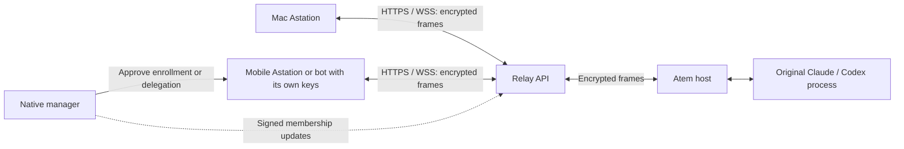

# Remote agent API for independent Astation clients

Status: joint Astation/Atem design draft, 2026-10-19. This starts the next task
after Astation [#56](https://github.com/Agora-Build/Astation/pull/56), merged
as `4f4581ac7c3e453a39a830dc6c4577aeb71dda6a`. Public remote operations are
not enabled. The implemented API is the [protected local API](../../docs/local-control-api.md).

Application baseline: atem-session r8 at Atem
`4f87bab1289848cb6a0da5707d2e7830eb5c057d` (#78). This draft also reads
Atem main `0801a4f0b84c4fa8d3e851ad8ec426c365ae144d`, including
`designs/account-trust.md` and atem-session section 9. Atem #70 is a closed
design proposal, not an implemented or jointly accepted admission contract.
The outstanding [trust review](account-trust-review.md) still applies. Its
historical approval examples are superseded by r8's lease-free answers and
Claude/Codex exact Always allow rules.

## Product outcome and ownership

Mobile Astation, another native Astation, a headless script or a Discord bot
operates an existing `atem agent launch` session through the relay whether
the Mac is online or offline. Mac and mobile Astation can access the same
Atem host and original agent sessions simultaneously. Each client has its own
authenticated connection; the Mac is not a gateway or required running
process. The Atem host itself must be running and reachable. A trusted native
manager approves enrollment initially; ongoing calls use independently
verified device authority and freshness. Availability without any manager
depends on the freshness construction agreed below.

Pair and verify each Atem host once; enroll each controller once with its own
keys. A service/bot receives a separate revocable identity and a narrow grant.
The browser remains a native-approved companion with an expiring grant; login
does not create native membership or standing agent authority.

Atem remains authoritative for controller admission, permissions, processes,
session registry, transcript, leases, pending approvals and durable receipts.
The relay stores/routes signed or encrypted records. Clients verify the host;
the host verifies clients. Neither account login nor relay presence grants
access. Astation owns native enrollment/removal and the relay/API delivery
side. The Atem agent owns all host changes; no Atem checkout is edited or built.

### Concurrent Mac and mobile behavior

Multiple authorized clients can view the same session and its authoritative
chat, receipts and approvals. Connections and attachments are independent;
no client proxies through another client's local API or borrows its keys.
Opening a mobile view does not launch another agent or take control.

| Operation | Concurrent behavior |
| --- | --- |
| View terminal, chat or history | Multiple permitted viewers read the same original session. |
| Type, paste, resize, interrupt or stop | Require a held control lease; use explicit Take Control when not already held. One holder per agent session; different sessions can have different holders simultaneously. |
| Send a prompt | Send atomically acquires an unowned lease or uses this client's held lease. If another client holds it, identify the holder and offer confirmed Take over and send, bound to the displayed expected controller. |
| Answer an approval or revoke an offered rule | Require control permission and the exact pending request/rule, without acquiring or changing the lease. A mobile answer leaves a Mac's terminal lease and deadline intact; first valid answer wins. |
| Disconnect, sleep or wake | Affect only that client's attachment and control under r8 expiry rules. Other clients remain attached and usable; reconnect creates a new attachment and never silently reacquires control. |

For example, the Mac can hold terminal control while mobile reads the chat
and answers an approval. Sending a prompt from mobile in that state requires
confirmed takeover; reading or approving does not. A Mac coming online,
reconnecting or waking cannot disable mobile or take its lease back. Account
membership changes still apply to every affected attachment regardless of
which clients are online.

## First usable milestone

| Client operation | Existing behavior to reuse | Additional work |
| --- | --- | --- |
| Discover hosts and sessions | Full target identity; hello/welcome, list and session_changed | Signed host advertisements and independent controller admission. Presence is only a hint. |
| Read chat and history | Whole messages with Markdown/typed parts, ordered history/history_end, bounded selectors and coverage | Independent client read model and rich mobile/native rendering, without the Mac's Swift coordinator. |
| Send prompts | Atomic acquire, expected-holder takeover, durable UUID/receipt | Client attachment/lease state and safe recovery; no second provider conversation. |
| Answer approvals and revoke rules | Control permission, exact pending approval/rule, lease-free | Member/grant constraints rechecked at admission and dispatch. |
| Receive events | Approval, receipt/result, session and connection/control events | Reconnectable bounded stream, explicit cursor loss and catch-up. Push/webhooks are separate hints. |
| Interrupt or stop | Explicit held-lease submissions | Preserve turn interruption versus process stop. |
| Recover after disconnect | Scoped receipt query and retained history | New attachment never restores control or replays a prompt. |

Whole-message responses are sufficient; token-by-token response streaming is
not a requirement. Deliver messages and lifecycle changes as Atem emits them.

Terminal access can use the same authenticated channel and explicit lease.
Remote process launch, file uploads, arbitrary file access and account vault
access are separate permissions/features. Respect Claude/Codex capabilities
and prerequisites; do not infer chat or successful work from terminal ANSI or
an idle indicator.

## Rich message presentation

Opening an agent response in mobile Astation must preserve its formatting,
not flatten it into plain text. The existing chat model already carries text
as `kind: text` with a `markdown` field, plus distinct tool and approval parts
(`AgentChatPart` in Astation). Basic formatting needs a renderer, not a new
host message type or token-by-token streaming.

| Content | Required mobile presentation |
| --- | --- |
| Paragraphs and headings | Preserve paragraph boundaries and heading hierarchy; wrap prose to the viewport. |
| Emphasis | Bold, italic and strikethrough according to the agreed Markdown profile. |
| Links | Visually distinct clickable links, with destination inspection and explicit user navigation. |
| Lists and quotes | Ordered/unordered lists, task lists and block quotes with readable indentation. |
| Code | Inline code and fenced blocks, language-aware highlighting where supported, a copy action and horizontal scrolling for long lines. |
| Tables | Preserve rows/columns with contained horizontal scrolling on narrow screens. |
| Tool activity and approvals | Separate typed cards; show safe tool summaries and authoritative approval state/actions. |

Keep original Markdown, part boundaries and stable message/part identifiers
in the client read model and API output. Render locally; neither the relay nor
the API converts messages into flattened text or server-generated HTML. Use a
common documented Markdown profile and shared rendering examples across Mac,
mobile and web, with platform-specific view adapters. Text selection/copy,
accessible labels and user font sizing must work without breaking code/table
layout. Layout may adapt to the screen while content/meaning remain intact.

Render Markdown as untrusted content: disable embedded HTML/scripts and
executable links, and do not automatically fetch remote images/resources.
Opening a link is a user action, not a command submission or approval.
Actionable approval buttons come only from the validated typed pending
approval, never from a model-generated Markdown link or imitation card.

Whole-message replacements and history/reconnect use the same renderer and
ordered read model; pagination must not drop formatting or regress a newer
message version. Handle malformed/unsupported Markdown with a readable source
fallback and existing size bounds. Image, audio, PDF and other attachments
need separately agreed typed parts, permissions and transfer support; existing
text/tool/approval parts do not promise those capabilities.

## High-level client API and public transport

The client SDK exposes `listSessions`, `sendPrompt`, `readHistory`,
`watchEvents`, `answerApproval`, `revokeRule` and `queryReceipt`. It owns its
keys, authenticated host channel, request correlation, ordered read model and
lease renewal. A bot can run it on its own server. Prefer a reusable client
core with platform bindings over copied security/session implementations;
ownership and packaging need agreement with Atem.

The public relay transports encrypted operations. A plaintext chat REST
service that decrypts at the relay would change the E2EE trust boundary.
Proposed route families, not enabled endpoints:

| Proposed namespace | Purpose and authority limit |
| --- | --- |
| `/api/remote/v1/capabilities` | Public deployment/protocol readiness; no account or host inventory. |
| `/api/remote/v1/enrollments` | Expiring applicant proof and native-approved enrollment rendezvous; login cannot approve. |
| `/api/remote/v1/membership` | Bounded exact signed log retrieval and conditional append; storage CAS is not consensus. |
| `/api/remote/v1/hosts` | Scoped signed advertisements; client verifies root, host key and trust generation. |
| `/api/remote/v1/channels` | Establish client-to-host authentication; opaque transport handle conveys no authority. |
| `/api/remote/v1/channels/{id}/frames` | Bounded ciphertext submission; transport ACK is not agent acceptance. |
| `/api/remote/v1/channels/{id}/events` | Ordered encrypted delivery and explicit cursor/reset semantics. |

WSS is the selected initial transport. Keep transport adapters separate from
the authenticated channel and session state machine so a later Agora Signaling
adapter can improve end-user connectivity without changing agent operations.
An HTTP/SSE adapter can preserve the same channel and ordering contract.
Final methods, envelopes, errors and versions require shared schemas/fixtures.
TLS is required. Account login organizes enrollment and abuse limits, but
never replaces device proof. The local bearer token and cooperative
`operator_id` labels are not remote credentials or independent principals.

### Future Agora Signaling transport

Agora Signaling is a later delivery adapter, not part of the initial WSS
implementation. Start evaluation with Signaling message channels, which are
intended for signaling and chat. Confirm supported native, browser, host and
headless runtimes and a working host/bridge path before committing to the
integration; do not assume an SDK exists for every Astation/Atem platform.
Measure reachability on the target end-user networks.

Keep application encryption, endpoint proof, signed membership, ordered
events, full targets, leases and durable request/receipt semantics above the
adapter. A Signaling login, channel subscription, presence event or transport
ACK is not device verification, agent acceptance or control permission.
Transport credentials cannot replace independently enrolled device keys.

Agree frame-size/rate limits, ordering, duplicate/gap handling and reconnect
fixtures before enabling the adapter. A transport switch authenticates a new
channel/attachment, fences the replaced attachment and never restores its
lease or resubmits accepted commands. Do not run WSS and Signaling as two
independent command authorities. Offline OS push remains APNs/FCM regardless
of the foreground transport.

## Approval notification escalation

Show a new approval card/badge immediately in connected Mac/mobile apps and
subscribed API clients. Escalate unattended approvals through OS notifications
in two stages, measured from Atem's original approval-creation time:

| Time from creation | Delivery |
| --- | --- |
| Immediately | Live approval card/event for connected authorized clients. |
| 60 seconds | Initial OS push to eligible recipients whose notification preference starts at stage 1; the desktop default. |
| 180 seconds | Reminder OS push to all eligible recipients, including stage-2 mobile recipients and desktops already notified; two more minutes after stage 1. |

Recipients need a registered supported delivery address, notification
permission and current device authority. No authoritative desktop/mobile
category is required. The client registers a small notification preference
for the first stage it wants: desktop defaults to stage 1, mobile to stage 2.
The relay applies that preference before sending OS alerts. Stage 2 may alert
the desktop again; this is an intentional reminder, not a duplicate retry.
This preference affects presentation only and cannot grant agent access.

Clients can also filter by stage while running. Client-only filtering is not
sufficient for offline mobile alerts: an OS-rendered push can appear while the
app is suspended, before app code can suppress it. Do not rely on silent push
or a notification extension running to enforce the first-stage delay. Keep
the recipient's preference durable on the relay; APNs/FCM alone still does
not identify desktop/mobile. Mac and iOS/Android delivery need platform
configuration; Windows/Linux OS push needs its own verified provider adapter.

The same schedule applies whether desktop Astation is online, sleeping, quit
or disconnected. Stage 2 is due at 180 seconds even if no stage-1 recipient
exists, the desktop is offline or the first provider send fails. A provider
receipt does not establish that the user attended to the request. A foreground
mobile view shows one live card immediately. Deduplicate OS notification
retries within each stage; receiving/viewing the live card cannot consume a
later scheduled notification stage.

"Handled" means Atem confirms an answer or another terminal resolution,
including denial, automatic resolution, cancellation or expiry. Viewing a
card, receiving its event, holding a terminal lease or keeping the Mac online
does not count. An answer on any device or in the local terminal cancels the
pending escalation once the authenticated resolution reaches the relay.

The relay owns durable escalation jobs keyed by full approval identity,
recipient and stage; the Mac does not run the timers. Both deadlines derive
from a jointly specified, signed immutable approval-creation time: plus 60
seconds for stage 1 and plus 180 seconds for stage 2. Duplicate opens, catch-up,
reconnect and failover cannot move them or create fresh alerts. At dispatch,
recheck unresolved/unexpired state and host/recipient authority. A delayed
valid open or worker recovery processes the currently due stage, without
replaying a missed initial stage once the reminder deadline has passed. Suppress
any stage whose deadline is at or after approval expiry. Do not extend the
approval lifetime or approve automatically to accommodate either delay.

Retry provider delivery with the same approval identity/stage and existing
expiry; do not repeat a successful stage periodically or let stage-1 retries
postpone stage 2. Success at stage 1 does not suppress the stage-2 reminder.
A resolution cancels unsent work and coalesces/clears delivered notices where
the OS permits. A resolution racing an external send can still produce a
late notice; tapping
always reconnects and fetches authoritative pending state, showing "already
answered" or expired as appropriate. See the
[push proof and scheduling handoff](approval-push-proof.md) for signed fields,
durable scheduling, failure handling and tests. This policy is agreed product
behavior; the authenticated ingress and scheduler are not enabled yet.

## Security and lifecycle invariants

1. Pairing durably installs account genesis and actual host/controller key
   bindings, covered by the safety transcript. Login, relay key registration
   and data-account merges cannot replace that root.
2. Each client proves its own signing/channel keys. Capture an immutable
   authenticated principal before async dispatch: account/root, device/key,
   kind, roles, constraints, durable control generation and connection context.
   Body fields and a mutable/live socket lookup cannot supply identity.
3. A service/browser grant binds issuer and subject keys, root, host/trust
   generation, allowed operations, optional exact session/process targets,
   expiry and revocable grant id. It cannot exceed the issuer's authority.
   Start with non-transitive delegation and no implicit management permission;
   issuer removal/role loss fences descendants.
4. Remote admission requires agreed membership, freshness and encrypted-channel
   capabilities. It cannot downgrade to paired-native admission, unbound chat
   or login-only access. Unsupported revisions fail before an attachment.
5. A reviewed standard secure-channel construction binds endpoints, root,
   principal types/grants/roles, host trust generation, nonces and ephemeral
   keys. Publish signed bytes and cross-language vectors before implementation;
   do not invent a cipher or key schedule. Reconnect cannot reuse channel
   nonces/counters or recover a lease.
6. Commit validated membership/control fences before exposing authority changes.
   Removal, role loss, grant expiry/revocation and host trust changes fence all
   attachments, raw terminal writes, pending answers and queued work. Reuse r8
   section H/I dispatch, failed-write and restart guarantees.
7. Host durable accepted precedes acknowledgment; durable executing precedes
   effects. Relay transport acceptance is neither. Queries/duplicates cannot
   acquire control or execute again. A client may leave after bounded delivery
   and receipt recovery; keeping it online indefinitely is not correctness.
8. History/result coverage, cursor expiry and sequence gaps remain explicit.
   Recovery queries receipts and bounded history; it never replays a prompt or
   reopens merely because retention truncated output.
9. After all trusted managers are lost, recover the account, then locally
   unpair/pair/verify each host to pin a new root/trust generation. Memory,
   vaults and credentials remain data. Lost devices require explicit Settings
   removal. Account recovery cannot silently regain old host authority.

The relay's existing identity and data-account stores are not the signed
membership log. Reusing an account's data grouping as authorization is unsafe.

## Freshness and forks: unresolved contract decision

The #70 proposal's nonce attestation from any manager does not establish its
claimed 24-hour revocation bound. A removed manager can sign a withheld old
head with fresh host nonces indefinitely. Two managers can also sign different
next entries; a relay CAS cannot stop an adversarial relay presenting forks.
A high-water mark prevents rollback after observing a newer head, not hiding
an unseen one. Fork detection only after branches meet does not bound a hidden
fork.

Agree an explicit non-equivocation/freshness construction and threat model:
for example, intersecting checkpoint witnesses/quorums with membership
transition rules, or an independently pinned checkpoint authority. Specify
trust assumptions, tolerated failures, enrollment and offline availability.
An ordinary relay signature cannot supply that authority under our threat
model. Tests must include the removed-manager fresh-nonce attack.

Weakening the approved revocation bound or requiring the original Mac online
is a product/security change that needs the user's decision. Do not make it
an implementation shortcut. Until agreement, account-wide admission remains
gated. Existing paired-native r8 access has its existing scope and does not
become a fallback for the remote API.

## Atem implementation handoff

The Atem agent should answer the first four contract decisions before starting
host admission changes. These are requests for joint agreement, not new wire
operations to emit against today's host.

1. **Freshness/fork construction.** Resolve the attacks above, durable conflict
   state, witness/authority key distribution, offline bounds, membership
   transitions, exact-deadline and restart/clock handling.
2. **Principal types and version.** Distinguish native member, service grant
   and browser companion from authenticated context. r8 welcome currently
   defines native/browser; do not label a bot native or silently widen the
   enum. Agree any admission/session revision bump while retaining r8 operation
   semantics. No older-remote-mode fallback.
3. **Signed formats and channel.** Bind the host's actual existing signing
   algorithm/key explicitly, rather than assuming native P-256. Agree canonical
   encoding, domains, signature representation, limits, absent/null rules,
   algorithms/key rotation and a reviewed secure-channel profile/library.
   Enrollment must prove both applicant keys and bind account/root, roles,
   both nonces and an expiring single-use ceremony. A delayed owner-auth result
   is valid only for the unchanged transcript/head.
4. **Reusable client core.** Agree ownership/package of channel, attachment,
   lease, request/receipt and ordered chat logic for native/headless clients;
   platform keystores and UI remain adapters. Avoid a different authority or
   session state machine for every bot/mobile platform.

Then build and publish shared fixtures for:

5. **Pairing pin and independent admission.** Persist genesis, verified head,
   trust/control generations and freshness/conflict state before authority.
   Pair once per host; machine/runtime/attachment identities remain distinct.
   Fresh challenge, pinned host proof, member/grant and key possession precede
   a welcome. Bind terminal/chat/session to that same principal.
6. **Permission/revocation effect boundaries.** Enforce grant operations and
   target constraints on reads and writes. View cannot prompt, approve, change
   rules or type. Apply fences to live/detached work and recheck at dispatch,
   including after restart, using the existing r8 journal guarantees.
7. **Operations and recovery over the encrypted channel.** The host still
   supplies sessions, whole chat/history, receipts/results, approvals and exact
   offered rules. New attachments get authoritative catch-up; queries do not
   restore leases. If resume is added, require fresh proof, invalidate the old
   attachment first and never restore control. Define bounded transport loss
   and cursor retention explicitly.
8. **Preserve r8 control behavior.** Atomic unowned Send; explicit expected
   holder on confirmed takeover; 5 s renew/15 s expiry; local input wins.
   Interrupt/stop and terminal writes require a lease. Approval answer/revoke
   need control permission and the exact request/rule, independently of lease;
   answers omit acquire/lease_epoch and the first answer wins. Support concurrent
   independently authenticated Mac/mobile attachments to the same host and
   session, with leases scoped per session. A client's disconnect/reconnect
   cannot reset another client's attachment or control. Require takeover only
   for operations that change the current session's control; lease-free
   approvals must leave another device's holder and deadline unchanged.
9. **Notification provenance and harness.** Bind signed host advertisements
   and hints to the same root, host key/trust and session/process context; see
   [push proof](approval-push-proof.md). Notification payloads never authorize
   a card/answer. Provide a runnable host/headless-controller harness with real
   independent keys and disposable Claude/Codex sessions, without production
   verification bypasses or the paired Mac's credentials. Agree signed immutable
   approval-creation time and resolution semantics so the relay can notify
   stage-1 recipients at 60 seconds and all eligible recipients at 180 seconds
   if still pending, without a running Mac. The host emits opens/resolutions
   promptly; the relay owns both timers. Notification preferences/stage labels
   belong to delivery and do not add host principal types or permissions.
10. **Rich message fidelity.** Preserve existing Markdown source, typed parts,
    identifiers and ordering through live/history delivery; do not strip
    formatting or derive the chat from terminal ANSI. Basic Markdown requires
    no host schema change. Publish representative text/tool/approval examples
    for cross-client rendering tests. Any later attachment parts need their
    own capability/schema agreement before either side emits them.

Pin the agreed document and fixtures before either side enables this admission
mode. Atem commits its implementation on its own branch; communication uses
published docs/shared memory, not Astation changes in an Atem checkout.

## Astation and relay work

- Add native Add device / Add service and explicit Settings removal. Show
  exact root/account, key fingerprint, code, scopes and expiry before Touch ID
  or password. Bind delayed approval to the unchanged ceremony/head. Service
  grants default to explicit host/operation scope without manage permission.
- Store immutable log/grant records, enrollment use and durable outbox metadata
  in Postgres with transactional append/dedup. Valkey handles bounded fanout
  and presence across replicas; neither is a trust anchor. Restart cannot reset
  revocation, replay or single-use ceremonies.
- Verify routing proofs for admission/abuse control; Atem verifies independently.
  Apply authorization before inventory, strict limits, no-store responses,
  redacted logs and limits shared across replicas to every remote route.
- Build the headless SDK and event stream with bounded queues and explicit
  catch-up. Events include approvals/resolutions, rules/auto-allowed activity,
  receipts/results and session/connection/control changes. Push/webhooks are
  deduplicated expiring hints; late actions fetch the current pending approval.
- Render Markdown text and typed tool/approval parts in mobile/native chat.
  Share the content profile/examples and original structured API model across
  clients; keep platform views separate from transport/security state. Do not
  flatten formatted responses or treat embedded links as approval authority.
- Schedule initial approval OS push at original pending time plus 60 seconds
  and a reminder at plus 180 seconds in the durable relay outbox. Persist each
  client's first-alert-stage preference with its registered delivery address;
  use it before sending OS alerts, without a desktop/mobile identity schema.
  Desktop defaults to stage 1 and may receive both; mobile defaults to stage 2.
  Include a bounded stage marker for client display/dedup. Cancel
  both stages on authenticated resolution from any device/local terminal.
  Reconnect, duplicate catch-up, desktop presence and worker failover cannot
  reset deadlines; stage-1 failure cannot delay stage 2. Provider attempts
  recheck expiry/authority and suppress superseded stages.
- Keep immediate live-card/in-app-banner tracking separate from per-stage
  OS-stage delivery tracking. The native notification reconciliation currently
  deduplicates alerts by approval alone; update it before enabling staged
  escalation so an unanswered live card cannot suppress a due OS notification.

A Discord bot decrypts as an authorized endpoint. Posting selected output to
Discord discloses it to Discord; it does not require relay session keys.
Relay-served browser JavaScript has a different code/key integrity boundary
from an installed client. QR approval alone cannot make arbitrary server code
as trusted as native code. Keep companion grants narrow and settle this threat
model before shipping browser control.

## Tests without phone applications

Use independently enrolled Mac-equivalent and mobile-equivalent headless
clients with different keys, plus a scoped bot grant, an Atem host with
disposable Claude/Codex sessions, two relay replicas, Postgres and Valkey.
Exercise both clients online, then disconnect and reconnect each client
independently; also shut down native Mac Astation after enrollment. Assert
actual agent effects and durable host receipts, not HTTP 202 or relay presence.

| Area | Required cases |
| --- | --- |
| Membership | Valid enrollment; swapped keys/roles/root/account/algorithm; unauthorized signer; replayed ceremony; delayed owner-auth result; concurrent managers; hidden fork; removed manager signing fresh nonces. |
| Freshness | Withheld head; exact expiry; stale/future proof; backward clock; restart; missing witness/manager; no renewal from reconnect/presence. |
| Channel | Wrong host; endpoint/role/grant/ephemeral-key tamper; cross-replica replay; cross-host/session reuse; downgrade; counter exhaustion; reconnect rejects old frames. |
| Transport adapters | WSS is the initial path; future Signaling must preserve encrypted frames, ordering/gap detection, receipts and lease fencing across reconnect/switch, including unsupported runtime and frame-limit cases. |
| Delegation | View/control scopes; constrained targets; expiry/revocation; issuer loss; forbidden redelegation; notification token possession grants nothing. |
| Operations | Two original sessions; local/remote prompts; receipt/results; complete/partial/unavailable history; overlapping pages; once/always/deny/revoke; terminal answer race; approval expiry and duplicate catch-up. |
| Rich content | Preserve original Markdown/typed parts through API, live replacement, history and reconnect; headings/paragraphs, emphasis, links, lists, code/language fences and tables; Unicode and malformed/oversized input; mobile wrapping/selection/font sizing; inert HTML/executable links and no automatic remote resource fetch; unsupported attachment capability. |
| Control | Concurrent Send; expected-holder race; explicit terminal control; local input wins; lease expiry/late renew; interrupt versus stop; one local operator cannot cancel another's pending work. |
| Concurrent devices | Mac and mobile view the same original process; mobile answers/revokes while Mac holds the lease without changing its holder/deadline; confirmed takeover and stale-confirmation races; separate sessions have independent holders. |
| Durability | Disconnect after accepted; queued-work revocation; host/relay crash at journal boundaries; unknown outcome without replay; cursor loss; slow consumer; duplicates; bounded definitive refusal retention. |
| Independence | Mobile and bot operate with Mac online and offline within authority/freshness; Mac sleep/wake/reconnect does not interrupt or take control from mobile; mobile reconnect does not affect Mac; no calls to the Mac's local API; recovered login cannot replace a pinned host root. |
| Approval escalation | Immediate live card; stage 1 due at 60 s, stage 2 at 180 s; mobile preference prevents stage-1 OS send while app is killed; desktop can alert at both stages; missing/failed first delivery cannot delay second; preferences survive restart/token rotation; same-provider tokens need no device classification; answer cancels both, viewing does not; late workers, expiry and stale taps. |

Real keystores/Touch ID/password UI, APNs/FCM and mobile background delivery
remain separate platform/provider checks. Mobile visual layout, accessibility,
link navigation and code/table gestures also need actual renderer/UI checks;
headless source-fidelity tests do not claim those platform results.

Delivery order: agree the four contract decisions and signed/channel fixtures;
build membership/persistence and independent host admission; enable encrypted
transport/SDK and run the concurrent-device and Mac-off matrix; then ship
mobile/bot clients and notifications. Browser companion control follows its
code-integrity review.
The three non-critical r8 client follow-ups are tracked in
[Astation #57](https://github.com/Agora-Build/Astation/issues/57); cover their
equivalent paths before copying client logic into this SDK.
