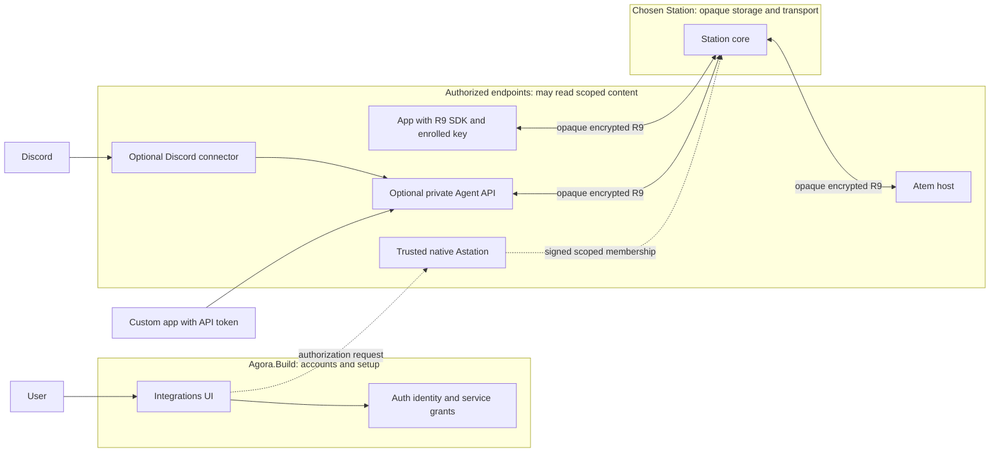

# Unified integrations and agent API access

Status: design draft for joint Portal, Auth, Station, Astation and Atem review,
2026-10-23. This document assigns proposed ownership and describes work to
build; it does not advertise deployed API endpoints or change the R9 contract.

## Product direction

Use one Agora.Build account page and one authorization model for built-in
connectors and custom applications:

```text
Account > Integrations
  Discord - My Server
  Custom App - My Dashboard
  Add Integration
    Discord
    Custom App / API
```

Discord is a preset of the same integration resource. A custom integration
can use a Bearer-token gateway or, as an advanced connection method, enroll
its own key and use the R9 SDK. Do not create a separate developer API-key
page. Future public OAuth application registration describes a developer's
application; each user's authorized connection still appears here.

Both first-party and third-party integrations receive explicit permissions,
expiry and revocation controls. The official Discord connector provisions
credentials automatically; a custom gateway client can copy an API token once.
Native Astation apps continue using account login and their own enrolled
device keys. Browser clients retain the existing native-approved companion
model; this proposal does not turn browsers into standalone native members.

## Recommended ownership

Agora.Build owns accounts and the integration setup experience. The user's
chosen Station owns private server-side storage and encrypted transport. Atem
and explicitly authorized clients own decryption and agent execution. A central
Agora.Build API must not become a required reader of private agent data.

### Private-data boundary

The user requires memory, vault data and user-stored credentials to remain on
their chosen private infrastructure, including a self-hosted Station or a
Station shared with friends. This is a data-custody requirement, separate from
which team writes a component or which repository contains it.

| Boundary | Allowed responsibility | Excluded responsibility |
| --- | --- | --- |
| Agora.Build / Auth backend | Account profile, login, provider authentication, integration catalog and explicitly saved relay registrations/opaque integration references. | No agent prompts/results, terminal content, memory/vault bodies, user vault secrets, account decryption keys or endpoint private keys. No proxying those plaintext payloads through the Portal backend. |
| Chosen Station core | Tenant-private opaque transport; ciphertext storage/sync; signed membership records and sealed recovery material. | No content decryption, plaintext agent HTTP API, API-token-derived device identity or power to sign membership. |
| Atem and enrolled native/direct clients | Decrypt authorized content, execute host operations and hold their protected keys. | Login alone cannot grant private-data access; a relay operator cannot enroll them. |
| Optional private Agent API / connector | A separately authorized decrypting endpoint on infrastructure chosen by the user; validate its API tokens and use its scoped service identity. | No automatic access to account K, memory, vault or credentials. Sharing a machine with Station grants no authority. |
| Discord or another third party | Receive only content explicitly sent through its authorized integration. | No implicit access to the rest of the private account or its secrets. |

"Stays on the relay" means the selected Station is the private server-side
store, with no duplicate private store on Agora.Build. Authorized clients still
need plaintext while using data. Local caches, exports, backups and any extra
server replica need explicit storage policy; do not promise the relay is the
only physical copy. Station stores synchronized confidential content encrypted;
plaintext storage with encryption off does not meet this privacy guarantee.
Changing this design does not enable encryption or erase old plaintext backups.

Authentication data used by Auth is distinct from credentials users put in a
vault. The existing Agora Console connection also uses Portal-managed provider
tokens and certificate APIs; it is not evidence that every kind of secret is
already confined to Station. Whether that existing provider integration meets
the desired custody rule needs its own review, without silently moving or
deleting the current credentials.

The Portal may present one Integrations UI while making authorized requests
directly to the selected private service. Private labels, target policies,
usage details and secrets need not be copied into its account database. A
browser remains an explicitly authorized endpoint under the companion model;
putting a page on agora.build does not grant its backend private-data access.

The recommended simple-API deployment is a separate service alongside the
chosen Station, or on other infrastructure the user trusts. It is optional:
native/direct R9 clients need only Station and Atem. A raw-token API that reads
and returns agent messages necessarily decrypts them somewhere; hosting that
endpoint centrally on Agora.Build would introduce an additional trusted reader
and must not be the default under this custody requirement. The implementation
team and packaging remain open for review; it is not a native-Mac dependency.

### Component assignment

| Component | Proposed implementation owner | Responsibility |
| --- | --- | --- |
| Integrations page and catalog | Portal / agora.build | One setup/management UI and catalog; fetch private integration details directly from the chosen service, without centralizing content or secrets. |
| Identity and delegated service login | Auth / auth.agora.build | Native OIDC, registered resource audiences/scopes, future public-app OAuth consent, and a supported machine/service grant for unattended routing. |
| Native integration authorization | Astation | Display the exact endpoint, keys, account/root, targets, permissions and expiry; require fresh owner confirmation; sign and durably publish through the shared R9 core. |
| Private API runtime and credential authority | Separate optional service; implementation owner under review | Run on user-chosen infrastructure; own scoped service keys/channels, issue/validate private API tokens, manage receipts/events and enforce revocation. |
| Official Discord connector | Separate optional connector; implementation owner under review | Discord OAuth/install/events, guild/channel/user policy and formatting, with a distinct scoped service identity per integration. May share the private API's operation layer; neither requires a running Mac. |
| Opaque transport and signed storage | Station / station.agora.build | Account-private routing, unchanged channel bytes, signed-log storage and delivery. Never issue agent authority or store gateway private keys/plaintext transcripts. |
| Host authority and protocol | Atem | Verify service membership, scope, expiry and key possession; enforce leases/receipts/approvals; provide the shared client and any agreed missing bindings/fixtures. |

The private API and Discord connector are application services. They may share
a deployment with Station, but credentials, logs, storage permissions and code
boundaries must remain separate from its opaque core. Colocation does not make
the Station operator an enrolled member, but an operator controlling the
gateway's machine can potentially read its plaintext/software keys. A shared
relay operator remains outside the content trust boundary only if the decrypting
service runs elsewhere or the user explicitly trusts that operator as well.
Process/container separation alone is not protection against its host admin.
No gateway hostname is selected by this draft. Choose its public origin and
registered audience with
the owners; do not reuse the Portal audience by assumption.

Self-hosting and sharing a Station must preserve separate accounts, roots,
storage namespaces and routing admission. Friends using one server do not
become members of each other's trusted device lists. The operator can observe
necessary routing/membership metadata and traffic timing/size, and can interrupt
service; it cannot derive decryption authority from operating the server.
Changing the relay does not reset trust, create membership or expose keys.
Migration, auth-resource registration and service delegation need explicit
support; this proposal does not claim arbitrary self-hosted deployments already
work with Auth or that a relay move is an automatic data migration.

## Architecture and privacy



Portal/Auth login permits account administration and routing visibility.
The native-signed service membership permits particular agent operations.
Neither one substitutes for the other. The gateway cannot grant itself more
authority by issuing an API token or changing its database.

The gateway is a decrypting R9 endpoint on the user's selected infrastructure.
It can read the requests/results it serves; the third-party app can read the
content returned to it. Discord also
receives content posted there. Explain this in the connection consent screen.
Direct SDK clients instead terminate encryption themselves. Station remains
unable to read R9 payloads in either path. Gateway authorization does not grant
account-wide memory/vault/credential keys or access to encrypted backups.

An existing desktop is needed only when it supplies the manager confirmation;
any enrolled native manager can do so. Once active, the gateway/connector and
Atem run independently of that Mac. An Atem host must still be reachable.

## One creation flow

1. Sign in to Agora.Build and choose Discord or Custom App / API.
2. Name the integration and select the R9 account/root, hosts, optional supported
   project/session constraints, operations and expiry. Default to minimal access.
   Proposed expiry default: 30 days; the agreed service maximum is 90 days.
3. Identify the endpoint. For hosted access, the gateway generates a dedicated
   service identity and retains its private key in protected server storage.
   A direct SDK client generates its own keys locally. Bind its public key and
   account/genesis to the authenticated setup request reviewed by the manager.
   Existing R9 has no separate service-enrollment possession-proof ceremony:
   the host first verifies possession through `sig_c` at channel admission.
   A claimed public key alone is not an active integration; do not describe
   the host-pairing ceremony as a service proof or invent another signed object.
4. A trusted native manager reviews and approves the exact request using fresh
   Touch ID, Face ID or the OS-supported password/passcode fallback. Bind the
   exact existing `add` or `set_roles` body, including the keys, principal,
   account/genesis, scopes, expiry and predecessor. Keep single-use setup context
   and endpoint-origin binding in the application workflow; they are not extra
   fields or a new service ceremony in R9. Verify the configured endpoint through
   TLS. A changed request or membership head invalidates the confirmation.
   Reuse the core's builders and verifier; missing transport/UI
   APIs require joint review, not new signatures.
5. Durably commit the signed authorization and provisioning state. Keep the
   integration pending until the relevant host has accepted its service identity.
   A committed log entry with an offline host is not proof that host is ready.
   The gateway verifies its own service `welcome` against the trusted chain/head
   including its membership entry; no new host-acknowledgment message is assumed.
6. Finish the connection: reveal a custom API token once, complete Discord's
   setup automatically, or deliver public enrollment metadata to the SDK client.
   Only an active authorization can expose usable agent access.

Account login alone can create a pending request, not activate it. When no
trusted manager is available, show pending authorization and the existing
recovery route. Do not replace native confirmation with a Portal checkbox.

Use one idempotent operation ID across the browser/native/gateway workflow.
Persist exact approved bodies and progress, resume after disconnect/restart,
and reconcile CAS conflicts through the existing core. There is no transaction
spanning all services: use durable stages and compensating cleanup. A failed or
abandoned provisioning step must never expose a usable unapproved credential.

Suggested display states are Awaiting approval, Provisioning, Waiting for host,
Ready, Paused, Expired, Revoking and Revoked. Keep connection health separate
from authorization: an offline host does not become revoked, and an available
gateway does not imply an active service grant.

## Credentials, refresh and validation

| Credential | Issuer and storage | Validation and lifetime |
| --- | --- | --- |
| Native login access/refresh tokens | Auth; access in memory, rotating refresh in device-only protected storage. | Portal or Station checks its own registered audience/scope. Existing serialized refresh and fresh-auth rules apply. |
| Custom gateway API token | Gateway, on behalf of an approved integration; secret delivered once, stored by the caller. Gateway retains a public ID and hash of a high-entropy random secret. | Gateway checks the token and current integration/credential status, target, operation and expiry. Expiry never exceeds signed service authorization. Send only in the Authorization header over HTTPS/WSS. |
| Service routing access token | Auth, through a proposed dedicated delegated service grant. | Station validates its own audience/scope and the authorized account binding. A short-lived routing token never replaces R9 proof. Exact registration/claims/issuance contract needs Auth review. |
| R9 service key and signed authorization | Service generates its key; an existing native manager signs its membership through the core. Private key stays at the gateway/connector or direct client. | Atem verifies the chain, scopes, expiry and possession. No manage/redelegation; at most 90 days, as in the existing service contract. |
| Discord bot/install credentials | Discord; retained only by the connector's secret store. | Discord credentials authenticate Discord interactions, not Atem access. Do not show/copy the shared Discord bot secret as a user's integration token. |

A raw API key can authenticate directly to the gateway; a separate token
exchange is unnecessary for the first custom-client API. It does not refresh
itself. Rotation issues a new credential within the existing authorization;
renewing or expanding R9 authorization needs native manager confirmation.
The official Discord integration need not mint a user-visible API token.
Renewal or narrowing through `set_roles` always fences the existing channel,
lease and queued work, even when it only extends expiry. Open a fresh channel
and reconcile uncertain receipts without replay; do not promise seamless renewal.
The verifier's 90-day check is relative to `signed_at`. The native signer must
use the current time, never forward-date it to stretch an authorization.

Short-lived service routing tokens may renew unattended within the approved
service delegation. Renewing a login token is not fresh user authentication
and cannot extend the signed service expiry. Account logout, disconnecting
Discord, token rotation and revoking R9 authorization are distinct actions;
the UI must say which action is being performed.

Auth/Station need an explicit service-to-account delegation contract before
unattended hosted access can ship. Current Station login maps a verified
`(issuer, subject)` to its account; a new service subject must not be treated as
the human subject, matched by email or supplied by an unsigned request field.
Agree how Auth attests the delegation and how Station validates it. Do not
copy a user's native refresh token to the gateway or invent `client_credentials`
support that Auth has not registered. This is an integration contract gap,
not a reason to change the R9 cryptographic identity model.

## Permissions and lifecycle

Use the same permissions for Discord and custom clients. R9 requires `view`,
which includes registry, chat/history, terminal subscription and receipt queries
within the selected target scope. A service grant cannot provide discovery-only
or chat-without-terminal-viewing access; consent must describe that whole read
capability. Gateway policy can further restrict what an API caller receives.
Sending prompts and answering approvals are optional operations. Interrupt/stop
and terminal input/resize are separate choices. File uploads, remote
process launch, vault access, device management and redelegation are not implied.
Map selections to the core's actual signed scope representation; do not invent
another scope language on the relay.

Session scopes bind actual process/session IDs and stop matching after agent
relaunch; never silently widen them. Project scopes use existing `h1.<kid>.`
hashes produced by a trusted native manager or host. Do not give account `K` to
the gateway to compute them. A locked host credential agent leaves project
comparison unavailable and affected sessions out of scope. Key rotation and
retained-generation behavior need explicit coverage before offering that filter.

Every request is limited by the intersection of the caller credential, current
integration policy and host-verified R9 authorization. An API token cannot widen
the service identity's grant. Prompt submission follows atomic acquire and
confirmed takeover; headless callers receive a conflict rather than silently
taking another client's control. Approval answers follow the existing lease-free
rules and exact pending request/rule identifiers.

Rotate a gateway token without re-enrolling an unchanged service key. Store token
generations and disable the selected old credential across replicas/streams;
offer an explicit bounded overlap if needed. Lost token-delivery responses never
cause secret replay from database storage: reconcile the created credential,
then explicitly replace it. Never persist raw tokens in an idempotency cache.

Revocation has two layers. The gateway can immediately disable its token and
stop its own work, including streams and queued dispatch. Native managers also
publish signed service removal for host-side enforcement, including direct SDK
access. Show pending cryptographic removal until it propagates. The R9 relay
can delay an unseen removal; this proposal does not promise instantaneous
host revocation or change the agreed propagation model. Apply removal to all
credentials of that service; revoke one raw token without removing unrelated
credentials/integrations. Expiry cannot be postponed by reconnect or restart.

## API shape and real-time events

Keep three API responsibilities explicit, even if deployments share a domain:

| API | Authenticates | Handles |
| --- | --- | --- |
| Agora.Build account API | Auth-issued account/admin grants for that resource. | Account and setup coordination; no private agent/data payloads. |
| Station data/transport API | Its registered routing/storage grants, plus existing signed/encrypted object checks. | Ciphertext storage/sync, signed records and opaque R9 transport; login is not decryption authority. |
| Optional private agent API | API credentials issued/validated by that private endpoint. | Scoped plaintext agent operations backed by its manager-authorized R9 service identity. |

The single Integrations UI is not a single shared API-token authority. A token
for Agora.Build must not work as a private agent API credential, and a private
agent token must not work as Station device proof or an account-admin token.

Proposed Portal management family: `/api/v1/integrations`. It owns account UI
references and setup coordination, not private content or a proxy to the agent.
Detailed private configuration and token issuance/validation belong to the
chosen private service's API. The native approval record and gateway
activation remain cryptographically verified product operations, not database
fields the browser can set to true. Portal authenticates its own session/token
and protects cookie-based writes against CSRF.

The gateway exposes its own versioned API for sessions, messages, approvals,
receipts and event subscriptions. Exact paths are a follow-up contract; these
methods are not new plaintext Station endpoints. Gateway admin OAuth tokens
must have its registered audience, never the Portal audience forwarded to an
arbitrary destination. Raw integration tokens are accepted only by the configured
gateway. Select and register resource origins before implementation.

HTTP callers submit prompts with a stable idempotency key. Persist its binding
to integration/principal, full R9 target, payload and request ID before effects.
Duplicates query/return the original receipt; uncertain delivery never creates
a new prompt. Use the host's accepted/executing/completed/rejected/outcome_unknown
semantics. Approval races, local-input precedence, leases, reconnect recovery
and generation fences continue using the shared client state machines.

Use WebSocket initially, with optional authenticated fetch/SSE for clients that
only need response events. Preserve Markdown, typed tool/approval parts, message
IDs and receipt states; whole-message updates are sufficient. Bounded history
and event cursors must distinguish resync from missing history. Do not put
long-lived API tokens in URLs. Public browser clients use their own OAuth/backend
session flow; do not embed a shared integration secret into distributed web or
mobile code. Ordinary EventSource/browser WebSocket limitations need a supported
authenticated adapter, not a query-string credential workaround.

The gateway handles plaintext as an endpoint, so retention needs a documented
policy. Default to no persisted transcript/prompt/tool body. Keep only the
minimal encrypted operational state needed for receipts/recovery, with defined
retention; logs, metrics, Portal summaries and idempotency indexes exclude raw
tokens, keys and agent content. Detailed retention limits belong in the gateway
API contract before implementation.

## Discord-specific behavior

The Connect Discord preset adds Discord OAuth state/callback handling, selected
guild/channel and allowed actor/role policy. Verify Discord's documented ingress
authentication and deduplicate interaction IDs. Installation alone does not
authorize everyone in that server to operate Atem. Bind each invocation to the
approved integration and allowed Discord actor/channel; never accept a Discord
message's claimed Agora account or R9 identity.

Connector credentials use the same agent-operation layer as custom API calls.
An authenticated Discord approval command still needs the exact current typed
approval and permission; model-generated links/text never create an approval.
Formatting adapts to Discord's limits without changing receipt meaning or
silently losing content. Separate integrations cannot share an R9 identity,
conversation scope or authority just because they use the same global bot.

## Implementation order and acceptance

1. Jointly review private-data custody, implementation ownership,
   service-to-account Auth admission and the private API endpoint/privacy
   contract. Retain separate Station registration and existing
   live R9 release gates; this design does not close them.
2. Implement one custom integration with native-approved service enrollment,
   hashed API credentials and the minimal gateway methods/events. Use the actual
   shared client/host, not a protocol replica. Native approval/control APIs and
   artifact gaps are handed to Atem; Astation does not edit Atem checkouts.
3. Prove a headless API client can read, submit and answer an approval with the
   original Mac offline. Exercise actual-host reconnect and replica failures.
4. Add Discord as a preset over that same authorization and operation layer.
5. Add public developer OAuth registration/consent when multi-user third-party
   products need it. Keep each user's grant in the same Integrations page.

Acceptance tests must include cross-account/host refusal; narrow operation scope;
wrong issuer/audience/service delegation; enrollment key/head substitution;
late/duplicate owner confirmation; crash between signing/publication/activation;
lost token response; expiry and token rotation across replicas; pending host;
revocation of a token versus a service; reconnect after durable prompt acceptance;
approval races; Discord actor/channel isolation and interaction replay; Mac-off
operation; two accounts sharing one Station without cross-account access; an
independently hosted Station/private API; and evidence that the opaque Station
core and Agora.Build backend receive no private plaintext or endpoint keys.

## Current shared-core constraints and review gaps

[Atem's service-path review](https://github.com/Agora-Build/Astation/issues/65#issuecomment-6376801806)
was checked against immutable host/core pin
`6526e1cf602f01ebc33893698c2b1d588c8f889e`. The
[contract](https://github.com/Agora-Build/Atem/blob/6526e1cf602f01ebc33893698c2b1d588c8f889e/designs/protocol/atem-session-v1.md)
and [bindings](https://github.com/Agora-Build/Atem/blob/6526e1cf602f01ebc33893698c2b1d588c8f889e/designs/protocol/atem-client-bindings.md)
remain authoritative. This review does not approve additional gateway authority
or request an R9 change.

- Services have no encryption key for push hints. The gateway receives approvals
  while attached; it cannot rely on native push delivery to wake it.
- Shipped bindings exclude `SoftwareKeyStore`. A hosted client needs its own
  protected key provider or the existing deferred-signature path. Typed service
  member/scope builders and a project-hash helper are absent; use the verifier's
  schema checks, never another wire/signature implementation. Select the server
  runtime and matching tested package after ownership review.
- Atem reports missing service binding coverage for admission/welcome, scope
  refusals and expiry, plus host scenarios for approval/seen, session and host
  restrictions, live renewal/narrowing, grant revocation, K rotation and refusal
  as a held-host reconciler. Add these to the joint acceptance plan; ordinary
  native or Rust bot success is insufficient binding/platform evidence.
- Under the current contract a service with control can `revoke_grant` browser
  companions on a permitted host even without a corresponding selected operation.
  The gateway API need not expose that method, but this does not narrow host
  authority of the service key. Keep this capability visible in the owner/security review and
  require a focused regression before activation; no narrower host guarantee
  is claimed by this draft.
- Logs allow at most 1,024 entries and 256 members; renewals/removals consume
  entries and IDs are not reused. Capacity planning and truthful exhaustion
  handling are required. Automatic re-pair, compaction or rollover is not
  authorized by this proposal.
- Service channels expire with their grant, subject to record/byte limits;
  the native channel's fixed 24-hour lifetime does not apply. The gateway can
  voluntarily close and establish a fresh handshake using the existing
  protocol. Its connection/receipt-recovery policy still needs review; this
  draft chooses neither a new host lifetime nor a default reconnect interval.

## Review and assignment requests

| Owner | Needed before implementation |
| --- | --- |
| Agora.Build / Portal | Own the single Integrations page/catalog, permitted account references and installation UX; define direct private-service setup without proxying or storing private content/secrets. |
| Auth | Specify service delegation and renewal, the exact API audiences/scopes and revocation behavior; distinguish owner account from service principal. Native PKCE login already exists. |
| Astation | Own native confirmation and signed service enrollment, trusted project-scope preparation and protected local state. No hosted plaintext gateway is assigned to the native app. |
| Station | Own private ciphertext storage/routing and account isolation for self-hosted/shared deployments; review separate optional API/connector packaging without merging its trust boundary into the core. |
| Private API / connector owner, to be assigned | Propose user-hosted deployment, key storage, provisioning/receipt persistence, raw-token lifecycle, endpoint and retention. A central Agora.Build decrypting service is not the default. |
| Atem | Confirm service scope/enrollment/SDK operations needed by the gateway against the current contract; identify missing bindings or fixtures. No R9 wire change is assumed or signed off here. |

Recommended assignment: Agora.Build builds account management and integration
setup; Station supplies the chosen private store and transport; Astation builds
native authorization; Atem supplies host/core capabilities. Assign the separate
private API/Discord implementation after reviewing its deployment and custody
requirements. Auth supplies supported identity/delegation contracts. Resolve
owner feedback here before turning proposals into API or deployment
requirements. No product code, production rollout or trust reset
is authorized by this design document.

## References

- [Remote agent API design](protocol/remote-agent-api.md)
- [Current independent API implementation](../docs/remote-api.md)
- [Account integration and trust boundary](protocol/account-identity-integration.md)
- [Agora.Build login and separate resource grants](../docs/agora-build-login.md)
- [Unified identity](../docs/specs/2026-10-10-unified-agora-build-identity.md)
- Atem coordination: [#81](https://github.com/Agora-Build/Atem/issues/81)
- Shared contract: [Atem #80](https://github.com/Agora-Build/Atem/pull/80)
