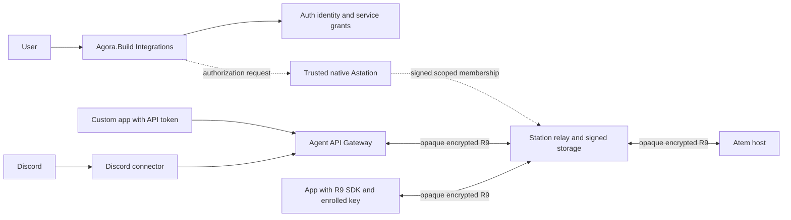

# Unified integrations and agent API access

Status: design draft for joint Portal, Auth, Astation and Atem review,
2026-10-23. This document assigns proposed ownership and describes work to
build; it does not advertise deployed API endpoints or change the R9 contract.

## Product direction

Use one Agora.Build account page and one authorization model for built-in
connectors and custom applications:

```text
Account > Integrations
  Discord - My Server
  Custom App - My Dashboard
  Add Integration
    Discord
    Custom App / API
```

Discord is a preset of the same integration resource. A custom integration
can use a Bearer-token gateway or, as an advanced connection method, enroll
its own key and use the R9 SDK. Do not create a separate developer API-key
page. Future public OAuth application registration describes a developer's
application; each user's authorized connection still appears here.

Both first-party and third-party integrations receive explicit permissions,
expiry and revocation controls. The official Discord connector provisions
credentials automatically; a custom gateway client can copy an API token once.
Native Astation apps continue using account login and their own enrolled
device keys. Browser clients retain the existing native-approved companion
model; this proposal does not turn browsers into standalone native members.

## Recommended ownership

Agora.Build owns the account-facing integration experience. The Astation
product owns agent execution access. Station remains an opaque relay.

| Component | Proposed implementation owner | Responsibility |
| --- | --- | --- |
| Integrations page and catalog | Portal / agora.build | List, create, name, permission/expiry forms, connection progress, usage summary, rotation/revoke UI and Discord installation entry point. |
| Identity and delegated service login | Auth / auth.agora.build | Native OIDC, registered resource audiences/scopes, future public-app OAuth consent, and a supported machine/service grant for unattended routing. |
| Native integration authorization | Astation | Display the exact endpoint, keys, account/root, targets, permissions and expiry; require fresh owner confirmation; sign and durably publish through the shared R9 core. |
| Integration runtime and credential authority | Astation Agent API Gateway | Own service keys and scoped R9 channels, issue/validate raw API tokens, execute allowed API operations, manage receipts/events, enforce token revocation and report sanitized status. |
| Official Discord connector | Astation integration backend | Discord OAuth/install/events, guild/channel/user policy and response formatting, with a distinct scoped R9 service identity for each integration. Share the gateway's agent-operation layer. |
| Opaque transport and signed storage | Station / station.agora.build | Account-private routing, unchanged channel bytes, signed-log storage and delivery. Never issue agent authority or store gateway private keys/plaintext transcripts. |
| Host authority and protocol | Atem | Verify service membership, scope, expiry and key possession; enforce leases/receipts/approvals; provide the shared client and any agreed missing bindings/fixtures. |

The gateway and Discord connector are application services. They may initially
share a deployment, but credentials, logs, storage permissions and code boundaries
must remain separate from Station's relay. No gateway hostname is selected by
this draft. Choose its public origin and registered audience with the owners;
do not reuse the obsolete Portal `api.agora.build` audience by assumption.

## Architecture and privacy



Portal/Auth login permits account administration and routing visibility.
The native-signed service membership permits particular agent operations.
Neither one substitutes for the other. The gateway cannot grant itself more
authority by issuing an API token or changing its database.

The gateway is a decrypting R9 endpoint. It can read the requests/results it
serves; the third-party app can read the content returned to it. Discord also
receives content posted there. Explain this in the connection consent screen.
Direct SDK clients instead terminate encryption themselves. Station remains
unable to read R9 payloads in either path. Gateway authorization does not grant
account-wide memory/vault/credential keys or access to encrypted backups.

An existing desktop is needed only when it supplies the manager confirmation;
any enrolled native manager can do so. Once active, the gateway/connector and
Atem run independently of that Mac. An Atem host must still be reachable.

## One creation flow

1. Sign in to Agora.Build and choose Discord or Custom App / API.
2. Name the integration and select the R9 account/root, hosts, optional supported
   project/session constraints, operations and expiry. Default to minimal access.
   Proposed expiry default: 30 days; the agreed service maximum is 90 days.
3. Identify the endpoint. For hosted access, the gateway generates a dedicated
   service identity and retains its private key in protected server storage.
   A direct SDK client generates its own keys locally. Verify possession through
   the existing shared-core enrollment ceremony; Portal never accepts a claimed
   public key as completed enrollment.
4. A trusted native manager reviews and approves the exact request using fresh
   Touch ID, Face ID or the OS-supported password/passcode fallback. Bind the
   keys, principal, account/genesis, scopes, expiry, nonces and predecessor as
   required by the R9 ceremony. Verify the configured endpoint through TLS and
   bind its origin to the setup request; do not insert an unsupported origin
   field into an R9 signed body. A changed request or membership head invalidates
   the confirmation. Reuse the core's builders and verifier; missing transport/UI
   APIs require joint review, not new signatures.
5. Durably commit the signed authorization and provisioning state. Keep the
   integration pending until the relevant host has accepted its service identity.
   A committed log entry with an offline host is not proof that host is ready.
6. Finish the connection: reveal a custom API token once, complete Discord's
   setup automatically, or deliver public enrollment metadata to the SDK client.
   Only an active authorization can expose usable agent access.

Account login alone can create a pending request, not activate it. When no
trusted manager is available, show pending authorization and the existing
recovery route. Do not replace native confirmation with a Portal checkbox.

Use one idempotent operation ID across the browser/native/gateway workflow.
Persist exact approved bodies and progress, resume after disconnect/restart,
and reconcile CAS conflicts through the existing core. There is no transaction
spanning all services: use durable stages and compensating cleanup. A failed or
abandoned provisioning step must never expose a usable unapproved credential.

Suggested display states are Awaiting approval, Provisioning, Waiting for host,
Ready, Paused, Expired, Revoking and Revoked. Keep connection health separate
from authorization: an offline host does not become revoked, and an available
gateway does not imply an active service grant.

## Credentials, refresh and validation

| Credential | Issuer and storage | Validation and lifetime |
| --- | --- | --- |
| Native login access/refresh tokens | Auth; access in memory, rotating refresh in device-only protected storage. | Portal or Station checks its own registered audience/scope. Existing serialized refresh and fresh-auth rules apply. |
| Custom gateway API token | Gateway, on behalf of an approved integration; secret delivered once, stored by the caller. Gateway retains a public ID and hash of a high-entropy random secret. | Gateway checks the token and current integration/credential status, target, operation and expiry. Expiry never exceeds signed service authorization. Send only in the Authorization header over HTTPS/WSS. |
| Service routing access token | Auth, through a proposed dedicated delegated service grant. | Station validates its own audience/scope and the authorized account binding. A short-lived routing token never replaces R9 proof. Exact registration/claims/issuance contract needs Auth review. |
| R9 service key and signed authorization | Service generates its key; an existing native manager signs its membership through the core. Private key stays at the gateway/connector or direct client. | Atem verifies the chain, scopes, expiry and possession. No manage/redelegation; at most 90 days, as in the existing service contract. |
| Discord bot/install credentials | Discord; retained only by the connector's secret store. | Discord credentials authenticate Discord interactions, not Atem access. Do not show/copy the shared Discord bot secret as a user's integration token. |

A raw API key can authenticate directly to the gateway; a separate token
exchange is unnecessary for the first custom-client API. It does not refresh
itself. Rotation issues a new credential within the existing authorization;
renewing or expanding R9 authorization needs native manager confirmation.
The official Discord integration need not mint a user-visible API token.

Short-lived service routing tokens may renew unattended within the approved
service delegation. Renewing a login token is not fresh user authentication
and cannot extend the signed service expiry. Account logout, disconnecting
Discord, token rotation and revoking R9 authorization are distinct actions;
the UI must say which action is being performed.

Auth/Station need an explicit service-to-account delegation contract before
unattended hosted access can ship. Current Station login maps a verified
`(issuer, subject)` to its account; a new service subject must not be treated as
the human subject, matched by email or supplied by an unsigned request field.
Agree how Auth attests the delegation and how Station validates it. Do not
copy a user's native refresh token to the gateway or invent `client_credentials`
support that Auth has not registered. This is an integration contract gap,
not a reason to change the R9 cryptographic identity model.

## Permissions and lifecycle

Use the same permissions for Discord and custom clients. Start with session
discovery, reading chat/results, sending prompts, and optional approval answers.
Interrupt/stop and terminal control are separate choices. File uploads, remote
process launch, vault access, device management and redelegation are not implied.
Map selections to the core's actual signed scope representation; do not invent
another scope language on the relay.

Every request is limited by the intersection of the caller credential, current
integration policy and host-verified R9 authorization. An API token cannot widen
the service identity's grant. Prompt submission follows atomic acquire and
confirmed takeover; headless callers receive a conflict rather than silently
taking another client's control. Approval answers follow the existing lease-free
rules and exact pending request/rule identifiers.

Rotate a gateway token without re-enrolling an unchanged service key. Store token
generations and disable the selected old credential across replicas/streams;
offer an explicit bounded overlap if needed. Lost token-delivery responses never
cause secret replay from database storage: reconcile the created credential,
then explicitly replace it. Never persist raw tokens in an idempotency cache.

Revocation has two layers. The gateway can immediately disable its token and
stop its own work, including streams and queued dispatch. Native managers also
publish signed service removal for host-side enforcement, including direct SDK
access. Show pending cryptographic removal until it propagates. The R9 relay
can delay an unseen removal; this proposal does not promise instantaneous
host revocation or change the agreed propagation model. Apply removal to all
credentials of that service; revoke one raw token without removing unrelated
credentials/integrations. Expiry cannot be postponed by reconnect or restart.

## API shape and real-time events

Proposed Portal management family: `/api/v1/integrations`. It owns account UI
metadata and provisioning requests. The native approval record and gateway
activation remain cryptographically verified product operations, not database
fields the browser can set to true. Portal authenticates its own session/token
and protects cookie-based writes against CSRF.

The gateway exposes its own versioned API for sessions, messages, approvals,
receipts and event subscriptions. Exact paths are a follow-up contract; these
methods are not new plaintext Station endpoints. Gateway admin OAuth tokens
must have its registered audience, never the Portal audience forwarded to an
arbitrary destination. Raw integration tokens are accepted only by the configured
gateway. Select and register resource origins before implementation.

HTTP callers submit prompts with a stable idempotency key. Persist its binding
to integration/principal, full R9 target, payload and request ID before effects.
Duplicates query/return the original receipt; uncertain delivery never creates
a new prompt. Use the host's accepted/executing/completed/rejected/outcome_unknown
semantics. Approval races, local-input precedence, leases, reconnect recovery
and generation fences continue using the shared client state machines.

Use WebSocket initially, with optional authenticated fetch/SSE for clients that
only need response events. Preserve Markdown, typed tool/approval parts, message
IDs and receipt states; whole-message updates are sufficient. Bounded history
and event cursors must distinguish resync from missing history. Do not put
long-lived API tokens in URLs. Public browser clients use their own OAuth/backend
session flow; do not embed a shared integration secret into distributed web or
mobile code. Ordinary EventSource/browser WebSocket limitations need a supported
authenticated adapter, not a query-string credential workaround.

The gateway handles plaintext as an endpoint, so retention needs a documented
policy. Default to no persisted transcript/prompt/tool body. Keep only the
minimal encrypted operational state needed for receipts/recovery, with defined
retention; logs, metrics, Portal summaries and idempotency indexes exclude raw
tokens, keys and agent content. Detailed retention limits belong in the gateway
API contract before implementation.

## Discord-specific behavior

The Connect Discord preset adds Discord OAuth state/callback handling, selected
guild/channel and allowed actor/role policy. Verify Discord's documented ingress
authentication and deduplicate interaction IDs. Installation alone does not
authorize everyone in that server to operate Atem. Bind each invocation to the
approved integration and allowed Discord actor/channel; never accept a Discord
message's claimed Agora account or R9 identity.

Connector credentials use the same agent-operation layer as custom API calls.
An authenticated Discord approval command still needs the exact current typed
approval and permission; model-generated links/text never create an approval.
Formatting adapts to Discord's limits without changing receipt meaning or
silently losing content. Separate integrations cannot share an R9 identity,
conversation scope or authority just because they use the same global bot.

## Implementation order and acceptance

1. Jointly review ownership, service-to-account Auth admission and the gateway
   endpoint/privacy contract. Retain separate Station registration and existing
   live R9 release gates; this design does not close them.
2. Implement one custom integration with native-approved service enrollment,
   hashed API credentials and the minimal gateway methods/events. Use the actual
   shared client/host, not a protocol replica. Native approval/control APIs and
   artifact gaps are handed to Atem; Astation does not edit Atem checkouts.
3. Prove a headless API client can read, submit and answer an approval with the
   original Mac offline. Exercise actual-host reconnect and replica failures.
4. Add Discord as a preset over that same authorization and operation layer.
5. Add public developer OAuth registration/consent when multi-user third-party
   products need it. Keep each user's grant in the same Integrations page.

Acceptance tests must include cross-account/host refusal; narrow operation scope;
wrong issuer/audience/service delegation; enrollment key/head substitution;
late/duplicate owner confirmation; crash between signing/publication/activation;
lost token response; expiry and token rotation across replicas; pending host;
revocation of a token versus a service; reconnect after durable prompt acceptance;
approval races; Discord actor/channel isolation and interaction replay; Mac-off
operation; and evidence that Station has no plaintext or endpoint private keys.

## Review and assignment requests

| Owner | Needed before implementation |
| --- | --- |
| Portal | Accept ownership of the single Integrations page/catalog, metadata and OAuth installation UX; propose its management API and native handoff. |
| Auth | Specify service delegation and renewal, the exact API audiences/scopes and revocation behavior; distinguish owner account from service principal. Native PKCE login already exists. |
| Astation | Own native service enrollment and the gateway/connector application boundary; propose key storage, provisioning/receipt persistence, raw-token lifecycle, deployment origin and retention limits. |
| Station | Confirm routing/privacy/storage integration for delegated services while remaining an opaque relay. This stays within Astation's relay ownership. |
| Atem | Confirm service scope/enrollment/SDK operations needed by the gateway against the current contract; identify missing bindings or fixtures. No R9 wire change is assumed or signed off here. |

Recommended assignment: Portal builds the user-facing management surface;
Astation builds native authorization and agent gateway/Discord behavior;
Auth supplies supported identity/delegation contracts; Atem supplies host/core
capabilities. Resolve owner feedback here before turning proposals into API
or deployment requirements. No product code, production rollout or trust reset
is authorized by this design document.

## References

- [Remote agent API design](protocol/remote-agent-api.md)
- [Current independent API implementation](../docs/remote-api.md)
- [Account integration and trust boundary](protocol/account-identity-integration.md)
- [Agora.Build login and separate resource grants](../docs/agora-build-login.md)
- [Unified identity](../docs/specs/2026-10-10-unified-agora-build-identity.md)
- Atem coordination: [#81](https://github.com/Agora-Build/Atem/issues/81)
- Shared contract: [Atem #80](https://github.com/Agora-Build/Atem/pull/80)
