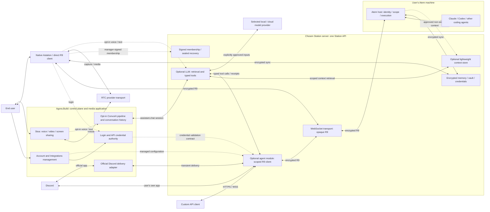

# Unified integrations and agent API access

Status: implementation started, 2026-10-24, following the owner's decisions in
the [Agora.Build companion](https://genie.netbird.cloud:44259/AGORA-BUILD-INTEGRATIONS.md).
The first Station increment is Auth validation and closed runtime admission;
integration execution is not yet enabled. This does not change the R9 contract
or authorize production deployment.

## Shared design and coordination

This is one shared design for **native Astation, Atem, Station API and
Agora.Build (Portal, Auth and Stoa)**. The current canonical source is this file
in the Astation repository, reviewed through
[Astation #65](https://github.com/Agora-Build/Astation/issues/65) and linked from
[Atem #81](https://github.com/Agora-Build/Atem/issues/81). Other components should
link to the shared revision instead of maintaining independent copies.

Pin the reviewed commit in cross-team handoffs, distinguish decisions from
future proposals and record which phase is being implemented. Agora.Build/Auth
contracts and any new Atem context/tool contracts require their owners' review.
The existing signed R9 contract remains authoritative for wire/security behavior;
this document neither expands current service scopes nor replaces that review.
Keep Portal/Auth and joint Atem handoff vaults aligned with the same revision.

The companion records D1-D23 and the Portal/Auth work, not a second system
architecture. Its 2026-10-24 snapshot has SHA-256
`2882551f944cf98a0cf39a18187884267c6bb1f11266ad544c73812ca815c8a0`.
The [Auth/Station admission contract](protocol/station-auth-validation.md)
describes the first implementation and the remaining live interoperability gate.

## Product direction

Use one Agora.Build account page and one authorization model for built-in
connectors and custom applications:

```text
Account > Integrations
  Discord - My Server
  Custom App - My Dashboard
  Add Integration
    Discord
    Custom App / API
```

Discord is a preset of the same integration resource. A custom integration
can use the Station API with a Bearer token or, as an advanced connection method,
enroll its own key and use the R9 SDK. Do not create a separate developer API-key
page. Future public OAuth application registration describes a developer's
application; each user's authorized connection still appears here.

Both first-party and third-party integrations receive explicit permissions,
expiry and revocation controls. The official Discord connector provisions
credentials automatically; a custom client retains its own private assertion
key and obtains five-minute Auth access tokens. Agora.Build stores public keys,
not the client's private key. Browser-generated keys are downloaded once and
never uploaded to Portal/Auth.
Native Astation apps continue using account login and their own enrolled
device keys. Browser clients retain the existing native-approved companion
model; this proposal does not turn browsers into standalone native members.

## Ownership and Station API

Agora.Build is the control plane: account/login/API authentication, integration
management and RTC/screen-sharing through Stoa. Station is the data plane on
the user's chosen server: private encrypted storage, R9 transport and runtime
agent-operation handlers behind one **Station API**. Native Astation supplies
manager confirmation; Atem verifies R9 authority and executes host operations.

Station validates credentials and applies authorized runtime configuration; it
does not become another identity provider, API-credential issuer or integration
management backend. Agora.Build manages the connection without proxying private
content through its backend.

Expose one Station API rather than requiring another publicly named service
or a separate gateway deployment. Implement agent integrations as a module in
the existing Rust Station server, using the shared `atem-client` crate. One
Station deployment and API origin can serve all modules on a registered custom
Station. The public `station.agora.build` remains an opaque relay/encrypted
store; it never runs decrypting MCP, LLM or agent modules.

### What handles R9

There are two R9 responsibilities inside Station:

- **Transport:** existing WebSocket handlers carry encrypted R9 envelopes between
  native/direct clients and Atem. They do not hold endpoint keys or decrypt the
  channel. Atem authenticates the client and handles the host side of R9.
- **Agent integrations:** an optional module accepts ordinary HTTP/WebSocket API
  calls or Discord interactions and uses `atem-client` as an R9 endpoint. It
  holds a separate service identity for each authorized integration and reads
  that integration's permitted agent requests/results.

R9 service identities are protected durable state of the agent module, not
another public service users must deploy. The module must still authenticate
to Atem through R9, even when it shares a process with the transport. No internal call may skip
membership, scope, expiry, lease, receipt or generation checks.

### Private-data boundary

The user requires memory, vault data and user-stored credentials to stay on
chosen Station infrastructure, including self-hosted or friend-shared servers.
Agora.Build must not become another private-content store or a mandatory
plaintext agent proxy.

| Component | Responsibility and access |
| --- | --- |
| Agora.Build / Auth backend | Account/login/API authentication, integration-management metadata/workflows, API credential lifecycle, catalog and explicitly saved relay registrations. No private agent payloads, memory/vault bodies, user vault secrets, account decryption keys or endpoint private keys. |
| Agora.Build / Stoa | Meetings, voice/video, screen-sharing UI, room/media APIs and provider integration. Media uses its dedicated RTC transport, outside Station's R9 relay/storage path. |
| Station relay and storage modules | Tenant-private ciphertext storage/sync, signed membership records, sealed recovery material and opaque R9 transport. No endpoint keys or content decryption. |
| Station agent module | Validate Agora.Build/Auth-issued integration credentials; hold scoped R9 service keys; handle authorized chat, approvals, receipts/events and Discord operations. This module can read its permitted agent content. It receives no account K or automatic memory/vault/credential access. |
| Native Astation and direct R9 clients | Hold their protected device keys and decrypt authorized content. Native managers review/sign exact enrollment requests. |
| Atem host | Verify membership and operation scope, enforce control/receipts/approvals and execute host operations. |
| Discord / third-party callers | Receive content explicitly sent through their permitted integration; no implied access to the rest of the private account. |

The Agora.Build backend boundary above covers normal account/control services.
The future assistant is separately optional: explicit user consent can authorize
a disclosed hosted assistant/model endpoint to receive selected non-secret
context, as described below. It never implicitly changes the control-plane
storage policy or grants plaintext credential access.

"Stays on Station" defines the private server-side store. Authorized clients
still need plaintext while using data. Local caches, exports, backups and any
additional replica require explicit storage policy; this is not a promise that
Station is the only physical copy. Confidential synchronized content must be
encrypted. Encryption-off storage and retained old plaintext backups do not meet
that confidentiality guarantee; this design neither changes their mode nor
claims to erase old copies.

Auth's own authentication/provider credentials are distinct from user vault
secrets. The existing Agora Console connection uses Portal-managed provider
tokens and certificate APIs. Whether that provider integration meets the desired
custody rule needs separate review; do not silently move/delete credentials or
claim that all existing secret-handling paths already satisfy it.

### Self-hosted and shared deployments

Use the same Station server/package for both deployments:

- **Relay and encrypted storage:** the agent module is disabled by default.
  Native/direct R9 clients work without giving Station decryption authority.
- **Agent integrations enabled:** the administrator makes the module available;
  each account must separately authorize its integrations through a trusted
  native manager. Installing/enabling the module enrolls nobody and grants
  access to no account by itself.

Register a custom Station in Portal using proof of control at
`/.well-known/agora-build-station`. Auth registers its exact origin and allowed
accounts; initially only the registering owner may use it. Owners can invite
other accounts; open public/shared-relay discovery is deferred. Each account
configures that relay in Astation/Atem without fallback to the public default.

Settings > Station AI has independent MCP, LLM and Agent switches, all off by
default, with explicit feature/Station/provider consent and Off/Starting/On/Error
states. Any enabled switch sets whole-account relay-only transport. Astation
sends the authenticated `transportPolicy` message after authentication and on
change; Atem durably saves the pairing-bound value and acknowledges it. Only
then is a direct link closed. Refuse affected direct Atem connections on port
8080 while enabled; preserve the shared local listener/HTTP API and credential
unlock/sync behavior. Lost ACKs/reconnects must be reconciled, not presented as
a completed account-wide transition. Native and host implementation is pending.

Enabling an integration explicitly trusts the selected Station as a decrypting
endpoint for that integration's scoped agent content. An administrator who
controls that machine may read its plaintext/software service keys. Module,
process or container separation does not protect against the host administrator.
The relay/storage handlers remain opaque, but a Station running an authorized
agent integration must not be advertised as blind to that integration's content.

Friends sharing one Station keep separate accounts, roots, namespaces, API
credentials and service identities. Using the same server does not add users
to each other's trusted device lists. If the shared server's operator must
remain outside the content trust boundary, leave agent integrations disabled
for that account and use a native/direct R9 client, or an integration on another
trusted Station. Remote integration placement still needs supported routing and
Auth admission; no copied user refresh token or new trust bypass is implied.

The relay operator can observe necessary routing/signed-log metadata and traffic
size/timing, and can interrupt service. Moving to another Station does not reset
trust, enroll a device or automatically migrate private data. Self-hosted/shared
Auth-resource registration and migration need explicit support and validation.

### Component assignment

| Component | Owner | Responsibility |
| --- | --- | --- |
| Integrations management | Agora.Build / Portal | One UI/management API, catalog, permitted configuration metadata, creation/rotation/revoke workflows and Discord install coordination. Fetch private runtime details directly from the chosen Station; do not centralize private content or user vault secrets. |
| Identity, API credentials and delegated service login | Agora.Build / Auth | Native OIDC, API credential issuance/rotation/revocation, verification contract, registered resource audiences/scopes, service-to-account delegation/renewal and future public-app OAuth consent. |
| RTC and screen sharing | Agora.Build / Stoa | Voice/video/meeting/screen-sharing application and media APIs. Native platforms provide capture/client capabilities; Station is not the RTC application or media relay. |
| Native integration authorization | Astation | Show the selected Station endpoint, exact keys/account/root/targets/permissions/expiry; require fresh manager confirmation; sign/durably publish through the shared core. |
| Station API, including agent integrations | Station server, maintained on the Astation side | Existing encrypted routing/storage plus credential validation, protected scoped service keys, agent execution handlers, receipts/events and Discord runtime adapter. Apply management decisions from Agora.Build with explicit authenticated account binding; keep tenant/module state isolated. |
| Host authority and protocol | Atem | Verify membership, scope, expiry and possession; enforce host operations; supply the shared client/core and reviewed missing helpers/fixtures. |

## Architecture and privacy



This is the whole target design, including future modules. Dashed assistant/
context paths require separate explicit opt-in and source permissions; they
are not existing transports or extra R9 message definitions. An authorized
context or agent handler may read its permitted data; the relay/storage paths
remain opaque. Credential payloads never flow into the context/model paths.
The agent/LLM/MCP nodes require a registered custom Station; they do not run on
`station.agora.build`. The official Discord adapter sees interactions/replies
transiently. The explicitly enabled voice pipeline receives audio/transcripts/
replies and stores conversation history as described below; neither path gets
vault secrets or account K.

For native/direct clients, Station transports ciphertext and Atem handles the
R9 host endpoint. For integration API/Discord calls, Station's agent module is
the client endpoint and Atem remains the host endpoint. Decryption happens in
the authorized endpoint, never because a request passed through the relay.

Portal/Auth login grants account administration/routing visibility. Auth owns
API credential issuance; Station validates those credentials for its configured
resource and applies the granted account/integration scope. The
native-signed service membership grants particular agent operations. Neither
substitutes for the other. A token or management database change cannot widen
the service's host-verified R9 authority. Moving account/API authentication to
Agora.Build does not move native membership signing or Atem's cryptographic
verification to the login service.

Consent must name the selected Station and explain that its agent module reads
the integration's requests/results. Discord also receives content posted there.
This does not provide account-wide memory/vault/credential keys or encrypted
backup access. Keep direct/native channels separate from integration channels;
never terminate an existing native channel in the agent module.

Agora.Build stores the permitted integration-management metadata. Private labels
or runtime details that should remain on Station can be fetched directly from
its API rather than copied into the management database. A browser remains an explicitly authorized
endpoint under the companion model; putting a page on agora.build does not
grant the Portal backend private-data access.

Stoa and its RTC/screen-sharing functionality belong to Agora.Build. Keep media
room/session management and RTC provider transport separate from Station's
agent/data path. Native capture and authorized local RTC/RTM token generation
remain client capabilities; this design does not require an API request for
every locally generated media token.

Any enrolled native manager can confirm setup. After activation, Station and
Atem operate without that Mac online. A reachable Atem host remains necessary.

## One creation flow

1. Sign in to Agora.Build and choose Discord or Custom App / API.
2. Name the integration and select the R9 account/root, hosts, optional supported
   project/session constraints, operations and expiry. Default to minimal access.
   Proposed expiry default: 30 days; the agreed service maximum is 90 days.
3. Identify the selected Station endpoint. For API access, its agent module
   generates a dedicated service identity and retains its private key in
   protected server storage.
   A direct SDK client generates its own keys locally. Bind its public key and
   account/genesis to the authenticated setup request reviewed by the manager.
   Existing R9 has no separate service-enrollment possession-proof ceremony:
   the host first verifies possession through `sig_c` at channel admission.
   A claimed public key alone is not an active integration; do not describe
   the host-pairing ceremony as a service proof or invent another signed object.
4. A trusted native manager reviews and approves the exact request using fresh
   Touch ID, Face ID or the OS-supported password/passcode fallback. Bind the
   exact existing `add` or `set_roles` body, including the keys, principal,
   account/genesis, scopes, expiry and predecessor. Keep single-use setup context
   and endpoint-origin binding in the application workflow; they are not extra
   fields or a new service ceremony in R9. Verify the configured endpoint through
   TLS. A changed request or membership head invalidates the confirmation.
   Reuse the core's builders and verifier; missing transport/UI
   APIs require joint review, not new signatures.
5. Durably commit the signed authorization and provisioning state. Keep the
   integration pending until the relevant host has accepted its service identity.
   A committed log entry with an offline host is not proof that host is ready.
   The agent module verifies its own service `welcome` against the trusted
   chain/head including its membership entry; no new host acknowledgment is
   assumed.
6. Finish the connection through Agora.Build/Auth: issue/reveal a custom API
   credential, complete Discord setup automatically, or deliver public enrollment
   metadata to the SDK client. Station validates the API credential at runtime.
   Only an active authorization can expose usable agent access.

Account login alone can create a pending request, not activate it. When no
trusted manager is available, show pending authorization and the existing
recovery route. Do not replace native confirmation with a Portal checkbox.

Use one idempotent operation ID across the browser/native/Station workflow.
Persist exact approved bodies and progress, resume after disconnect/restart,
and reconcile CAS conflicts through the existing core. There is no transaction
spanning all services: use durable stages and compensating cleanup. A failed or
abandoned provisioning step must never expose a usable unapproved credential.

Suggested display states are Awaiting approval, Provisioning, Waiting for host,
Ready, Paused, Expired, Revoking and Revoked. Keep connection health separate
from authorization: an offline host does not become revoked, and an available
agent module does not imply an active service grant.

## Credentials, refresh and validation

| Credential | Issuer and storage | Validation and lifetime |
| --- | --- | --- |
| Native login access/refresh tokens | Auth; access in memory, rotating refresh in device-only protected storage. | Portal or Station checks its own registered audience/scope. Existing serialized refresh and fresh-auth rules apply. |
| Integration API credential | Agora.Build/Auth owns issuance, rotation, revocation and its protected credential records; the caller retains its issued bearer credential. Station does not mint a competing credential. | Station validates the supported Auth contract, selected Station audience/resource, account/integration binding, status, operation and expiry. Access never exceeds current signed R9 service authority. Send only in the Authorization header over HTTPS/WSS. |
| Integration/service access token | Auth, using `private_key_jwt` and `client_credentials`; owner `sub`, integration `client_id`, selected Station `aud`, scopes and `r9_svc`. | ES256 `at+jwt`, at most five minutes. Match `r9_svc` to the approved R9 service key and the owner/client to current Station policy. No native refresh token is copied. |
| R9 service key and signed authorization | Service generates its key; an existing native manager signs its membership through the core. Private key stays at the agent module/connector or direct client. | Atem verifies the chain, scopes, expiry and possession. No manage/redelegation; at most 90 days, as in the existing service contract. |
| Discord bot/install credentials | Discord; retained only by the connector's secret store. | Discord credentials authenticate Discord interactions, not Atem access. Do not show/copy the shared Discord bot secret as a user's integration token. |

A caller can use an Agora.Build/Auth-issued bearer access token with Station API
without implementing R9. Station verifies Auth's signed ES256 `at+jwt` locally
against discovery/JWKS, exact issuer/Station audience and route scope. There is
no Auth call per operation. Unknown key refreshes have a five-second shared
budget; known cached keys survive an Auth outage for at most one hour, without
extending token expiration. Successful JWKS replacement removes old keys.
Portal tokens, native-login tokens, integration tokens and future assistant
session tokens remain separate admission profiles. A token is not R9 identity.

Integration client-key rotation accepts old/new public keys at Auth for ten
minutes. Disabling the client prevents new tokens; issued tokens expire within
five minutes. Portal sends an unsigned poll hint with no authority; Station
never adopts its cursor or policy. Station polls the authenticated feed every
minute for pauses, revocations and account-access changes. A Station's own Auth
client reports with `station.report` to Portal. Browser private reads use a
five-minute token-exchanged `station.read` token and call Station directly with
Portal-origin CORS. Auth PR #9 and Portal PR #15 publish these contracts;
Station wiring and live verification remain required. Portal #16 tracks the
missing authenticated owner field and cursor-recovery rule.

Agora.Build manages credential rotation within existing authority; renewing or
expanding R9 authorization still needs native manager confirmation. The official
Discord integration need not reveal a user-visible API credential.
Renewal or narrowing through `set_roles` always fences the existing channel,
lease and queued work, even when it only extends expiry. Open a fresh channel
and reconcile uncertain receipts without replay; do not promise seamless renewal.
The verifier's 90-day check is relative to `signed_at`. The native signer must
use the current time, never forward-date it to stretch an authorization.

Short-lived service routing tokens may renew unattended within the approved
service delegation. Renewing a login token is not fresh user authentication
and cannot extend the signed service expiry. Account logout, disconnecting
Discord, token rotation and revoking R9 authorization are distinct actions;
the UI must say which action is being performed.

Auth attests service delegation with owner `sub`, integration `client_id` and
`r9_svc`. Station maps only the verified `(issuer, subject)` and matches the
complete binding to current approved policy. Do not derive the owner from email,
unsigned request fields or a service subject supplied by the caller. The
`private_key_jwt`/client-credentials grant, registered custom resources and exact
fingerprint/feed interoperability must be delivered and tested before live
activation. Published or merged source does not establish a deployed dev
grant; local signed test tokens do not establish production interoperability.

## Permissions and lifecycle

Use the same permissions for Discord and custom clients. R9 requires `view`,
which includes registry, chat/history, terminal subscription and receipt queries
within the selected target scope. A service grant cannot provide discovery-only
or chat-without-terminal-viewing access; consent must describe that whole read
capability. Agent module policy can further restrict what an API caller receives.
Sending prompts and answering approvals are optional operations. Interrupt/stop
and terminal input/resize are separate choices. File uploads, remote
process launch, vault access, device management and redelegation are not implied.
Map selections to the core's actual signed scope representation; do not invent
another scope language on the relay.

Session scopes bind actual process/session IDs and stop matching after agent
relaunch; never silently widen them. Project scopes use existing `h1.<kid>.`
hashes produced by a trusted native manager or host. Do not give account `K` to
the agent module to compute them. A locked host credential agent leaves project
comparison unavailable and affected sessions out of scope. Key rotation and
retained-generation behavior need explicit coverage before offering that filter.

Every request is limited by the intersection of the caller credential, current
integration policy and host-verified R9 authorization. An API token cannot widen
the service identity's grant. Prompt submission follows atomic acquire and
confirmed takeover; headless callers receive a conflict rather than silently
taking another client's control. Approval answers follow the existing lease-free
rules and exact pending request/rule identifiers.

Agora.Build/Auth can rotate an API credential without re-enrolling an unchanged
service key. Its supported validation/revocation contract must fence the selected
old credential across Station replicas/streams, with explicit overlap and stale
cache bounds. Lost credential-delivery responses require reconciliation and
explicit replacement, not secret replay from an idempotency cache. Raw bearer
secrets must not enter Station logs, management metadata or idempotency records.

Revocation has two layers. Agora.Build/Auth revokes API credentials/integrations;
Station applies the authenticated change to its streams and queued dispatch.
Define its acknowledgment/propagation guarantees before promising immediate
enforcement across offline replicas. Native managers also
publish signed service removal for host-side enforcement, including direct SDK
access. Show pending cryptographic removal until it propagates. The R9 relay
can delay an unseen removal; this proposal does not promise instantaneous
host revocation or change the agreed propagation model. Apply removal to all
credentials of that service; revoke one raw token without removing unrelated
credentials/integrations. Expiry cannot be postponed by reconnect or restart.

## API shape and real-time events

Expose one Station API with internally distinct route/authentication handlers:

| API surface | Authenticates | Handles |
| --- | --- | --- |
| Agora.Build account API | Auth-issued grants for that account resource. | Account/catalog/setup coordination; no private agent/data payloads. |
| Station API: transport/storage routes | Registered Station routing/storage grants and existing signed/encrypted object checks. | Ciphertext sync, signed records and opaque R9 transport. |
| Station API: agent/integration routes | Agora.Build/Auth-issued integration credentials for the selected Station resource. | Scoped plaintext agent operations through the module's native-authorized R9 service identity. No credential issuance or account-management API. |

One API origin does not make credentials interchangeable. An integration API
token cannot administer an account, access arbitrary encrypted storage or act
as R9 device proof. Agora.Build grants must not substitute for Station grants.
Keep token types/scopes and route admission explicit; no authentication fallback
between handlers.

Proposed Agora.Build management family: `/api/v1/integrations`. It owns permitted
integration metadata and create/configure/rotate/revoke workflows, with Auth
owning API credential issuance and the validation contract. Private runtime
configuration and agent payloads stay on the selected Station; agent operations
execute through Station API.
Native approval and service activation remain cryptographically verified
operations, not database fields the browser can set to true. Portal protects
cookie-based writes against CSRF.

Extend Station API with versioned sessions/messages/approvals/receipts/events
and authenticated runtime configuration/status ingress. Management belongs to
Agora.Build. Exact paths/errors are a follow-up contract;
existing opaque `/api/remote/v1` routes keep their semantics. New plaintext
agent routes must require the enabled, separately authorized agent module.
Register the selected Station audience/scopes before implementation; never
forward a Portal token to an arbitrary configured Station.

The module's route to Atem must preserve authenticated tenant binding, whether
implemented through existing WebSocket routing or reviewed in-process transport.
Packaging the module into Station does not settle Auth delegation or authorize
an unsigned account claim/internal admission bypass. Specify that binding and
recovery before enabling the module.

HTTP callers submit prompts with a stable idempotency key. Persist its binding
to integration/principal, full R9 target, payload and request ID before effects.
Duplicates query/return the original receipt; uncertain delivery never creates
a new prompt. Use the host's accepted/executing/completed/rejected/outcome_unknown
semantics. Approval races, local-input precedence, leases, reconnect recovery
and generation fences continue using the shared client state machines.

Use WebSocket initially, with optional authenticated fetch/SSE for clients that
only need response events. Preserve Markdown, typed tool/approval parts, message
IDs and receipt states; whole-message updates are sufficient. Bounded history
and event cursors must distinguish resync from missing history. Do not put
long-lived API tokens in URLs. Public browser clients use their own OAuth/backend
session flow; do not embed a shared integration secret into distributed web or
mobile code. Ordinary EventSource/browser WebSocket limitations need a supported
authenticated adapter, not a query-string credential workaround.

Station keeps operational state/receipts and every signed R9 log entry in its
Postgres, with append-only operational events/monthly partitions and account
JSON export. Private-content references/receipts stay encrypted; Redis remains
transient routing. The log archive is an availability backup, never authority.
Do not persist extra transcript/prompt/tool bodies without explicit source
consent. Logs, metrics and management metadata exclude tokens, private keys and
agent content. Normal retention is indefinite; account deletion blocks access
and revokes integrations immediately, then permanently deletes all account
data after 14 days across Portal/Auth/Station. Restoration during the window
does not revive revoked grants. Backups expire within 30 days and restores
consult deletion records. Station deletion ACK/retry/export contracts remain
implementation work.

## Discord-specific behavior

Agora.Build owns the Connect Discord installation/consent/configuration workflow,
including OAuth state/callback handling and the selected guild/channel/actor
policy. Station owns runtime delivery and the adapter to its R9 client; private
agent content is not stored in the Portal management database. The official
Agora.Build Discord app verifies/deduplicates ingress centrally and forwards it
to the selected custom Station; its bot secret stays at Agora.Build. Replies
pass back through that adapter for delivery, with no transcript retention.
Verify Discord's documented ingress
authentication and deduplicate interaction IDs. Installation alone does not
authorize everyone in that server to operate Atem. Bind each invocation to the
approved integration and allowed Discord actor/channel; never accept a Discord
message's claimed Agora account or R9 identity.

Connector credentials use the same agent-operation layer as custom API calls.
An authenticated Discord approval command still needs the exact current typed
approval and permission; model-generated links/text never create an approval.
Formatting adapts to Discord's limits without changing receipt meaning or
silently losing content. Separate integrations cannot share an R9 identity,
conversation scope or authority just because they use the same global bot.

After the official app, support the user's own Discord app with its Interactions
Endpoint on their Station. Provision its bot token and public key directly from
Station AI > Agent to the authenticated Station, encrypted at rest, never to
Agora.Build. Portal still manages allowed actors/channels/expiry/revocation and
labels it Own Discord app. Never distribute the official shared bot secret to
Station operators. Disclose which adapter receives interaction content.

## Implementation order and acceptance

The voice/assistant direction below is future work. It does not add release
gates to the current R9 transport/agent API increment or authorize implementing
every phase at once.

1. Implement the unified Station API admission/privacy contract, protected service
   storage, per-account activation and service-to-account Auth binding. Product
   runtime placement is Station; account/API authentication, management and
   Stoa/RTC belong to Agora.Build. D1-D23 settle owner policy; exact API/security
   formats and live execution still need implementation/conformance review.
   Retain separate Station registration and existing live R9 release gates;
   this design does not close them.
2. Implement one custom integration with native-approved service enrollment,
   Agora.Build/Auth credential issuance/validation and minimal Station runtime
   methods/events. Use the actual
   shared client/host, not a protocol replica. Native approval/control APIs and
   artifact gaps are handed to Atem; Astation does not edit Atem checkouts.
3. Prove a headless API client can read, submit and answer an approval with the
   original Mac offline. Exercise actual-host reconnect and replica failures.
4. Add Discord as a preset over that same authorization and operation layer.
5. Add public developer OAuth registration/consent when multi-user third-party
   products need it. Keep each user's grant in the same Integrations page.

The following roadmap places the current API increment at phase 1; build later
assistant phases one at a time. Context ingestion, model access and new tools
need their own reviewed contracts with Atem; they are not implied by today's
service grant.

Acceptance tests must include cross-account/host refusal; narrow operation scope;
wrong issuer/audience/service delegation; enrollment key/head substitution;
late/duplicate owner confirmation; crash between signing/publication/activation;
lost token response; expiry and token rotation across replicas; pending host;
Auth key rotation/outages and stale revocation/configuration caches;
revocation of a token versus a service; reconnect after durable prompt acceptance;
approval races; Discord actor/channel isolation and interaction replay; Mac-off
operation; two accounts sharing one Station without cross-account access; an
independently hosted Station; disabled/unenrolled-module refusals; cross-route
credential confusion; per-integration key isolation; direct/native channels
remaining opaque while an integration is active; and evidence that the relay/
storage handlers and Agora.Build backend receive no private plaintext or keys.

## Future direction: a conversational assistant for coding agents

The end user talks or writes to a dedicated assistant, rather than directly
addressing the underlying coding agent. The assistant understands the user's
projects and coding-agent state, discusses the work, retrieves relevant context
and uses tools to ask coding agents to act. Existing direct agent/API workflows
remain available; the assistant is another authorized caller of the same tools.

```mermaid
flowchart LR
    User[End user] <--> UI[Agora.Build / Stoa or native voice and text UI]
    UI <--> Voice[Agora.Build ConvoAI pipeline and consented history]
    Voice <-->|assistant.chat session| Assistant[Station LLM endpoint / selected model]
    Assistant <-->|scoped retrieval| Context[Lightweight context store on chosen Station]
    Assistant <-->|typed tool calls / receipts| API[Station API]
    API <-->|encrypted R9| Atem[Atem and coding agents]
    Atem --> Export[Approved context ingestion]
    Export --> Context
```



Agora.Build owns the assistant experience, configuration and orchestration
contract; Stoa supplies the relevant voice/media experience. Station holds
approved private context and provides retrieval/runtime operations. Atem owns
host-side context capture and coding-agent adapters. The inference/retrieval
runtime and selected model provider must be explicit authorized endpoints.
Station exposes OpenAI-compatible `/v1/chat/completions`, performs retrieval
and function calls internally, and uses the configured model. ConvoAI declares
no tools. Its LLM URL and Auth session token are fixed for a conversation;
the token has `assistant.chat`, the exact Station audience, integration and
`sid`, lasts at most 72 hours, and requires an active session on every call.
Session-end notices/polling revoke it. RTC/RTM tokens refresh in place every
20 minutes (30-minute expiry) without replacing the ConvoAI agent.

The user's custom model provider URL/model and write-only API key are provisioned
directly from Astation to Station. One encrypted key per account is shared by
its Astation devices; Astation retains no saved copy. Never put that key in
Portal/Auth, logs or context. The consent names the Station/operator and model
recipient. A Station-local model may use a local HTTP address; otherwise require
HTTPS. Station default/custom provider selection and a minimal through-Station
test are later UI/runtime implementation, not an enabled model proxy today.

Opt-in Agora.Build voice conversations retain transcripts/replies in Portal's
history: Basic 90 days, Premium indefinitely. After downgrade, older-than-90-day
history gets 30 days with warnings before deletion unless upgraded again.
Audio/transcripts/replies cross Agora's pipeline; retrieved context goes to the
chosen model and stays off Portal unless included in a reply. Disclose this
additional retained copy. The credential-export prohibition still applies.

### Explicit opt-in

This feature is off by default. The user explicitly enables it and selects
accounts/projects/sessions, source categories, context retention and the local
or cloud providers that may receive context/audio. Account login, pairing,
agent API access or ordinary screen sharing does not enable context collection
or assistant/model access.

The user can knowingly authorize a privacy tradeoff for selected context sent
to a selected cloud assistant/model endpoint, including a managed Agora.Build
assistant if offered. That endpoint is an additional disclosed data recipient,
separate from the ordinary account/control plane. Enabling it never authorizes
plaintext credential export. Canonical private storage stays on chosen Station;
any extra retained copy/provider retention must be explicitly described.

Disabling the feature stops new collection, retrieval/model calls and tool use
through that assistant. Define credential revocation, stored-context deletion
and provider retention separately; do not promise that disabling recalls data
already sent to a provider. Broader sources/provider changes require a new
explicit choice rather than silently widening the existing opt-in.

### Lightweight context store

Atem can capture more than a terminal transcript: current session/process state,
agent activity, prompts/responses, tool outcomes, durable receipts, project
documents and approved memory/vault context. Design the export with source IDs,
account/project/session scope, timestamps, versions and provenance so retrieval
can explain where a fact came from and whether it may be stale. Do not assume
all these sources are exposed by the current API.

Start with a place to hold approved context, not a required vector database or
embedding pipeline. Use small versioned records/files for current state,
summaries, recent events and document/source references, with simple scoped
list/read/search operations. Bound reads and select relevant context for each
conversation rather than sending the entire store on every turn. Reuse suitable
Station persistence after its encrypted-storage/access contract is reviewed.

Cloud upload initially means the selected Station infrastructure, which can be
self-hosted or shared. Upload only approved non-secret projections, using
encrypted transport/storage. A reader still needs explicit decryption authority;
adding retrieval to Station does not grant a shared operator plaintext access.
Specify context-key/runtime placement before enabling retrieval there.

Embeddings, semantic search and a richer RAG pipeline are later options if
simple context retrieval proves insufficient. Documents, summaries, future
indexes/embeddings and caches all remain private data with the same tenant,
access and retention requirements. Conventional server-side search cannot be
advertised as opaque solely because its source documents are encrypted.

**Credential invariant:** credentials from Atem/Astation are never decrypted
for context export or uploaded as plaintext. The uploader must not decrypt
credential payloads and then attempt to redact them. Assistant context may
contain safe credential references/metadata, never the credential values,
private keys or recovery material. Credential synchronization, where enabled,
must carry encrypted payloads; those payloads are not decrypted for export or
model-readable context.

Use allowlisted non-secret exports instead of uploading a whole credential
store/vault. When an approved operation needs a credential, resolve/use it at
the authorized execution endpoint without returning its value to the context
store, assistant, model or cloud tool arguments/results. Enabling the assistant
does not relax this rule. New context/tools need a separately scoped Atem
contract; today's agent service authority includes no memory/vault/credential
access or account K.

Sending retrieved context to a cloud LLM, embedding service or speech provider
is an explicit additional disclosure. Name the provider and selected data in the
configuration/consent flow; do not represent that content as remaining solely
on Station. Define retention, cache invalidation and source deletion before
rollout; later indexes need matching rebuild behavior. A local or self-hosted provider can preserve
a narrower deployment boundary.

### Tools and current state

Use the same typed Station API tools for listing sessions, reading status/history,
submitting prompts and handling permitted approvals. Add richer context tools
only after their source permissions and Atem contract are reviewed. Bind every
action to the authenticated user/integration and exact host/session/process,
with existing scopes, takeover confirmation, leases and durable receipts.
LLM output is a proposed tool invocation, never new authority or evidence that
an approval was granted. Retrieved documents and coding-agent output cannot
override those permissions.

The assistant can answer/discuss without acting. When acting, it checks fresh
host state; stored summaries are context, not authoritative live status. Reconnects
query uncertain receipts rather than resubmitting work. Voice and text use this
same path, including the existing confirmation rules for sensitive operations.

### Phased delivery

| Phase | Deliverable | Boundary |
| --- | --- | --- |
| 1. Agent APIs | Finish the current R9-backed text/session/chat/approval/receipt APIs and integration authentication. | Establish live correctness before adding an LLM intermediary. |
| 2. Lightweight context | Add source-scoped Atem export, Station context records and simple read-only retrieval. | Explicit opt-in, selected non-secret projections and provenance; no mandatory embeddings or vector database. |
| 3. Text assistant | Add a dedicated conversational LLM over retrieval and the existing typed tools. | Prove discussion, fresh-state checks, target selection, action confirmation and receipt recovery in text first. |
| 4. Voice assistant | Add speech input/output through the Agora.Build/Stoa or native client experience. | Users address the assistant; it uses tools to reach coding agents. Keep the same authority and a reviewable text/tool history. |
| 5. More clients/context | Extend mobile/Discord and additional approved sources/tools. | Review new source/secret permissions and provider disclosures individually; no blanket account-context access. |

Future acceptance includes disabled/no-consent refusal, changed/revoked opt-in,
cross-account/project retrieval isolation, stale or removed context, duplicate
ingestion, credential payloads never decrypted/exported, model/tool
prompt injection, denied/taken-over actions, uncertain receipts and voice/text
parity. These are future-phase tests, not evidence of implemented capabilities.

## Current shared-core constraints and review gaps

[Atem's service-path review](https://github.com/Agora-Build/Astation/issues/65#issuecomment-6376801806)
was checked against immutable host/core pin
`6526e1cf602f01ebc33893698c2b1d588c8f889e`. The
[contract](https://github.com/Agora-Build/Atem/blob/6526e1cf602f01ebc33893698c2b1d588c8f889e/designs/protocol/atem-session-v1.md)
and [bindings](https://github.com/Agora-Build/Atem/blob/6526e1cf602f01ebc33893698c2b1d588c8f889e/designs/protocol/atem-client-bindings.md)
remain authoritative. This review does not approve additional service authority
or request an R9 change.

- Services have no encryption key for push hints. The agent module receives
  approvals while attached; it cannot rely on native push delivery to wake it.
- Shipped bindings exclude `SoftwareKeyStore`. A hosted client needs its own
  protected key provider or the existing deferred-signature path. Typed service
  member/scope builders and a project-hash helper are absent; use the verifier's
  schema checks, never another wire/signature implementation. Station's Rust
  module should use the existing crate directly with protected per-integration
  keys; the FFI limitation remains relevant to external SDK clients. No new
  JVM/Node server runtime is required by this design.
- Atem reports missing service binding coverage for admission/welcome, scope
  refusals and expiry, plus host scenarios for approval/seen, session and host
  restrictions, live renewal/narrowing, grant revocation, K rotation and refusal
  as a held-host reconciler. Add these to the joint acceptance plan; ordinary
  native or Rust bot success is insufficient binding/platform evidence.
- Under the current contract a service with control can `revoke_grant` browser
  companions on a permitted host even without a corresponding selected operation.
  The agent module API need not expose that method, but this does not narrow host
  authority of the service key. Keep this capability visible in the owner/security
  review and require a focused regression before activation; no narrower host
  guarantee is claimed by this draft.
- Logs allow at most 1,024 entries and 256 members; renewals/removals consume
  entries and IDs are not reused. Capacity planning and truthful exhaustion
  handling are required. Automatic re-pair, compaction or rollover is not
  authorized by this proposal.
- Service channels expire with their grant, subject to record/byte limits;
  the native channel's fixed 24-hour lifetime does not apply. The agent module can
  voluntarily close and establish a fresh handshake using the existing
  protocol. Its connection/receipt-recovery policy still needs review; this
  draft chooses neither a new host lifetime nor a default reconnect interval.

## Review and assignment requests

| Owner | Implementation and conformance work |
| --- | --- |
| Agora.Build / Portal | Integration management UI/API, permitted metadata and Discord installation/consent; direct setup with chosen Station runtime without proxying/storing private content or user vault credentials. |
| Agora.Build / Auth | Implement D1-D4/D15/D17: dynamic clients, private-key assertions/client-credentials, registered Station resources/accounts, signed owner/service binding, rotation and browser exchange. Publish byte-level fingerprint vectors and dev interoperability evidence. Native PKCE exists. |
| Agora.Build / Stoa | RTC/meeting/screen-sharing application, media APIs and provider integration, separate from Station's agent/data transport. |
| Astation native | Exact manager-confirmed service enrollment, trusted project-scope preparation and protected local state. |
| Station server / Astation team | Unified transport/storage/runtime handlers, Auth credential validation, protected per-integration R9 service keys, authenticated management-change application, receipt persistence, tenant/route isolation and Discord runtime delivery. No account/credential issuer or RTC application. |
| Atem | Confirm service/client operations against the current contract, provide agreed missing helpers/fixtures and review service conformance. No wire change is assumed. |

Station owns integrated transport/storage/runtime APIs; Agora.Build owns account
and API authentication, integration management and Stoa/RTC/screen sharing.
Native Astation owns manager approval; Atem owns host/core.
The user authorized implementation from both documents on 2026-10-24. D1-D23
settle the earlier owner-policy questions, including retention and credential
lifetimes. The fingerprint definition and published issuance/feed contracts
are consumed by the [integration components](protocol/station-integration-lifecycle.md).
The owner/recovery feed follow-up, native/provisioning/runtime wiring and
current shared-core constraints remain technical implementation/security
gates. No expanded R9 authority, live trust reset or production rollout follows
from starting this work. Main merges still require user approval.

## References

- [Remote agent API design](protocol/remote-agent-api.md)
- [Auth and Station admission](protocol/station-auth-validation.md)
- [Agora.Build companion: D1-D23 and delivery](https://genie.netbird.cloud:44259/AGORA-BUILD-INTEGRATIONS.md)
- [Current independent API implementation](../docs/remote-api.md)
- [Account integration and trust boundary](protocol/account-identity-integration.md)
- [Agora.Build login and separate resource grants](../docs/agora-build-login.md)
- [Unified identity](../docs/specs/2026-10-10-unified-agora-build-identity.md)
- Atem coordination: [#81](https://github.com/Agora-Build/Atem/issues/81)
- Shared contract: [Atem #80](https://github.com/Agora-Build/Atem/pull/80)
