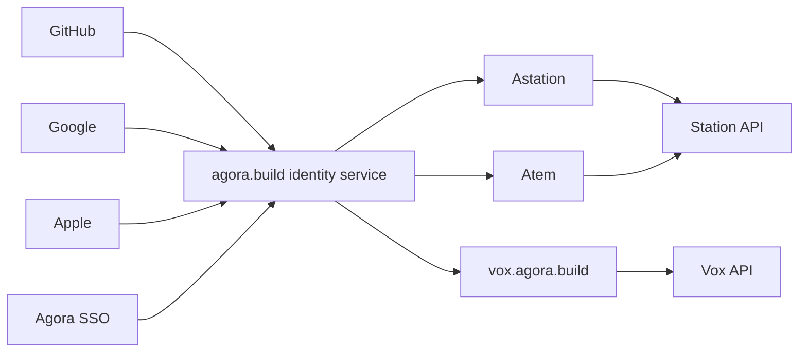

# Unified agora.build Identity

Status: approved architecture. The identity service and Portal are implemented;
Astation now uses their OIDC login and linked Agora project API. See the
[current login guide](../agora-build-login.md) for configurable dev URLs,
confirmed API shapes and remaining registration/live-verification requirements,
and the [account integration design](../../designs/protocol/account-identity-integration.md)
for trust boundaries. The permanent subject format is now
`ab` plus a 26-character Crockford ULID; no existing identity is silently renamed.

## Goal

Give Astation, Atem, Vox, and future agora.build products one account and a
shared browser sign-in experience. Users can sign in with GitHub, Google,
Apple, or Agora, and explicitly link multiple providers to the same account.
Agora.build owns the permanent account identity; upstream providers supply
ways to authenticate that identity.

The shared identity service implements the registered OIDC contract. Products
use its discovery, client registration and resource scopes. Provider support,
backups, upgrades, recovery, availability and deployment ownership belong to
the Auth service. Agora resource access remains an explicitly authorized
Portal connection; a provider's public website is not an authentication API.

## Account ownership and linking

The identity service creates an opaque permanent agora.build account ID. Each
upstream identity is recorded under its provider namespace and immutable user
ID; for OIDC providers this is the exact `(issuer, subject)` pair. A provider
identity can belong to only one agora.build account. Changing email, display
name, or linked providers does not change the agora.build account ID.

Linking requires an authenticated agora.build session, recent authentication,
and proof of control of the new provider identity. Never automatically link
accounts just because their emails match, including verified emails. Apple
private-relay addresses and provider-specific usernames are profile data.
Unlinking must leave a usable sign-in or recovery method. Existing separate
accounts require an explicit account merge with appropriate approval; adding
a provider must not silently merge product data.

First-party products need a consistent account ID. Configure the OIDC issuer
to provide a stable common `sub` to the registered first-party clients, or
map pairwise subjects through the identity service to its permanent internal
account ID. Do not assume subjects issued to different clients are equal.

## Product authentication

Register separate clients for Astation, Atem, and Vox. Product APIs accept only
credentials issued by the agora.build identity service for their documented
audience and scopes. Identity and product authorization remain separate:
sharing a login does not grant access to every product, organization, or team.

| Consumer | Intended flow |
| --- | --- |
| Astation native app | System-browser authorization code with PKCE S256 and a validated loopback callback; public client without an embedded client secret. |
| Atem CLI | Browser authorization code with PKCE when practical, or OAuth device authorization for a remote/headless machine. Preserve explicit Astation pairing where device trust is required. |
| Vox web app | Authorization code with PKCE through a backend, with a product-scoped Secure/HttpOnly session cookie. Keep refresh credentials on the backend. |
| Product APIs | Validate identity-service access tokens, API audience, lifetime, scopes, and applicable organization/product permissions. |

Browser SSO comes from the identity service's session. Each web product gets
its own session; sharing a cookie across every `*.agora.build` subdomain is
unnecessary. Register exact web redirect URIs and the native loopback behavior
supported by the provider. Validate OAuth state and, when using OIDC ID tokens,
nonce and ID-token claims. ID tokens identify a login to a client; they are not
API access tokens.

For signed JWT access tokens, APIs verify signatures with keys discovered from
the explicitly configured trusted issuer. Pin the issuer and accepted
algorithms, validate the intended audience and expiry, and handle key rotation.
Do not trust a token-selected issuer or key URL. An opaque-token deployment
instead needs the provider's supported introspection contract. Account disable,
logout, session revocation, and refresh-token rotation need explicit lifecycle
semantics; locally validated access tokens may remain usable until expiry.

Atem remains an ephemeral client. Completing an accepted operation must not
depend on keeping its login process or WebSocket alive indefinitely. Product
handlers commit accepted work durably and provide bounded acknowledgments and
safe retry/reconnect behavior.

## Agora service connections

Signing in through Agora can establish an agora.build identity once the
approved federation contract is implemented. Accessing Agora projects, billing,
or service APIs remains a separately authorized provider connection with its
own scopes, access/refresh tokens, and revocation lifecycle.

An agora.build token must not be sent to the Agora BFF as an Agora access token.
Users signing in through GitHub, Google, or Apple may connect an Agora account
later when a product feature needs it. Treat provider credentials separately
from product login sessions and grant them only to approved consumers.

## Device trust and encryption

The identity service is authoritative for the agora.build login identity and
session status. Astation's approved device keys, signed account state, and
recovery protocol remain authoritative for E2EE device trust and key access.

- Logging in, linking a provider, or resetting an SSO password must not approve
  a new device, release account encryption keys, or decrypt existing data.
- A new Atem device still needs the documented pairing, safety-code, and
  Astation approval process, or a separately designed cryptographic recovery
  flow. SSO recovery and E2EE recovery are different operations.
- The relay validates account credentials and enforces access controls. It
  must not invent device identity or authorize an encryption-state transition
  without the required device proof and migration prerequisites.
- Session logout and device revocation have separate effects. Disabling a
  login does not erase keys already held by an approved device; revocation
  must follow the E2EE protocol and its key-rotation rules.

## Legacy configuration decision

Leave `AGORA_ACCOUNT_USERINFO_URL`, `AGORA_ACCOUNT_SUBJECT_FIELD`, and
`AGORA_ACCOUNT_AUTH_TIME_FIELD` unset while the unified service is built.
They are optional Agora-specific relay settings, not requirements the portal
team must satisfy to build agora.build SSO. Ordinary pairing, sync, and E2EE
can operate without this registration feature.

| Legacy setting | Intended replacement |
| --- | --- |
| `AGORA_ACCOUNT_USERINFO_URL` | Trusted agora.build issuer and API audience, with access-token validation through issuer signing keys/JWKS or supported introspection. |
| `AGORA_ACCOUNT_SUBJECT_FIELD` | The permanent agora.build account identity defined by the new SSO contract; preserve issuer/subject namespaces when binding identities. |
| `AGORA_ACCOUNT_AUTH_TIME_FIELD` | Fresh-authentication proof for sensitive actions that require it, using the new provider's documented semantics. Separate this from device approval and E2EE recovery. |

Do not configure a guessed Agora userinfo endpoint as a temporary dependency.
Retain the existing compatibility implementation until the replacement and
data/account migration are verified, then remove its settings and code as part
of that migration. The replacement uses `ACCOUNT_OIDC_ISSUER`,
`ACCOUNT_OIDC_AUDIENCE` and `ACCOUNT_OIDC_REQUIRED_SCOPE` on the relay, with the
matching registered native client/resource/scope in the app. Actual service
availability and Astation registration still require verification.

## Migration from the current implementation

Legacy Astation service sessions used Agora-specific OAuth paths, client ID
`atem`, and scopes `basic_info,console`. New native account login uses agora.build;
legacy sessions are retained only for existing credential consumers. The relay's optional `AGORA_ACCOUNT_*` verifier accepts
an Agora bearer token and a single subject string; the database calls that
field `agora_user`. Those names and interfaces are compatibility behavior,
not the target unified-account design.

1. Define and deploy the identity service, its stable account-ID contract, and
   separate product clients. Test one provider end to end before adding more.
   Leave optional relay account registration disabled in the meantime.
2. Introduce issuer-aware account verification and neutral configuration.
   Prefer standard issuer discovery and JWT verification or introspection over
   a configurable provider-specific userinfo field. Reject tokens from
   different issuers/audiences even if their subject strings match.
3. Introduce permanent internal principals and unique issuer/subject bindings
   with a transactional migration. Inventory any existing registrations and
   pending merge requests; do not relabel existing `agora_user` values as new
   subjects. Existing Agora accounts require an explicit verified binding to
   an agora.build account, without email-based matching.
4. Adapt Astation and Atem login and token storage for the selected provider.
   Simply pointing `ASTATION_SSO_URL` at the new host is insufficient: the
   current endpoints, scope, client registration, and token consumers are
   Agora-specific. Keep separately consented Agora service connections working.
5. Preserve existing data-account IDs, paired device IDs, and cryptographic
   account identifiers. Do not move ciphertext or rewrite signed account state
   merely because the login issuer changes. Any required cryptographic account
   migration needs its own verified, resumable protocol and recovery plan.
6. Roll out one product and one relay at a time, verify old-data access and
   retry behavior, then remove legacy paths only after verified migration.
   Document rollback limits before changing durable bindings or account data.

Required acceptance cases include separate products recognizing the same
account; linked providers surviving email changes; matching emails on unrelated
accounts staying separate; wrong-issuer/audience and expired tokens failing;
signing-key rotation and service outages; independent Agora connection
revocation; and new-device login failing to unlock E2EE data without approval.
Interrupted migrations and reconnects must preserve existing data and device
bindings without duplicate registrations or implicit account merges.
